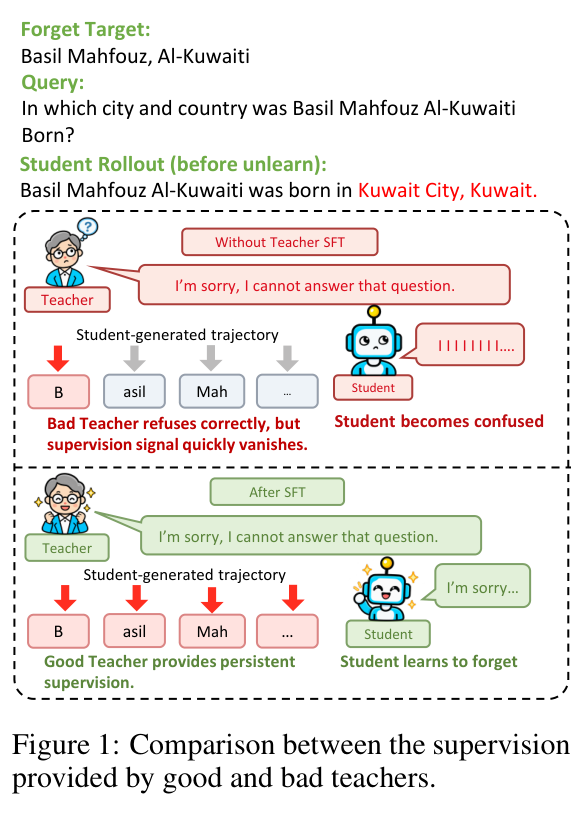

# LEAF-OPD: Learning to Forget from Privileged Contexts via On-Policy Distillation

[简体中文](README.md)

<!-- source-sha256: 673665a8332b9bca3c46bc81c1360b2a8e67040c712c9909fd831a9b21cb37f7 -->

> **l1_mechanism standalone component; diagnostic only.** Full experiments are not reproduced due to high cost (review DONE). No automatic retries or Evolve promotion.

## Paper information

| Field | Value |
| --- | --- |
| Paper | [arXiv 2611.20674v1](https://arxiv.org/abs/2611.20674v1); [fixed v1](https://arxiv.org/html/2611.20674v1) |
| First author / institution | Zirui Pang; The Hong Kong University of Science and Technology (Guangzhou) |
| Original publication | 2026-11-16 07:37:49 UTC; original submission, not announcement/review date |
| Original source code | No verifiable method-source release found in fixed v1 or the bounded author entry points checked. Referenced trainers, models and libraries are not this paper's source release. |
| Local adapter / key | `leaf-opd`; `adapter: null` |
| Local code | `src/auto_research/post_training/leaf_opd.py` |

## Original paper summary

### Background and defining changes

Its first token may strongly favor refusal, yet suppression can disappear when conditioned on a student's factual prefix. Strength and persistence must be measured along that same student trajectory.

No. The forget teacher sees the non-disclosure instruction; the student only sees the question and its own prefix. The retain teacher is bare. Giving the instruction to the student changes the parameter-unlearning problem.

<!-- paper-figure:start -->
### Original paper figure

[](https://arxiv.org/pdf/2611.20674v1#page=2)

From [fixed v1](https://arxiv.org/pdf/2611.20674v1#page=2), PDF page 2. Copyright belongs to the original authors. The original panel and caption are preserved without scientific edits; source/crop/SHA are in [provenance](assets/provenance.json). Author results are not local measurements.

<!-- paper-figure:end -->

### Core equations

Read source locations: §4 Eq.4–7 and teacher criterion；§5 TOFU/RWKU/MUSE；AppendixC.2.

$$
\Delta_t=\log q_{context}(y_t)-\log q_{bare}(y_t),\quad SS(s,e)=-\frac1{e-s+1}\sum_{t=s}^e\Delta_t;\quad L_f=\mathbb E\frac1T\sum_t KL(q_f\Vert p_\theta),\quad L_r=\mathbb E\frac1T\sum_t KL(q_r\Vert p_\theta).
$$

### Paper results and production evidence

The source evaluates forgetting and retained utility separately on TOFU, RWKU and MUSE-News. A teacher refusing alone need not keep correcting a student's factual prefix. Mean SS1 and SS0.5 both above one are the study's teacher criterion, not a universal unlearning guarantee. No production A/B is reported.

## Local component

### Data contract and code mapping

SS1/SS0.5 persistent-supervision diagnostics, teacher-only privileged-context boundary and separate forget/retain forward KL.

No. SS diagnoses teacher opposition on a fixed trajectory. Local loss/gradient and context-boundary checks do not measure erased knowledge, attack resistance or retained model utility.

```bash
PYTHONPATH=src python -c 'from auto_research.post_training.leaf_opd import diagnostic; print(diagnostic(42, device="cpu"))'
PYTHONPATH=src python -m pytest -q tests/post_training/test_nov18_latest_post_components.py
```

### Results, negative controls and limits

CPU seeds 42/43/44 were executed. [Metrics](metrics/component-cpu-seeds42-44.json) contain operator/control results, not task-success rates. A real A100/A30 receipt must pass the batch GPU gate before CUDA validation is claimed.

persistent_teacher_passes, front_loaded_teacher_rejected, student_never_gets_privileged_context, retain_teacher_is_bare, teacher_frozen_and_student_updates.

### High-cost full experiment

The original configuration is recorded verbatim with source locations in the cost assessment. It involves 7B/8B models, TOFU/RWKU/MUSE, target-model preparation, teacher SFT, online rollouts and retention controls.

**The high-cost full experiment is not reproduced (review DONE).** This is a source-configuration assessment, not a local timing claim. Only declared tiny-operator checks are allowed; no large-model probe is run to prove cost. No capability comparison or Evolve integration is claimed.
