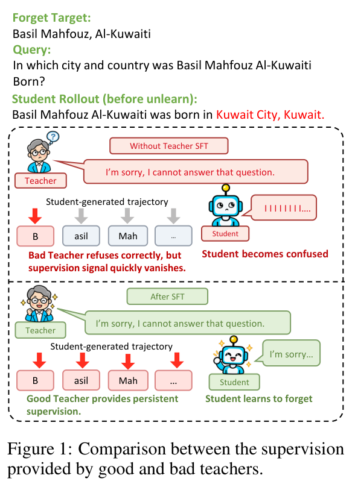
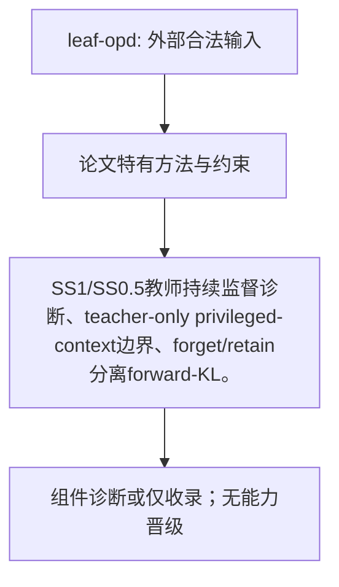

# LEAF-OPD: Learning to Forget from Privileged Contexts via On-Policy Distillation

[English](README-en.md)

> **l1_mechanism 独立组件，diagnostic only。** 完整实验成本过高，不复现（审查 DONE）；不自动重试、不进入Evolve晋级。

## 论文信息

| 字段 | 内容 |
| --- | --- |
| 论文链接 | [arXiv 2611.20674v1](https://arxiv.org/abs/2611.20674v1)；[固定v1原文](https://arxiv.org/html/2611.20674v1) |
| 公司 / 作者机构 | 一作 **Zirui Pang**：**The Hong Kong University of Science and Technology (Guangzhou)**；不把所用Google/Meta模型当作者机构 |
| 首次公开日期 | **2026-11-16 07:37:49 UTC**，原始arXiv提交，不替换成公告或本次审查日期 |
| 原作者开源代码 | 固定v1及所核作者入口未找到可验证的本篇方法源码发布；引用的训练器、模型或库不算本篇开源。 |
| 本地 adapter / key | `leaf-opd`；`adapter: null` |
| 本地复现代码 | `src/auto_research/post_training/leaf_opd.py` |

## 原始论文总结

### 背景与主要改动

教师独立解码的首token可能强烈拒答，但在学生已生成事实前缀上，后续token抑制可能迅速消失；需要按同一学生轨迹测监督强度和持续性。

不能。forget teacher读取非披露指令，student始终只读原问题和自身生成prefix；retain teacher不带该指令。将指令给学生会改变所研究的参数遗忘问题。

<!-- paper-figure:start -->
### 原论文关键图

[](https://arxiv.org/pdf/2611.20674v1#page=2)

图片来自[原论文](https://arxiv.org/pdf/2611.20674v1#page=2)第2页，版权归原作者所有；完整保留图与原图注，未重绘/改数值。来源、裁剪与SHA见[provenance](assets/provenance.json)。图表中的结果属于作者，不是本地实验。

<!-- paper-figure:end -->



### 核心公式

固定v1位置：§4 Eq.4–7 and teacher criterion；§5 TOFU/RWKU/MUSE；AppendixC.2。

$$
\Delta_t=\log q_{context}(y_t)-\log q_{bare}(y_t),\quad SS(s,e)=-\frac1{e-s+1}\sum_{t=s}^e\Delta_t;\quad L_f=\mathbb E\frac1T\sum_t KL(q_f\Vert p_\theta),\quad L_r=\mathbb E\frac1T\sum_t KL(q_r\Vert p_\theta).
$$

### 论文离线与线上效果

作者在TOFU、RWKU和MUSE-News分开衡量遗忘和保留效用；强调teacher能单独拒答不代表能在学生事实前缀上持续纠正。原文将平均SS1和SS0.5均大于1作为本实验good-teacher门槛，不是通用遗忘保证。未报告生产线上A/B。

## 本地复现

### 数据协议与代码映射

SS1/SS0.5教师持续监督诊断、teacher-only privileged-context边界、forget/retain分离forward-KL。

不。SS只诊断teacher对固定轨迹的反对强度；本地loss/梯度和上下文负控也不构成删除知识、抗攻击或保留效用的模型实测。

```bash
PYTHONPATH=src python -c 'from auto_research.post_training.leaf_opd import diagnostic; print(diagnostic(42, device="cpu"))'
PYTHONPATH=src python -m pytest -q tests/post_training/test_nov18_latest_post_components.py
```

### 结果、负控与边界

已实际执行CPU seeds42/43/44；[指标](metrics/component-cpu-seeds42-44.json)仅记录算子与负控，不含任务成功率。CUDA验证由统一批次真实A100/A30回执验收，未完成前不得称GPU已通过。

persistent_teacher_passes、front_loaded_teacher_rejected、student_never_gets_privileged_context、retain_teacher_is_bare、teacher_frozen_and_student_updates。

### 高成本完整实验

§5含Llama2-7B、Qwen3-8B及Llama3-8B，TOFU/RWKU/MUSE多基准；需目标模型微调、教师强化SFT、在线采样和保留集对照。

**完整实验成本过高，不复现（审查 DONE）**。成本依据来自原文配置而非本地测速；只在明确小算子预算内工作，不为证明高成本探跑大模型。单卡A100/A30或Mac不能替代论文完整多模型/多任务/专家与系统对照。
