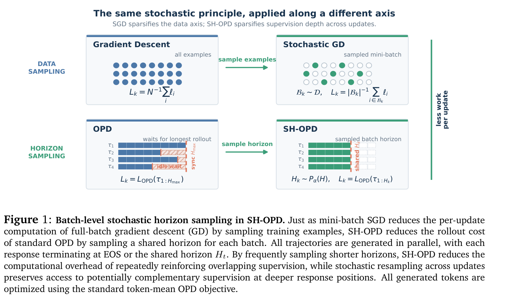

# Rethinking Supervision Scaling in On-Policy Distillation: From Dense Supervision to Stochastic Horizons

[简体中文](README.md)

<!-- source-sha256: 3ed65049e9cdc91d06809a0513c12ebec44fbe5c5c3e280dd06db416b7e5b6c7 -->

> **l1_mechanism standalone component; diagnostic only.** Full experiments are not reproduced due to high cost (review DONE). No automatic retries or Evolve promotion.

## Paper information

| Field | Value |
| --- | --- |
| Paper | [arXiv 2611.20687v1](https://arxiv.org/abs/2611.20687v1); [fixed v1](https://arxiv.org/html/2611.20687v1) |
| First author / institution | Xinhao Yao; Renmin University of China |
| Original publication | 2026-11-16 07:51:25 UTC; original submission, not announcement/review date |
| Original source code | [Author repository](https://github.com/chen123CtrlS/SH-OPD); verified revision `98467d23930e2197dd0b240af9e37cc7c5c3f505`; licence MIT. Release evidence only; upstream training not executed. |
| Local adapter / key | `sh-opd`; `adapter: null` |
| Local code | `src/auto_research/post_training/sh_opd.py` |

## Original paper summary

### Background and defining changes

It samples one generation cap per batch, broadcasts it to all rollout workers and stops at EOS or that cap. It does not generate a full long answer and only trim its loss afterward.

SH-OPD retains the original token-mean objective and accepts systematic depth reweighting. Inverse-probability compensation belongs to its comparison STOPD, not this algorithm.

<!-- paper-figure:start -->
### Original paper figure

[](https://arxiv.org/pdf/2611.20687v1#page=1)

From [fixed v1](https://arxiv.org/pdf/2611.20687v1#page=1), PDF page 1. Copyright belongs to the original authors. The original panel and caption are preserved without scientific edits; source/crop/SHA are in [provenance](assets/provenance.json). Author results are not local measurements.

<!-- paper-figure:end -->

### Core equations

Read source locations: §4 Definition1, Algorithm1, Eq.5–8；§5；AppendixA.1.

$$
P(H\ge kH_0)=k^{-\alpha},\quad p_k=k^{-\alpha}-(k+1)^{-\alpha}\ (k<K),\quad p_K=K^{-\alpha};\quad L=\frac{\sum_{b,t\le N_b}\ell_{bt}}{\sum_bN_b}.
$$

### Paper results and production evidence

The preferred alpha differs between math and code. The math alpha=1 setting reports 45.5% of full-OPD per-update wall time, while more aggressive truncation hurts quality. These are author results with 1.5B models and long rollouts, not speedups inferred from the local sampler. No production A/B is reported.

## Local component

### Data contract and code mapping

Power-survival distribution, one actual generation cap per batch, standard token-mean OPD and implicit position weights; no inverse-probability correction.

Algorithm 1 averages all supervised generated tokens together. With unequal EOS lengths, per-response averaging changes token weights. The component checks caps, PMFs and masks, not real rollout throughput.

```bash
PYTHONPATH=src python -c 'from auto_research.post_training.sh_opd import diagnostic; print(diagnostic(42, device="cpu"))'
PYTHONPATH=src python -m pytest -q tests/post_training/test_nov18_latest_post_components.py
```

### Results, negative controls and limits

CPU seeds 42/43/44 were executed. [Metrics](metrics/component-cpu-seeds42-44.json) contain operator/control results, not task-success rates. A real A100/A30 receipt must pass the batch GPU gate before CUDA validation is claimed.

pmf_normalized, alpha_zero_is_full_opd, true_shared_generation_cap, token_not_sequence_mean, padding_zero_gradient, implicit_early_weight_not_debiased.

### High-cost full experiment

The original configuration is recorded verbatim with source locations in the cost assessment. It involves 1.5B teacher/student, math/code sweeps, batch 64, 7,168 response tokens and roughly 45 million supervised math tokens.

**The high-cost full experiment is not reproduced (review DONE).** This is a source-configuration assessment, not a local timing claim. Only declared tiny-operator checks are allowed; no large-model probe is run to prove cost. No capability comparison or Evolve integration is claimed.
