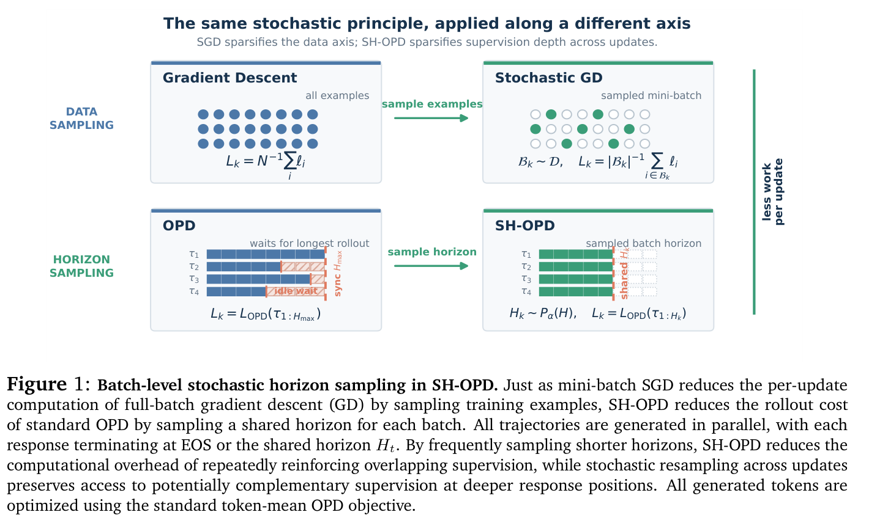
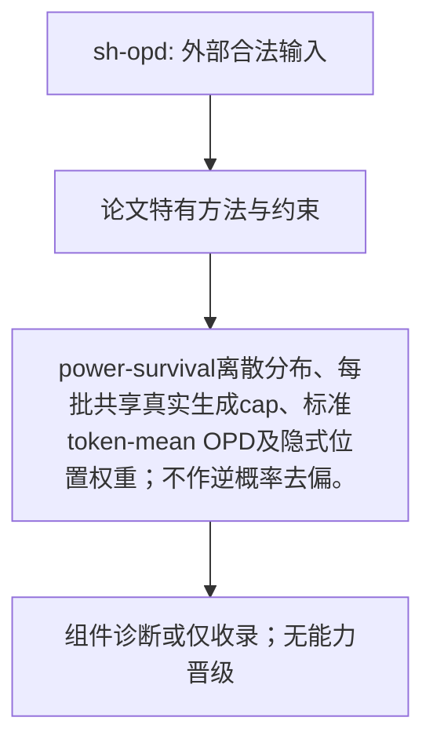

# Rethinking Supervision Scaling in On-Policy Distillation: From Dense Supervision to Stochastic Horizons

[English](README-en.md)

> **l1_mechanism 独立组件，diagnostic only。** 完整实验成本过高，不复现（审查 DONE）；不自动重试、不进入Evolve晋级。

## 论文信息

| 字段 | 内容 |
| --- | --- |
| 论文链接 | [arXiv 2611.20687v1](https://arxiv.org/abs/2611.20687v1)；[固定v1原文](https://arxiv.org/html/2611.20687v1) |
| 公司 / 作者机构 | 一作 **Xinhao Yao**：**Renmin University of China**；不把所用Google/Meta模型当作者机构 |
| 首次公开日期 | **2026-11-16 07:51:25 UTC**，原始arXiv提交，不替换成公告或本次审查日期 |
| 原作者开源代码 | [作者仓库](https://github.com/chen123CtrlS/SH-OPD)；固定SHA `98467d23930e2197dd0b240af9e37cc7c5c3f505`；许可 MIT。仅核对发布证据，未执行上游训练。 |
| 本地 adapter / key | `sh-opd`；`adapter: null` |
| 本地复现代码 | `src/auto_research/post_training/sh_opd.py` |

## 原始论文总结

### 背景与主要改动

每个训练batch先抽一个共享生成长度上限，广播给所有rollout worker，生成在EOS或该上限结束；不是先生成完整长答案再裁loss。

SH-OPD明确保留原token-mean目标，接受位置曝光频率的系统性重加权；逆概率补偿是其比较对象STOPD，不应混入本实现。

<!-- paper-figure:start -->
### 原论文关键图

[](https://arxiv.org/pdf/2611.20687v1#page=1)

图片来自[原论文](https://arxiv.org/pdf/2611.20687v1#page=1)第1页，版权归原作者所有；完整保留图与原图注，未重绘/改数值。来源、裁剪与SHA见[provenance](assets/provenance.json)。图表中的结果属于作者，不是本地实验。

<!-- paper-figure:end -->



### 核心公式

固定v1位置：§4 Definition1, Algorithm1, Eq.5–8；§5；AppendixA.1。

$$
P(H\ge kH_0)=k^{-\alpha},\quad p_k=k^{-\alpha}-(k+1)^{-\alpha}\ (k<K),\quad p_K=K^{-\alpha};\quad L=\frac{\sum_{b,t\le N_b}\ell_{bt}}{\sum_bN_b}.
$$

### 论文离线与线上效果

作者在数学与代码上报告不同最佳α，数学中α=1的per-update wall time约为完整OPD的45.5%；较激进截断反而降分。该结果依赖1.5B模型、长响应和真实系统，不由本地采样器推出。未报告生产线上A/B。

## 本地复现

### 数据协议与代码映射

power-survival离散分布、每批共享真实生成cap、标准token-mean OPD及隐式位置权重；不作逆概率去偏。

算法1对所有生成且监督的token一起求均值；不同EOS长度时，逐答案平均会改变token权重。组件检查cap、PMF和mask，但不宣称真实rollout吞吐提升。

```bash
PYTHONPATH=src python -c 'from auto_research.post_training.sh_opd import diagnostic; print(diagnostic(42, device="cpu"))'
PYTHONPATH=src python -m pytest -q tests/post_training/test_nov18_latest_post_components.py
```

### 结果、负控与边界

已实际执行CPU seeds42/43/44；[指标](metrics/component-cpu-seeds42-44.json)仅记录算子与负控，不含任务成功率。CUDA验证由统一批次真实A100/A30回执验收，未完成前不得称GPU已通过。

pmf_normalized、alpha_zero_is_full_opd、true_shared_generation_cap、token_not_sequence_mean、padding_zero_gradient、implicit_early_weight_not_debiased。

### 高成本完整实验

§3.1/§5用1.5B学生和教师，数学/代码任务，响应上限7168、batch64；数学训练约4500万监督token，多α和多任务扫描。

**完整实验成本过高，不复现（审查 DONE）**。成本依据来自原文配置而非本地测速；只在明确小算子预算内工作，不为证明高成本探跑大模型。单卡A100/A30或Mac不能替代论文完整多模型/多任务/专家与系统对照。
