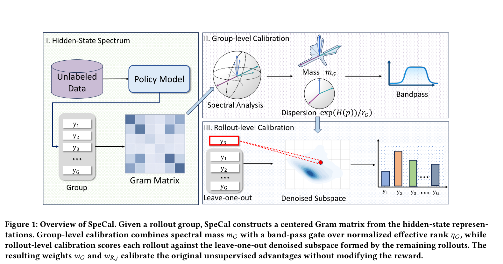

# SpeCal: Spectral Calibration for Unsupervised RLVR

[简体中文](README.md)

<!-- source-sha256: b4ee8b5eb2c9f5e8fd654f5db0470b4b013febf8a2abe58abde1cea042d50708 -->

> **l1_mechanism standalone component; diagnostic only.** Full experiments are not reproduced due to high cost (review DONE). No automatic retries or Evolve promotion.

## Paper information

| Field | Value |
| --- | --- |
| Paper | [arXiv 2611.20691v1](https://arxiv.org/abs/2611.20691v1); [fixed v1](https://arxiv.org/html/2611.20691v1) |
| First author / institution | Kai Tang; Zhejiang University / Ant Group |
| Original publication | 2026-11-16 07:56:19 UTC; original submission, not announcement/review date |
| Original source code | No verifiable method-source release found in fixed v1 or the bounded author entry points checked. Referenced trainers, models and libraries are not this paper's source release. |
| Local adapter / key | `specal`; `adapter: null` |
| Local code | `src/auto_research/post_training/specal.py` |

## Original paper summary

### Background and defining changes

No. It derives group and rollout weights from response hidden-state geometry, recalibrates existing unsupervised advantages and keeps the GRPO objective. Geometry weights are stop-gradient.

An outlier may create its own direction. LOO removes the row, centers the others and truncates their SVD using group effective rank before measuring held-out projected energy.

<!-- paper-figure:start -->
### Original paper figure

[](https://arxiv.org/pdf/2611.20691v1#page=4)

From [fixed v1](https://arxiv.org/pdf/2611.20691v1#page=4), PDF page 4. Copyright belongs to the original authors. The original panel and caption are preserved without scientific edits; source/crop/SHA are in [provenance](assets/provenance.json). Author results are not local measurements.

<!-- paper-figure:end -->

### Core equations

Read source locations: §3 Eq.3–12；§5 experimental setup.

$$
w_G=m_G\exp[-(ER_G/r_G-\mu_G)^2/(2\tau_G^2)],\quad s_j=\|V_{-j}^{\top}(z_j-\bar z_{-j})\|^2/\|z_j-\bar z_{-j}\|^2,\quad A^{cal}=RMS_b(w_G)\,RMS_g(w_R A^U).
$$

### Paper results and production evidence

The authors compare unsupervised RLVR on Qwen/Llama 8B models and math/OOD tasks, emphasizing that larger effective rank is not always better. Reported model gains depend on real hidden states and online GRPO; local spectral computation supplies no capability result. No production A/B is reported.

## Local component

### Data contract and code mapping

Centered Gram spectrum of normalized response representations, mass times effective-rank band-pass, denoised LOO-SVD support and two-level RMS advantage calibration.

No. They provide no semantic contrast and have zero spectral mass. The component returns zero calibrated advantages and rejects zero vectors, avoiding NaNs or treating degeneracy as perfection.

```bash
PYTHONPATH=src python -c 'from auto_research.post_training.specal import diagnostic; print(diagnostic(42, device="cpu"))'
PYTHONPATH=src python -m pytest -q tests/post_training/test_nov18_latest_post_components.py
```

### Results, negative controls and limits

CPU seeds 42/43/44 were executed. [Metrics](metrics/component-cpu-seeds42-44.json) contain operator/control results, not task-success rates. A real A100/A30 receipt must pass the batch GPU gate before CUDA validation is claimed.

all_calibration_stop_gradient, conditional_support_in_unit_interval, collapsed_group_yields_no_advantage, response_l2_scale_invariant, rollout_weights_clipped.

### High-cost full experiment

The original configuration is recorded verbatim with source locations in the cost assessment. It involves eight A100s, two 8B model families, batch 128, difficult DeepMath and multiple math/OOD evaluations.

**The high-cost full experiment is not reproduced (review DONE).** This is a source-configuration assessment, not a local timing claim. Only declared tiny-operator checks are allowed; no large-model probe is run to prove cost. No capability comparison or Evolve integration is claimed.
