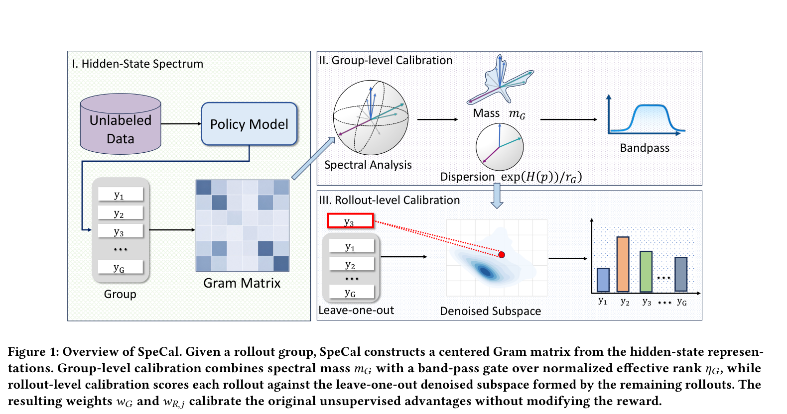
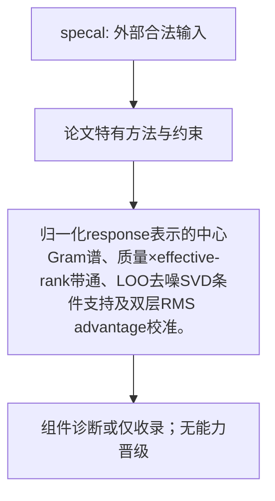

# SpeCal: Spectral Calibration for Unsupervised RLVR

[English](README-en.md)

> **l1_mechanism 独立组件，diagnostic only。** 完整实验成本过高，不复现（审查 DONE）；不自动重试、不进入Evolve晋级。

## 论文信息

| 字段 | 内容 |
| --- | --- |
| 论文链接 | [arXiv 2611.20691v1](https://arxiv.org/abs/2611.20691v1)；[固定v1原文](https://arxiv.org/html/2611.20691v1) |
| 公司 / 作者机构 | 一作 **Kai Tang**：**Zhejiang University / Ant Group**；不把所用Google/Meta模型当作者机构 |
| 首次公开日期 | **2026-11-16 07:56:19 UTC**，原始arXiv提交，不替换成公告或本次审查日期 |
| 原作者开源代码 | 固定v1及所核作者入口未找到可验证的本篇方法源码发布；引用的训练器、模型或库不算本篇开源。 |
| 本地 adapter / key | `specal`；`adapter: null` |
| 本地复现代码 | `src/auto_research/post_training/specal.py` |

## 原始论文总结

### 背景与主要改动

不是。它从response hidden-state几何生成group和rollout权重，重加权已有无监督advantage，再沿原GRPO目标更新；几何权重全部stop-gradient。

一个异常方向可能完全由该rollout创造。LOO先删去该行，中心化其余表示，用group有效秩截断SVD，才测被留出向量的投影能量比例。

<!-- paper-figure:start -->
### 原论文关键图

[](https://arxiv.org/pdf/2611.20691v1#page=4)

图片来自[原论文](https://arxiv.org/pdf/2611.20691v1#page=4)第4页，版权归原作者所有；完整保留图与原图注，未重绘/改数值。来源、裁剪与SHA见[provenance](assets/provenance.json)。图表中的结果属于作者，不是本地实验。

<!-- paper-figure:end -->



### 核心公式

固定v1位置：§3 Eq.3–12；§5 experimental setup。

$$
w_G=m_G\exp[-(ER_G/r_G-\mu_G)^2/(2\tau_G^2)],\quad s_j=\|V_{-j}^{\top}(z_j-\bar z_{-j})\|^2/\|z_j-\bar z_{-j}\|^2,\quad A^{cal}=RMS_b(w_G)\,RMS_g(w_R A^U).
$$

### 论文离线与线上效果

作者在8B Qwen/Llama两族及数学/OOD任务上比较无监督RLVR，强调有效谱秩不是越高越好。数学平均分的作者收益依赖真实hidden states与在线GRPO；本地谱计算不产生该能力证据。未报告生产线上A/B。

## 本地复现

### 数据协议与代码映射

归一化response表示的中心Gram谱、质量×effective-rank带通、LOO去噪SVD条件支持及双层RMS advantage校准。

不。该组没有相对语义差异，spectral mass为0。实现显式返回0校准advantage，并拒绝零向量输入，防止NaN或把退化组记作完美。

```bash
PYTHONPATH=src python -c 'from auto_research.post_training.specal import diagnostic; print(diagnostic(42, device="cpu"))'
PYTHONPATH=src python -m pytest -q tests/post_training/test_nov18_latest_post_components.py
```

### 结果、负控与边界

已实际执行CPU seeds42/43/44；[指标](metrics/component-cpu-seeds42-44.json)仅记录算子与负控，不含任务成功率。CUDA验证由统一批次真实A100/A30回执验收，未完成前不得称GPU已通过。

all_calibration_stop_gradient、conditional_support_in_unit_interval、collapsed_group_yields_no_advantage、response_l2_scale_invariant、rollout_weights_clipped。

### 高成本完整实验

§5明确8张A100，Qwen3-8B-Base/DeepSeek-R1-Distill-Llama-8B、DeepMath难题、batch128、多数学及OOD评测。

**完整实验成本过高，不复现（审查 DONE）**。成本依据来自原文配置而非本地测速；只在明确小算子预算内工作，不为证明高成本探跑大模型。单卡A100/A30或Mac不能替代论文完整多模型/多任务/专家与系统对照。
