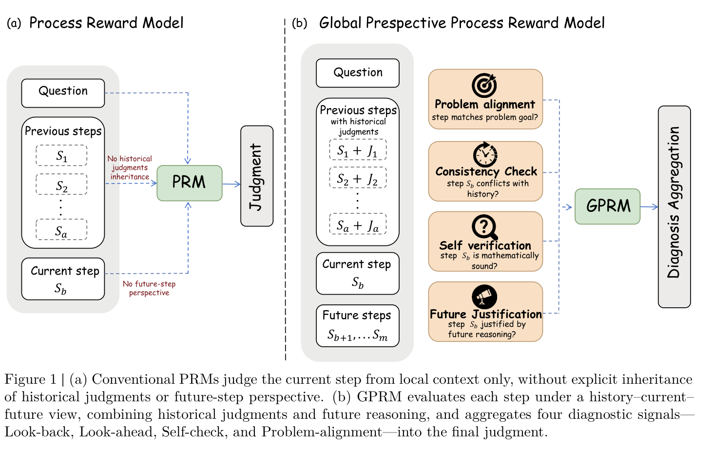

# GPRM: Global Perspective Process Reward Model

[简体中文](README.md)

<!-- source-sha256: 2a6bf88d82fd47d08bd0b4061e13274d6c188452a9ab9371ea0d3825a4bee86e -->

> **Review only; no local model implementation.** Full experiments are not reproduced due to high cost (review DONE). No automatic retries or Evolve promotion.

## Paper information

| Field | Value |
| --- | --- |
| Paper | [arXiv 2611.20755v1](https://arxiv.org/abs/2611.20755v1); [fixed v1](https://arxiv.org/html/2611.20755v1) |
| First author / institution | Zifan Zhang; Wuhan University |
| Original publication | 2026-11-16 09:03:27 UTC; original submission, not announcement/review date |
| Original source code | No verifiable method-source release found in fixed v1 or the bounded author entry points checked. Referenced trainers, models and libraries are not this paper's source release. |
| Local adapter / key | `gprm`; `adapter: null` |
| Local code | None; no placeholder model |

## Original paper summary

### Background and defining changes

Besides the question/current step it reads past steps with predicted judgments and the candidate's future trajectory. Its four axes are forward consistency, posterior verification, goal alignment and self validity.

Offline diagnosis and best-of-N already have completed candidates. Step-wise search must generate continuations before judging the current step; cost cannot be estimated as ordinary prefix-only PRM scoring.

<!-- paper-figure:start -->
### Original paper figure

From [fixed v1](https://arxiv.org/pdf/2611.20755v1#page=1), PDF page 1. Copyright belongs to the original authors. The original panel and caption are preserved without scientific edits; source/crop/SHA are in [provenance](assets/provenance.json). Author results are not local measurements.

<!-- paper-figure:end -->

### Core equations

Read source locations: §3.1–3.5；§4 model and search setup.

$$
X_i=(Q,\{(s_j,\hat y_j)\}_{j<i},s_i,s_{i+1:n}),\quad(\hat A_i,\hat y_i)=g_\phi(X_i),\quad\mathcal H_{i+1}=\mathcal H_i\cup\{(s_i,\hat y_i)\}.
$$

### Paper results and production evidence

The authors compare 4B/14B SFT-then-GRPO models on process evaluation and search, ablating history, future, goal and self-validity dimensions. Future information is a completed candidate trajectory, not a gold final answer; online step-wise search must first complete candidates. No production A/B is reported.

## Cost decision and local status

### Data contract and code mapping

Method and cost review only; no string parser or fixed rule replaces the four-dimensional global PRM.

A parser only extracts [CORRECT]; it cannot replace the 235B synthesis teacher, 4B/14B diagnostic models and search training. The full high-cost experiment is not reproduced, review DONE, with no invented model scores.

### Results and limits

No local model run, checkpoint/data download, paid API call or invented metric file. Review DONE does not mean implementation completed.

### High-cost full experiment

The original configuration is recorded verbatim with source locations in the cost assessment. It involves 4B/14B PRMs, a Qwen3-235B synthesis teacher, SFT/GRPO and 7B best-of-eight/step-wise completion search.

**The high-cost full experiment is not reproduced (review DONE).** This is a source-configuration assessment, not a local timing claim. Only declared tiny-operator checks are allowed; no large-model probe is run to prove cost. No capability comparison or Evolve integration is claimed.
