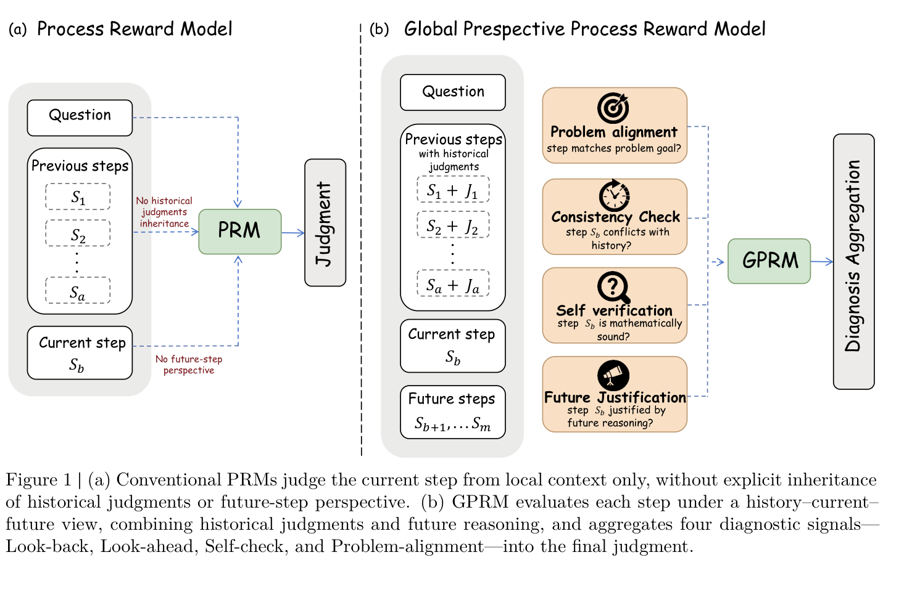
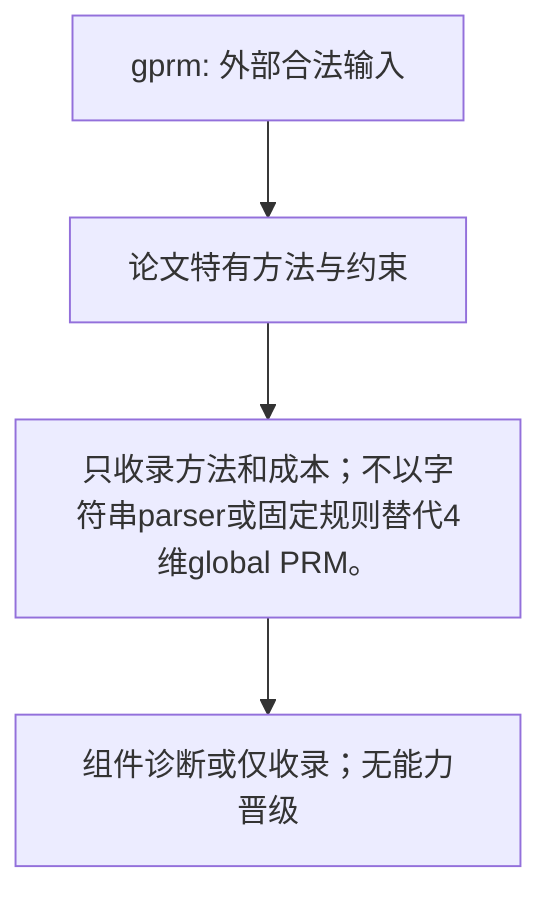

# GPRM: Global Perspective Process Reward Model

[English](README-en.md)

> **仅方法与成本收录，无本地模型实现。** 完整实验成本过高，不复现（审查 DONE）；不自动重试、不进入Evolve晋级。

## 论文信息

| 字段 | 内容 |
| --- | --- |
| 论文链接 | [arXiv 2611.20755v1](https://arxiv.org/abs/2611.20755v1)；[固定v1原文](https://arxiv.org/html/2611.20755v1) |
| 公司 / 作者机构 | 一作 **Zifan Zhang**：**Wuhan University**；不把所用Google/Meta模型当作者机构 |
| 首次公开日期 | **2026-11-16 09:03:27 UTC**，原始arXiv提交，不替换成公告或本次审查日期 |
| 原作者开源代码 | 固定v1及所核作者入口未找到可验证的本篇方法源码发布；引用的训练器、模型或库不算本篇开源。 |
| 本地 adapter / key | `gprm`；`adapter: null` |
| 本地复现代码 | 无；完整实验不复现，不创建占位模型 |

## 原始论文总结

### 背景与主要改动

除问题和当前step，还读历史step与已预测judgment、当前候选的后续trajectory；四维分析是forward consistency、posterior verification、goal alignment、self validity。

离线诊断和Best-of-N已有完整候选，未来信息免费可见；逐步搜索尚无未来，需要先生成continuation再判当前step，成本不能按普通prefix PRM估。

<!-- paper-figure:start -->
### 原论文关键图

图片来自[原论文](https://arxiv.org/pdf/2611.20755v1#page=1)第1页，版权归原作者所有；完整保留图与原图注，未重绘/改数值。来源、裁剪与SHA见[provenance](assets/provenance.json)。图表中的结果属于作者，不是本地实验。

<!-- paper-figure:end -->

### 核心公式

固定v1位置：§3.1–3.5；§4 model and search setup。

$$
X_i=(Q,\{(s_j,\hat y_j)\}_{j<i},s_i,s_{i+1:n}),\quad(\hat A_i,\hat y_i)=g_\phi(X_i),\quad\mathcal H_{i+1}=\mathcal H_i\cup\{(s_i,\hat y_i)\}.
$$

### 论文离线与线上效果

作者的4B/14B SFT后GRPO模型在过程评估和搜索上作比较，并将历史、未来、目标与self-validity逐维消融。未来信息是候选完整trajectory，不是gold最终答案；在线逐步搜索必须先续写完整才能评分。未报告生产线上A/B。

## 成本决策与本地状态

### 数据协议与代码映射

只收录方法和成本；不以字符串parser或固定规则替代4维global PRM。

parser只能提取[CORRECT]格式，不能代替235B教师合成、4B/14B诊断模型和搜索训练。故完整实验高成本不复现，review DONE；没有本地模型实现或虚构分数。

### 结果、负控与边界

没有本地模型运行、checkpoint下载、数据集下载、付费API调用或伪造metrics文件。保留未复现状态，不将审查DONE改称实现完成。

### 高成本完整实验

§4使用4B/14B PRM、Qwen3-235B-Instruct错误注入/分析教师与7B搜索策略，SFT后GRPO，再Best-of8/逐步续写搜索、多benchmark。

**完整实验成本过高，不复现（审查 DONE）**。成本依据来自原文配置而非本地测速；只在明确小算子预算内工作，不为证明高成本探跑大模型。单卡A100/A30或Mac不能替代论文完整多模型/多任务/专家与系统对照。
