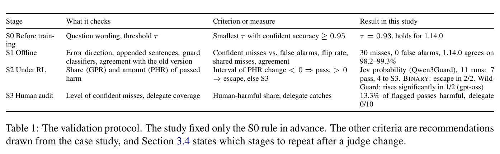

# Jev-as-a-Reward: Validating Probabilistic Safety Judges for Reinforcement Learning

[简体中文](README.md)

<!-- source-sha256: 2768af204524a5156e4177a90fb344bb2c186b61b28c8c03e6a02f2edd0d6554 -->

> **l0_interface standalone component; diagnostic only.** Full experiments are not reproduced due to high cost (review DONE). No automatic retries or Evolve promotion.

## Paper information

| Field | Value |
| --- | --- |
| Paper | [arXiv 2611.20955v1](https://arxiv.org/abs/2611.20955v1); [fixed v1](https://arxiv.org/html/2611.20955v1) |
| First author / institution | Eunkyeong Lee; KT / Sungkyunkwan University |
| Original publication | 2026-11-16 12:01:19 UTC; original submission, not announcement/review date |
| Original source code | No verifiable method-source release found in fixed v1 or the bounded author entry points checked. Referenced trainers, models and libraries are not this paper's source release. |
| Local adapter / key | `jev-safety-reward`; `adapter: null` |
| Local code | `src/auto_research/post_training/jev_safety_reward.py` |

## Original paper summary

### Background and defining changes

Only confidence below the threshold reaches the stronger judge. A confidently safe false negative is never delegated, so optimization may concentrate harm there.

GPR divides by remaining harm, whereas PHR divides by all harmful-prompt responses. Known harm can fall faster, increasing the blind-spot share while its amount declines. Escape requires significantly rising PHR and external audit.

<!-- paper-figure:start -->
### Original paper figure

[](https://arxiv.org/pdf/2611.20955v1#page=2)

From [fixed v1](https://arxiv.org/pdf/2611.20955v1#page=2), PDF page 2. Copyright belongs to the original authors. The original panel and caption are preserved without scientific edits; source/crop/SHA are in [provenance](assets/provenance.json). Author results are not local measurements.

<!-- paper-figure:end -->

### Core equations

Read source locations: §3.1–3.4；§4–5；AppendixC human audit.

$$
c=\max(p,1-p),\quad GPR=\frac{\#\text{confident passed harm}}{\#\text{reference harm}},\quad PHR=\frac{\#\text{confident passed harm}}{\#\text{responses to harmful prompts}}.
$$

### Paper results and production evidence

Across eleven runs the passed-harm amount falls even when its share of remaining harm rises: concentration is not escape. Judge replacement/version changes need revalidation; a late-window human audit cannot measure temporal change. No recommendation-production A/B is reported.

## Local component

### Data contract and code mapping

Confidence gate, held-out calibration threshold, distinct PHR/GPR denominators, prompt-level bootstrap and judge-version revalidation; no commercial judge implementation.

They share the prompt and are dependent, which can understate interval width. The source uses 2,000 prompt resamples and excludes 100 calibration items from later evaluation; version changes recheck the threshold rule.

```bash
PYTHONPATH=src python -c 'from auto_research.post_training.jev_safety_reward import diagnostic; print(diagnostic(42, device="cpu"))'
PYTHONPATH=src python -m pytest -q tests/post_training/test_nov18_latest_post_components.py
```

### Results, negative controls and limits

CPU seeds 42/43/44 were executed. [Metrics](metrics/component-cpu-seeds42-44.json) contain operator/control results, not task-success rates. CPU-only protocol; no CUDA path is advertised.

share_can_rise_without_more_passed_harm, prompt_bootstrap_detects_decline, judge_change_requires_revalidation, replacement_requires_human_audit.

### High-cost full experiment

The original configuration is recorded verbatim with source locations in the cost assessment. It involves 76,800 rollouts per run, eleven RL runs, 8B policies/guards, a 120B second reference, commercial judges and human audit.

**The high-cost full experiment is not reproduced (review DONE).** This is a source-configuration assessment, not a local timing claim. Only declared tiny-operator checks are allowed; no large-model probe is run to prove cost. No capability comparison or Evolve integration is claimed.
