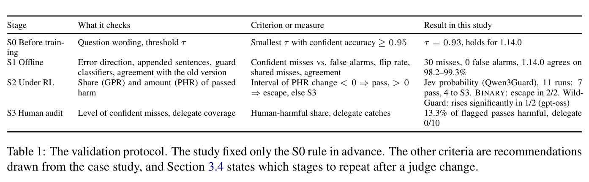
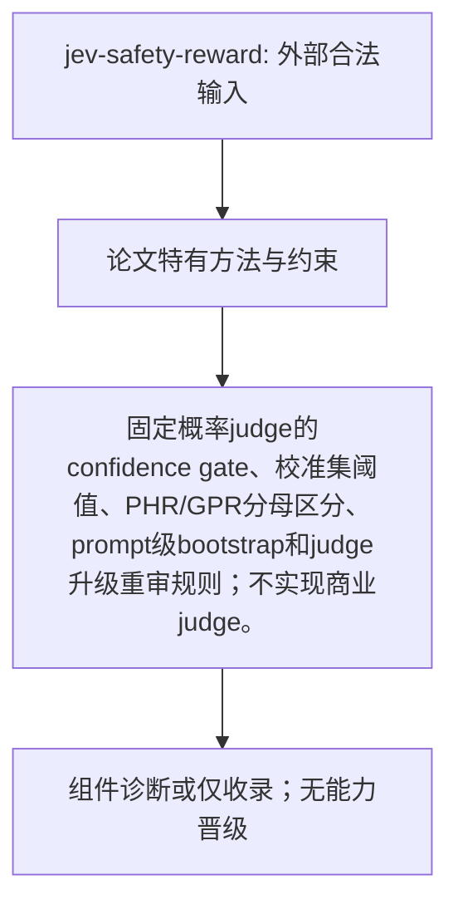

# Jev-as-a-Reward: Validating Probabilistic Safety Judges for Reinforcement Learning

[English](README-en.md)

> **l0_interface 独立组件，diagnostic only。** 完整实验成本过高，不复现（审查 DONE）；不自动重试、不进入Evolve晋级。

## 论文信息

| 字段 | 内容 |
| --- | --- |
| 论文链接 | [arXiv 2611.20955v1](https://arxiv.org/abs/2611.20955v1)；[固定v1原文](https://arxiv.org/html/2611.20955v1) |
| 公司 / 作者机构 | 一作 **Eunkyeong Lee**：**KT / Sungkyunkwan University**；不把所用Google/Meta模型当作者机构 |
| 首次公开日期 | **2026-11-16 12:01:19 UTC**，原始arXiv提交，不替换成公告或本次审查日期 |
| 原作者开源代码 | 固定v1及所核作者入口未找到可验证的本篇方法源码发布；引用的训练器、模型或库不算本篇开源。 |
| 本地 adapter / key | `jev-safety-reward`；`adapter: null` |
| 本地复现代码 | `src/auto_research/post_training/jev_safety_reward.py` |

## 原始论文总结

### 背景与主要改动

c=max(p,1-p)低于阈值才交强judge；高置信把有害判为安全的miss永远不会被委托，训练可能集中到这个区域。

GPR分母是剩余harm，PHR分母是harmful-prompt全部回答。若已知harm消失更快，盲区绝对量仍下降而份额上升；escape要看PHR显著增加及外部人工审核。

<!-- paper-figure:start -->
### 原论文关键图

[](https://arxiv.org/pdf/2611.20955v1#page=2)

图片来自[原论文](https://arxiv.org/pdf/2611.20955v1#page=2)第2页，版权归原作者所有；完整保留图与原图注，未重绘/改数值。来源、裁剪与SHA见[provenance](assets/provenance.json)。图表中的结果属于作者，不是本地实验。

<!-- paper-figure:end -->



### 核心公式

固定v1位置：§3.1–3.4；§4–5；AppendixC human audit。

$$
c=\max(p,1-p),\quad GPR=\frac{\#\text{confident passed harm}}{\#\text{reference harm}},\quad PHR=\frac{\#\text{confident passed harm}}{\#\text{responses to harmful prompts}}.
$$

### 论文离线与线上效果

作者11组运行均出现passed harm量下降但可能占剩余harm的份额上升，说明blind-spot浓缩不等于escape。judge替换和版本更新需复核，S3仅晚窗口人工审查不能检验时间变化。未报告搜广推生产线上A/B。

## 本地复现

### 数据协议与代码映射

固定概率judge的confidence gate、校准集阈值、PHR/GPR分母区分、prompt级bootstrap和judge升级重审规则；不实现商业judge。

它们共享prompt，相关性会低估区间宽度。原文按prompt重采样2000次，并将100校准条目排除在后续评测之外；新judge版本重查阈值规则。

```bash
PYTHONPATH=src python -c 'from auto_research.post_training.jev_safety_reward import diagnostic; print(diagnostic(42, device="cpu"))'
PYTHONPATH=src python -m pytest -q tests/post_training/test_nov18_latest_post_components.py
```

### 结果、负控与边界

已实际执行CPU seeds42/43/44；[指标](metrics/component-cpu-seeds42-44.json)仅记录算子与负控，不含任务成功率。此协议仅支持CPU，不宣称CUDA路径。

share_can_rise_without_more_passed_harm、prompt_bootstrap_detects_decline、judge_change_requires_revalidation、replacement_requires_human_audit。

### 高成本完整实验

§3–5每run76800个rollout、11组RL运行、8B策略/8B guard与120B第二参考及商业judge、人类审核；完整安全训练和评判campaign不运行。

**完整实验成本过高，不复现（审查 DONE）**。成本依据来自原文配置而非本地测速；只在明确小算子预算内工作，不为证明高成本探跑大模型。单卡A100/A30或Mac不能替代论文完整多模型/多任务/专家与系统对照。
