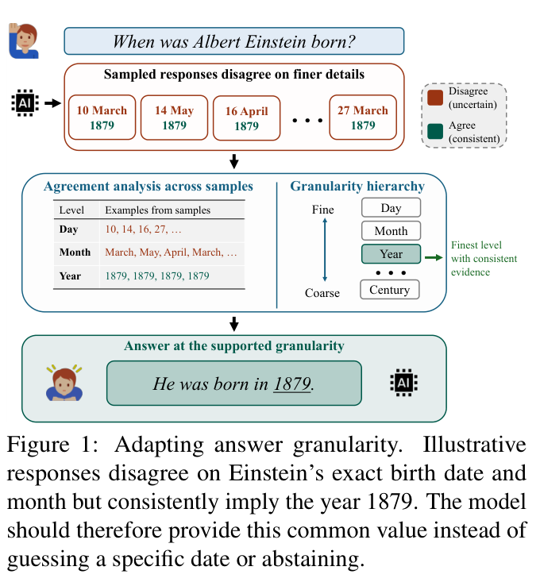

# Teaching Language Models to Adapt Answer Granularity to Their Confidence

[简体中文](README.md)

<!-- source-sha256: d9e9657a1c43d036a0ad7e69d7c75616f80f1e0e78eb317f1d0541ec306c63b8 -->

> **l0_interface standalone component; diagnostic only.** Full experiments are not reproduced due to high cost (review DONE). No automatic retries or Evolve promotion.

## Paper information

| Field | Value |
| --- | --- |
| Paper | [arXiv 2611.21211v1](https://arxiv.org/abs/2611.21211v1); [fixed v1](https://arxiv.org/html/2611.21211v1) |
| First author / institution | Lukas Ellinger; Technical University of Munich |
| Original publication | 2026-11-16 15:02:48 UTC; original submission, not announcement/review date |
| Original source code | [Author repository](https://github.com/lukasellinger/teaching-granularity); verified revision `5f4b2b53ccd14f30f44257138bcd978b8a6be2f9`; licence MIT. Release evidence only; upstream training not executed. |
| Local adapter / key | `confidence-adaptive-granularity`; `adapter: null` |
| Local code | `src/auto_research/post_training/confidence_adaptive_granularity.py` |

## Original paper summary

### Background and defining changes

Under this task definition yes, but the answer should use the finest reliably supported level. Utility measures verified information gain, assigning -1 to an error and zero to abstention.

Vital Persons chooses the finest value shared by at least sixteen of twenty model responses using agreement, not gold correctness. Fewer than sixteen usable parses are excluded; enough usable responses without consensus yield IDK.

<!-- paper-figure:start -->
### Original paper figure

[](https://arxiv.org/pdf/2611.21211v1#page=1)

From [fixed v1](https://arxiv.org/pdf/2611.21211v1#page=1), PDF page 1. Copyright belongs to the original authors. The original panel and caption are preserved without scientific edits; source/crop/SHA are in [provenance](assets/provenance.json). Author results are not local measurements.

<!-- paper-figure:end -->

### Core equations

Read source locations: §3.1–3.6；AppendixF/H.

$$
G(\ell)=\frac{\log(\Omega_{prior}/\Omega_\ell)}{\log(\Omega_{prior}/\Omega_{finest})},\quad U=\begin{cases}0&\text{abstain}\\G(\ell)&\text{verified correct at chosen level}\\-1&\text{otherwise.}\end{cases}
$$

### Paper results and production evidence

The authors train on temporal/geographic hierarchies and evaluate unseen relations and open QA, separating correctness, informativeness and coarsening. A post-hoc test-optimal fixed cap is a comparison bound, not a permissible training or validation-selection rule. No production A/B is reported.

## Local component

### Data contract and code mapping

20-sample/16-vote consensus on externally verified hierarchies, recognition requiring every coarser level to pass and normalized information utility; no gold-driven consensus target selection.

No. The interface requires externally verified fine-to-coarse paths instead of guessing geographic containment from strings. It implements selection and utility, not a model-knowledge accuracy measure.

```bash
PYTHONPATH=src python -c 'from auto_research.post_training.confidence_adaptive_granularity import diagnostic; print(diagnostic(42, device="cpu"))'
PYTHONPATH=src python -m pytest -q tests/post_training/test_nov18_latest_post_components.py
```

### Results, negative controls and limits

CPU seeds 42/43/44 were executed. [Metrics](metrics/component-cpu-seeds42-44.json) contain operator/control results, not task-success rates. CPU-only protocol; no CUDA path is advertised.

shared_coarse_value_selected_without_gold, too_few_parses_excluded, all_coarser_recognition_required, abstention_differs_from_error.

### High-cost full experiment

The original configuration is recorded verbatim with source locations in the cost assessment. It involves 1.2B/3B/9B/31B models, twenty samples per entity-relation, grounding, LoRA, thousands of QA items and human/model judges.

**The high-cost full experiment is not reproduced (review DONE).** This is a source-configuration assessment, not a local timing claim. Only declared tiny-operator checks are allowed; no large-model probe is run to prove cost. No capability comparison or Evolve integration is claimed.
