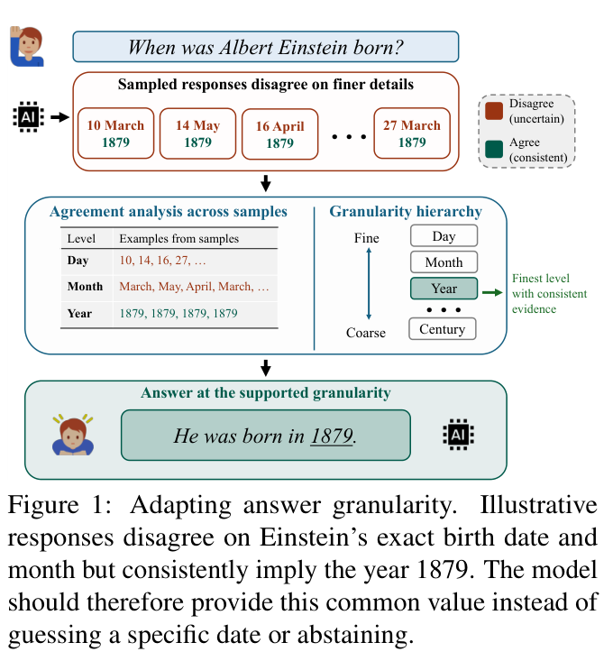
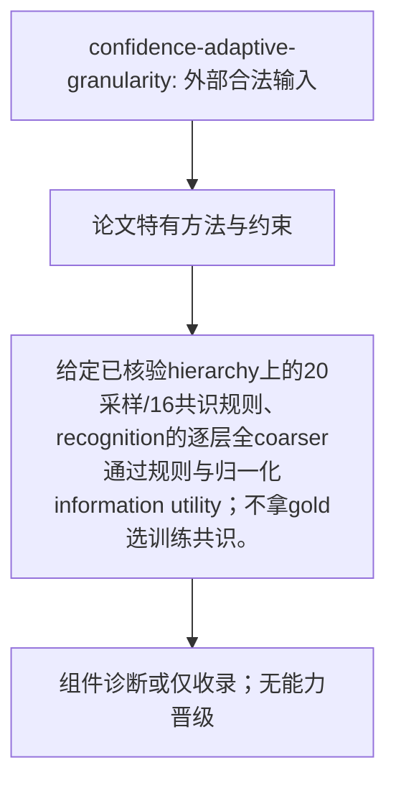

# Teaching Language Models to Adapt Answer Granularity to Their Confidence

[English](README-en.md)

> **l0_interface 独立组件，diagnostic only。** 完整实验成本过高，不复现（审查 DONE）；不自动重试、不进入Evolve晋级。

## 论文信息

| 字段 | 内容 |
| --- | --- |
| 论文链接 | [arXiv 2611.21211v1](https://arxiv.org/abs/2611.21211v1)；[固定v1原文](https://arxiv.org/html/2611.21211v1) |
| 公司 / 作者机构 | 一作 **Lukas Ellinger**：**Technical University of Munich**；不把所用Google/Meta模型当作者机构 |
| 首次公开日期 | **2026-11-16 15:02:48 UTC**，原始arXiv提交，不替换成公告或本次审查日期 |
| 原作者开源代码 | [作者仓库](https://github.com/lukasellinger/teaching-granularity)；固定SHA `5f4b2b53ccd14f30f44257138bcd978b8a6be2f9`；许可 MIT。仅核对发布证据，未执行上游训练。 |
| 本地 adapter / key | `confidence-adaptive-granularity`；`adapter: null` |
| 本地复现代码 | `src/auto_research/post_training/confidence_adaptive_granularity.py` |

## 原始论文总结

### 背景与主要改动

在该任务定义中可以，但应返回模型可靠支持的最细层级，而不是无限泛化。utility按剩余不确定性衡量正确信息，错误记-1，拒答记0。

Vital Persons规则在20个模型回答中找至少16条共享的最细值，只依赖一致性而非gold正确性。usable不足16则排除；足够却无共识则训练IDK。

<!-- paper-figure:start -->
### 原论文关键图

[](https://arxiv.org/pdf/2611.21211v1#page=1)

图片来自[原论文](https://arxiv.org/pdf/2611.21211v1#page=1)第1页，版权归原作者所有；完整保留图与原图注，未重绘/改数值。来源、裁剪与SHA见[provenance](assets/provenance.json)。图表中的结果属于作者，不是本地实验。

<!-- paper-figure:end -->



### 核心公式

固定v1位置：§3.1–3.6；AppendixF/H。

$$
G(\ell)=\frac{\log(\Omega_{prior}/\Omega_\ell)}{\log(\Omega_{prior}/\Omega_{finest})},\quad U=\begin{cases}0&\text{abstain}\\G(\ell)&\text{verified correct at chosen level}\\-1&\text{otherwise.}\end{cases}
$$

### 论文离线与线上效果

作者在固定时间/地理层级训练，并测未见关系和开放式QA泛化，区分正确性、信息量和粗化。test上事后最优fixed cap只是对照上界，不能用作本地训练或validation调参规则。未报告生产线上A/B。

## 本地复现

### 数据协议与代码映射

给定已核验hierarchy上的20采样/16共识规则、recognition的逐层全coarser通过规则与归一化information utility；不拿gold选训练共识。

没有。接口要求外部已核验fine-to-coarse路径，避免按字符串相似猜城市包含关系；只实现选择和utility协议，不把同层一致性写成模型知识准确率。

```bash
PYTHONPATH=src python -c 'from auto_research.post_training.confidence_adaptive_granularity import diagnostic; print(diagnostic(42, device="cpu"))'
PYTHONPATH=src python -m pytest -q tests/post_training/test_nov18_latest_post_components.py
```

### 结果、负控与边界

已实际执行CPU seeds42/43/44；[指标](metrics/component-cpu-seeds42-44.json)仅记录算子与负控，不含任务成功率。此协议仅支持CPU，不宣称CUDA路径。

shared_coarse_value_selected_without_gold、too_few_parses_excluded、all_coarser_recognition_required、abstention_differs_from_error。

### 高成本完整实验

§3.6有1.2B/3B/9B/31B四模型，逐实体关系20采样、Wikidata grounding、LoRA及数千题多评判器/人类审核；完整矩阵不运行。

**完整实验成本过高，不复现（审查 DONE）**。成本依据来自原文配置而非本地测速；只在明确小算子预算内工作，不为证明高成本探跑大模型。单卡A100/A30或Mac不能替代论文完整多模型/多任务/专家与系统对照。
