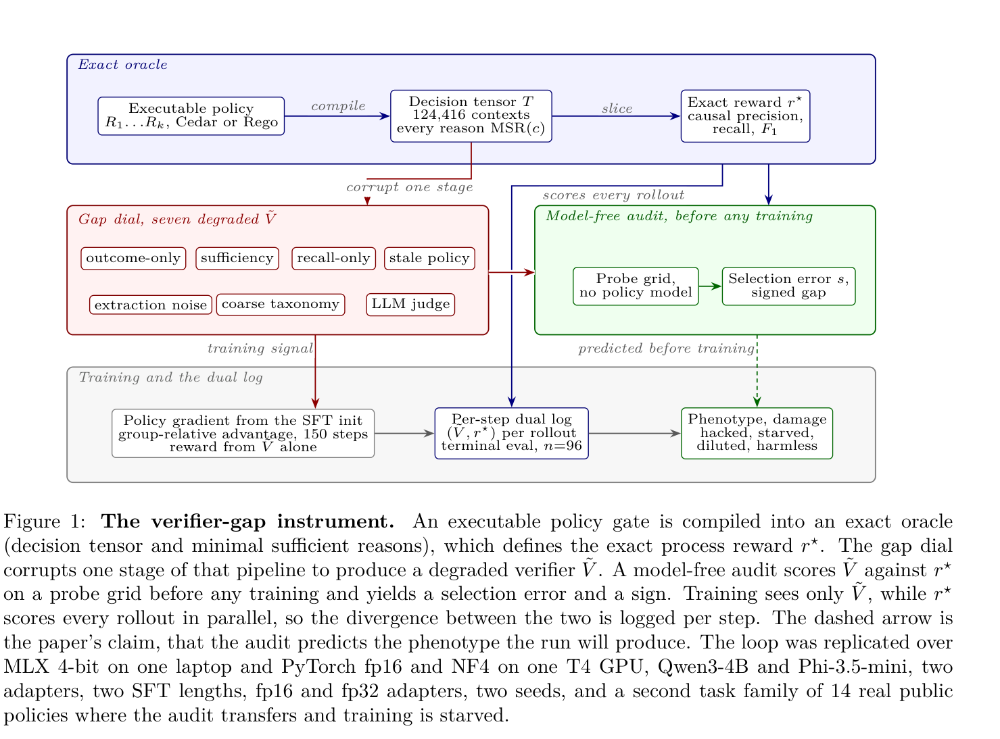

# Optimistic Verifiers Get Hacked: Reward Hacking Under an Exact Process Oracle

[简体中文](README.md)

<!-- source-sha256: ab98d5f884a36017b5c67ee3bf437488563836616517e09567e1e5f7161e182c -->

> **l1_mechanism standalone component; diagnostic only.** Full experiments are not reproduced due to high cost (review DONE). No automatic retries or Evolve promotion.

## Paper information

| Field | Value |
| --- | --- |
| Paper | [arXiv 2611.21538v1](https://arxiv.org/abs/2611.21538v1); [fixed v1](https://arxiv.org/html/2611.21538v1) |
| First author / institution | Arunkumar V; University College of Engineering, BIT Campus, Anna University, Tiruchirappalli |
| Original publication | 2026-11-16 18:25:42 UTC; original submission, not announcement/review date |
| Original source code | No verifiable method-source release found in fixed v1 or the bounded author entry points checked. Referenced trainers, models and libraries are not this paper's source release. |
| Local adapter / key | `optimistic-verifier-audit`; `adapter: null` |
| Local code | `src/auto_research/post_training/optimistic_verifier_audit.py` |

## Original paper summary

### Background and defining changes

Fixing the cited features must preserve the decision for every completion of other features; subset minimality then removes redundant features. Multiple alternative reasons form an antichain.

Citing every feature may be sufficient while including irrelevant material. The exact reward uses the MSR union for precision and the best individual MSR for recall, so padding lowers precision.

<!-- paper-figure:start -->
### Original paper figure

[](https://arxiv.org/pdf/2611.21538v1#page=4)

From [fixed v1](https://arxiv.org/pdf/2611.21538v1#page=4), PDF page 4. Copyright belongs to the original authors. The original panel and caption are preserved without scientific edits; source/crop/SHA are in [provenance](assets/provenance.json). Author results are not local measurements.

<!-- paper-figure:end -->

### Core equations

Read source locations: §3 Definitions1–2；§4–5；AppendixA/B/D.

$$
S\text{ sufficient at }c\iff\forall c':c'_S=c_S,\ G(c')=G(c);\quad MSR(c)=\text{subset-minimal sufficient antichain};\quad P=|E\cap\cup MSR|/|E|,\ R=\max_{m\in MSR}|E\cap m|/|m|.
$$

### Paper results and production evidence

The source dual-logs proxy and exact rewards on enumerable policies and finds damage magnitude unstable across frameworks/precisions; real-policy ports may starve the training signal. These retained failures do not imply that every optimistic verifier is inevitably hacked. No production A/B is reported.

## Local component

### Data contract and code mapping

Exact MSR antichains on small finite state spaces, causal precision/recall/F1 and proxy selection-error/signed/absolute gaps; no simulated LLM damage claims.

Completion/subset enumeration grows exponentially. The component rejects over-budget domains rather than probing the entire 124,416-state multi-gate/model campaign. The oracle belongs only to an external scorer.

```bash
PYTHONPATH=src python -c 'from auto_research.post_training.optimistic_verifier_audit import diagnostic; print(diagnostic(42, device="cpu"))'
PYTHONPATH=src python -m pytest -q tests/post_training/test_nov18_latest_post_components.py
```

### Results, negative controls and limits

CPU seeds 42/43/44 were executed. [Metrics](metrics/component-cpu-seeds42-44.json) contain operator/control results, not task-success rates. CPU-only protocol; no CUDA path is advertised.

alternative_minimal_reasons, irrelevant_padding_reduces_precision, sufficiency_tie_hides_true_preference, irrelevant_feature_is_not_a_reason.

### High-cost full experiment

The original configuration is recorded verbatim with source locations in the cost assessment. It involves 124,416 contexts, multiple gates/public policies and 4B/mini model, framework, precision, adapter and seed training comparisons.

**The high-cost full experiment is not reproduced (review DONE).** This is a source-configuration assessment, not a local timing claim. Only declared tiny-operator checks are allowed; no large-model probe is run to prove cost. No capability comparison or Evolve integration is claimed.
