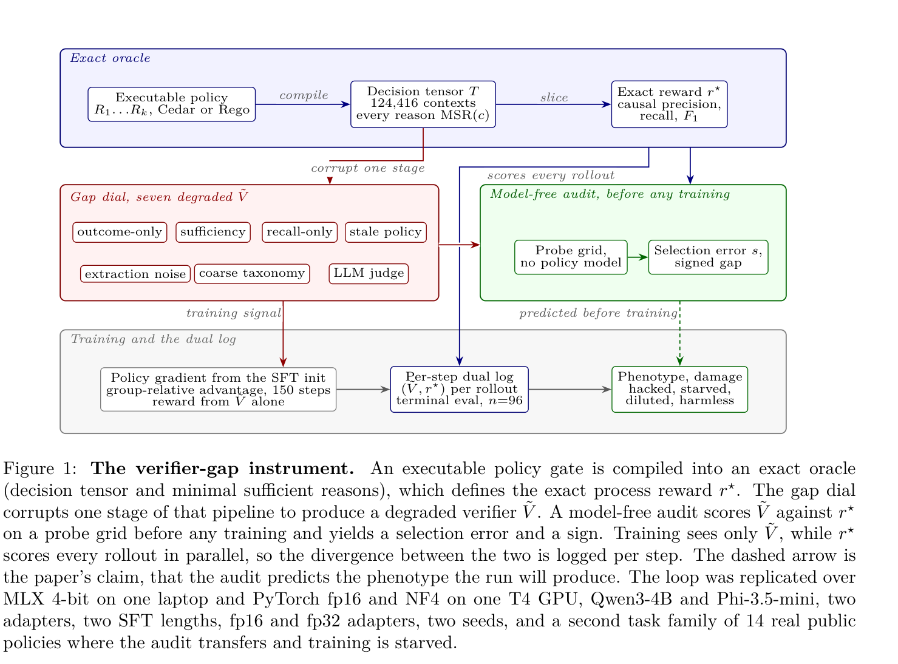
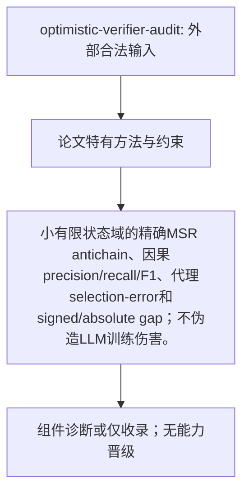

# Optimistic Verifiers Get Hacked: Reward Hacking Under an Exact Process Oracle

[English](README-en.md)

> **l1_mechanism 独立组件，diagnostic only。** 完整实验成本过高，不复现（审查 DONE）；不自动重试、不进入Evolve晋级。

## 论文信息

| 字段 | 内容 |
| --- | --- |
| 论文链接 | [arXiv 2611.21538v1](https://arxiv.org/abs/2611.21538v1)；[固定v1原文](https://arxiv.org/html/2611.21538v1) |
| 公司 / 作者机构 | 一作 **Arunkumar V**：**University College of Engineering, BIT Campus, Anna University, Tiruchirappalli**；不把所用Google/Meta模型当作者机构 |
| 首次公开日期 | **2026-11-16 18:25:42 UTC**，原始arXiv提交，不替换成公告或本次审查日期 |
| 原作者开源代码 | 固定v1及所核作者入口未找到可验证的本篇方法源码发布；引用的训练器、模型或库不算本篇开源。 |
| 本地 adapter / key | `optimistic-verifier-audit`；`adapter: null` |
| 本地复现代码 | `src/auto_research/post_training/optimistic_verifier_audit.py` |

## 原始论文总结

### 背景与主要改动

固定被引用特征后，所有其它特征补全都必须维持同一决策；再去掉任一特征就不充分才是minimal。可能存在多个替代充分理由，需保存antichain。

引用所有特征通常充分，却夹带无因果作用内容。精确reward用MSR并集测precision、最佳单个MSR测recall，padding会降低precision而不因充分性拿满分。

<!-- paper-figure:start -->
### 原论文关键图

[](https://arxiv.org/pdf/2611.21538v1#page=4)

图片来自[原论文](https://arxiv.org/pdf/2611.21538v1#page=4)第4页，版权归原作者所有；完整保留图与原图注，未重绘/改数值。来源、裁剪与SHA见[provenance](assets/provenance.json)。图表中的结果属于作者，不是本地实验。

<!-- paper-figure:end -->



### 核心公式

固定v1位置：§3 Definitions1–2；§4–5；AppendixA/B/D。

$$
S\text{ sufficient at }c\iff\forall c':c'_S=c_S,\ G(c')=G(c);\quad MSR(c)=\text{subset-minimal sufficient antichain};\quad P=|E\cap\cup MSR|/|E|,\ R=\max_{m\in MSR}|E\cap m|/|m|.
$$

### 论文离线与线上效果

作者在精确可枚举策略上同时记录proxy和true reward，并报告跨框架/精度damage大小并不稳定；真实策略移植中还出现学习信号饥饿。该保留失败结果的结论不能简化成所有乐观verifier必然被攻破。未报告生产线上A/B。

## 本地复现

### 数据协议与代码映射

小有限状态域的精确MSR antichain、因果precision/recall/F1、代理selection-error和signed/absolute gap；不伪造LLM训练伤害。

按定义枚举补全和子集成本指数增长；组件用上限显式拒绝超预算，不为了证明昂贵跑124416状态×多gate×多模型矩阵。oracle只给外部scorer。

```bash
PYTHONPATH=src python -c 'from auto_research.post_training.optimistic_verifier_audit import diagnostic; print(diagnostic(42, device="cpu"))'
PYTHONPATH=src python -m pytest -q tests/post_training/test_nov18_latest_post_components.py
```

### 结果、负控与边界

已实际执行CPU seeds42/43/44；[指标](metrics/component-cpu-seeds42-44.json)仅记录算子与负控，不含任务成功率。此协议仅支持CPU，不宣称CUDA路径。

alternative_minimal_reasons、irrelevant_padding_reduces_precision、sufficiency_tie_hides_true_preference、irrelevant_feature_is_not_a_reason。

### 高成本完整实验

§3/D完整124416状态、12训练gate/4留出gate、14真实策略、4B/mini多框架精度/adapter/seed训练矩阵；本地只在小枚举域核定义，不跑模型campaign。

**完整实验成本过高，不复现（审查 DONE）**。成本依据来自原文配置而非本地测速；只在明确小算子预算内工作，不为证明高成本探跑大模型。单卡A100/A30或Mac不能替代论文完整多模型/多任务/专家与系统对照。
