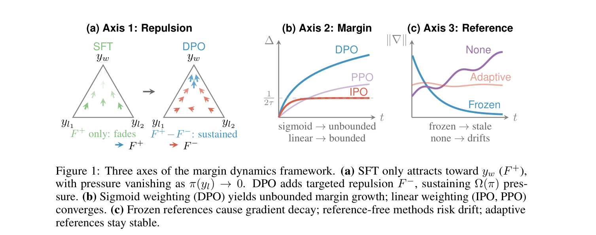

# Margin Dynamics for Large Language Model Alignment

[简体中文](README.md)

<!-- source-sha256: 743c21a049f60e0daea6cc17df0902f93f3c4b40ffb55adc8a809f92d25b5c1e -->

> **l1_mechanism standalone component; diagnostic only.** Full experiments are not reproduced due to high cost (review DONE). No automatic retries or Evolve promotion.

## Paper information

| Field | Value |
| --- | --- |
| Paper | [arXiv 2611.21766v1](https://arxiv.org/abs/2611.21766v1); [fixed v1](https://arxiv.org/html/2611.21766v1) |
| First author / institution | Xingzi Xu; Amazon |
| Original publication | 2026-11-16 19:02:17 UTC; original submission, not announcement/review date |
| Original source code | No verifiable method-source release found in fixed v1 or the bounded author entry points checked. Referenced trainers, models and libraries are not this paper's source release. |
| Local adapter / key | `margin-dynamics-tpo`; `adapter: null` |
| Local code | `src/auto_research/post_training/margin_dynamics_tpo.py` |

## Original paper summary

### Background and defining changes

An ordinary sigmoid preference loss can keep increasing the margin. Saturated easy examples leave concentrated hard-example interference. TPO seeks restoring force near a target and bounded distant gradients.

Label smoothing balances the two forces at delta*=log((1-epsilon)/epsilon). The original length-normalized score gap must divide by beta and add mu; the margin shift cannot be omitted.

<!-- paper-figure:start -->
### Original paper figure

[](https://arxiv.org/pdf/2611.21766v1#page=3)

From [fixed v1](https://arxiv.org/pdf/2611.21766v1#page=3), PDF page 3. Copyright belongs to the original authors. The original panel and caption are preserved without scientific edits; source/crop/SHA are in [provenance](assets/provenance.json). Author results are not local measurements.

<!-- paper-figure:end -->

### Core equations

Read source locations: §2.1 Eq.3；AppendixB Eq.25；§3 experimental setup.

$$
\delta=\beta(s_w-s_l-\mu),\quad L_{TPO-S}=(1-\epsilon)\operatorname{softplus}(-\delta)+\epsilon\operatorname{softplus}(\delta),\quad (s_w-s_l)^*=\mu+\beta^{-1}\log\frac{1-\epsilon}{\epsilon}.
$$

### Paper results and production evidence

The paper connects SFT, DPO/SimPO and IPO through margin dynamics and constructs finite-attractor TPO-H/S losses. Two-completion gradient-flow theory is only an effective approximation for shared-parameter LoRA training; fitted beta_eff is not a full-model theorem. No production A/B is reported.

## Local component

### Data contract and code mapping

TPO-S label-smoothed sigmoid on length-normalized scores and Appendix-B normalized-Huber TPO-H; finite-attractor and bounded-gradient checks.

Neither without checking normalization. Appendix B uses error squared/(2 delta), then absolute error-delta/2. Distant per-example gradient magnitude is one before batch averaging.

```bash
PYTHONPATH=src python -c 'from auto_research.post_training.margin_dynamics_tpo import diagnostic; print(diagnostic(42, device="cpu"))'
PYTHONPATH=src python -m pytest -q tests/post_training/test_nov18_latest_post_components.py
```

### Results, negative controls and limits

CPU seeds 42/43/44 were executed. [Metrics](metrics/component-cpu-seeds42-44.json) contain operator/control results, not task-success rates. A real A100/A30 receipt must pass the batch GPU gate before CUDA validation is claimed.

below_attractor_pushed_up, attractor_zero_gradient, overshoot_restoring_force, huber_gradient_bounded, huber_target_is_stationary.

### High-cost full experiment

The source configuration in Appendix E totals approximately 153 GPU-hours using eight A100-40GB GPUs. Individual Qwen3-8B LoRA-rank-64 runs peak near 24GB. The standard replication additionally uses one SFT epoch on UltraChat-200k, 60K preference pairs for 5,000 steps and five seeds per method. This is a full data-size/noise/method campaign, not a scalar-loss check.

**The high-cost full experiment is not reproduced (review DONE).** This is a source-configuration assessment, not a local timing claim. Only declared tiny-operator checks are allowed; no large-model probe is run to prove cost. No capability comparison or Evolve integration is claimed.
