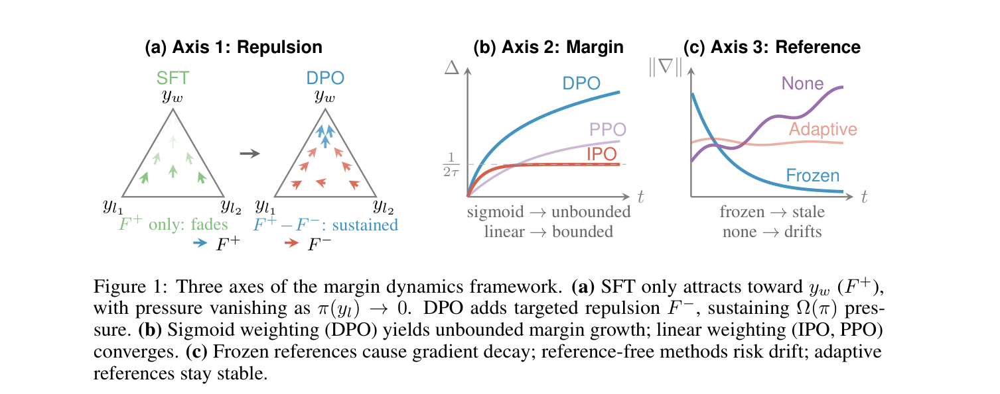
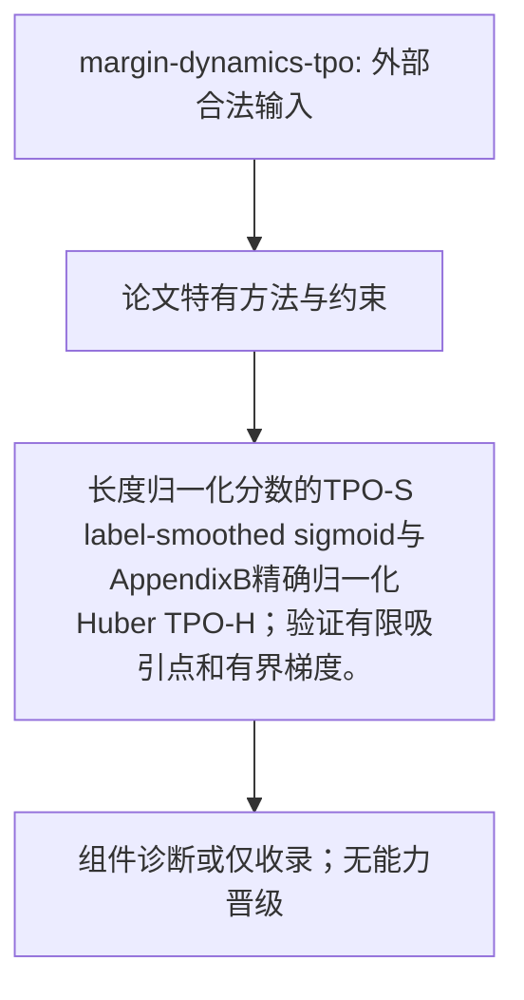

# Margin Dynamics for Large Language Model Alignment

[English](README-en.md)

> **l1_mechanism 独立组件，diagnostic only。** 完整实验成本过高，不复现（审查 DONE）；不自动重试、不进入Evolve晋级。

## 论文信息

| 字段 | 内容 |
| --- | --- |
| 论文链接 | [arXiv 2611.21766v1](https://arxiv.org/abs/2611.21766v1)；[固定v1原文](https://arxiv.org/html/2611.21766v1) |
| 公司 / 作者机构 | 一作 **Xingzi Xu**：**Amazon**；不把所用Google/Meta模型当作者机构 |
| 首次公开日期 | **2026-11-16 19:02:17 UTC**，原始arXiv提交，不替换成公告或本次审查日期 |
| 原作者开源代码 | 固定v1及所核作者入口未找到可验证的本篇方法源码发布；引用的训练器、模型或库不算本篇开源。 |
| 本地 adapter / key | `margin-dynamics-tpo`；`adapter: null` |
| 本地复现代码 | `src/auto_research/post_training/margin_dynamics_tpo.py` |

## 原始论文总结

### 背景与主要改动

普通sigmoid偏好loss的margin可持续增大；容易样本梯度饱和后，困难样本间干扰会集中。TPO希望保留目标附近恢复力并限制远端梯度。

label smoothing让正负两侧力平衡，δ*=log((1-ε)/ε)，所以原始长度归一化分差还要加μ并除β；不能漏掉margin平移。

<!-- paper-figure:start -->
### 原论文关键图

[](https://arxiv.org/pdf/2611.21766v1#page=3)

图片来自[原论文](https://arxiv.org/pdf/2611.21766v1#page=3)第3页，版权归原作者所有；完整保留图与原图注，未重绘/改数值。来源、裁剪与SHA见[provenance](assets/provenance.json)。图表中的结果属于作者，不是本地实验。

<!-- paper-figure:end -->



### 核心公式

固定v1位置：§2.1 Eq.3；AppendixB Eq.25；§3 experimental setup。

$$
\delta=\beta(s_w-s_l-\mu),\quad L_{TPO-S}=(1-\epsilon)\operatorname{softplus}(-\delta)+\epsilon\operatorname{softplus}(\delta),\quad (s_w-s_l)^*=\mu+\beta^{-1}\log\frac{1-\epsilon}{\epsilon}.
$$

### 论文离线与线上效果

作者用margin动力学统一解释SFT、DPO/SimPO与IPO，并构造有有限吸引点的TPO-H/S。两完成项gradient-flow理论对共享参数LoRA训练只给有效近似，不能把拟合βeff当严格全模型定理。未报告生产线上A/B。

## 本地复现

### 数据协议与代码映射

长度归一化分数的TPO-S label-smoothed sigmoid与AppendixB精确归一化Huber TPO-H；验证有限吸引点和有界梯度。

都不能不看归一化。AppendixB是误差²/(2δ)，超过δ后为|误差|-δ/2；这保证远端梯度绝对值为1，batch mean再除样本数。

```bash
PYTHONPATH=src python -c 'from auto_research.post_training.margin_dynamics_tpo import diagnostic; print(diagnostic(42, device="cpu"))'
PYTHONPATH=src python -m pytest -q tests/post_training/test_nov18_latest_post_components.py
```

### 结果、负控与边界

已实际执行CPU seeds42/43/44；[指标](metrics/component-cpu-seeds42-44.json)仅记录算子与负控，不含任务成功率。CUDA验证由统一批次真实A100/A30回执验收，未完成前不得称GPU已通过。

below_attractor_pushed_up、attractor_zero_gradient、overshoot_restoring_force、huber_gradient_bounded、huber_target_is_stationary。

### 高成本完整实验

§3与Appendix E：每个运行Qwen3-8B LoRA rank64、A100-40GB约24GB峰值，seq512。作者披露完整预算约153 GPU-hours、使用8张A100-40GB，预测/复刻/跨模型/补充实验分别约30/63/18/27小时；标准复刻还含UltraChat-200k一轮SFT、60K偏好对5000步及每方法5种子。不是单次标量loss验证。

**完整实验成本过高，不复现（审查 DONE）**。成本依据来自原文配置而非本地测速；只在明确小算子预算内工作，不为证明高成本探跑大模型。单卡A100/A30或Mac不能替代论文完整多模型/多任务/专家与系统对照。
