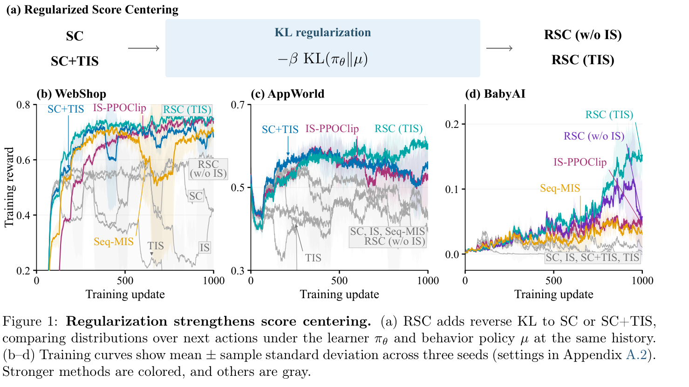

# Regularized Score Centering

[简体中文](README.md)

<!-- source-sha256: 19435f7b79d7e4ed8130b2b8f144410da32517d77ac78aff028ba1d87c77f3a2 -->

> **l1_mechanism standalone component; diagnostic only.** Full experiments are not reproduced due to high cost (review DONE). No automatic retries or Evolve promotion.

## Paper information

| Field | Value |
| --- | --- |
| Paper | [arXiv 2611.21791v1](https://arxiv.org/abs/2611.21791v1); [fixed v1](https://arxiv.org/html/2611.21791v1) |
| First author / institution | Hao Bai; University of Illinois Urbana-Champaign |
| Original publication | 2026-11-16 19:12:50 UTC; original submission, not announcement/review date |
| Original source code | [Author repository](https://github.com/BiEchi/rsc); verified revision `2fd280c420faa875809d4bb632ad1d2367e229cc`; no project-level licence verified; upstream source not copied. Release evidence only; upstream training not executed. |
| Local adapter / key | `regularized-score-centering`; `adapter: null` |
| Local code | `src/auto_research/post_training/regularized_score_centering.py` |

## Original paper summary

### Background and defining changes

No. It subtracts the behavior expectation of a weighted log-policy gradient at the same history. Response advantages may already be centered while the behavior-averaged learner score remains nonzero.

No. Sample and auxiliary reward ratios are independently computed and TIS-clipped. The KL term has its own cap. Coefficients are detached in the score surrogate and behavior remains fixed within an inner fit.

<!-- paper-figure:start -->
### Original paper figure

[](https://arxiv.org/pdf/2611.21791v1#page=1)

From [fixed v1](https://arxiv.org/pdf/2611.21791v1#page=1), PDF page 1. Copyright belongs to the original authors. The original panel and caption are preserved without scientific edits; source/crop/SHA are in [provenance](assets/provenance.json). Author results are not local measurements.

<!-- paper-figure:end -->

### Core equations

Read source locations: PDFp1 author superscripts；§3 Eq.3–8；§5.2 and AppendixA sampling.

$$
g=A[\rho^{TIS}\psi-\mathbb E_\mu(\rho^{TIS}\psi\mid h)]-\beta\mathbb E_\mu[\rho^{KL}\log\rho^{KL}\psi\mid h],\quad \psi=\nabla_\theta\log\pi_\theta.
$$

### Paper results and production evidence

The source studies stale behavior policies and train/inference numerical mismatch on math and six agentic tasks. SC reduces baseline-induced drift but can still leave the behavior policy; reverse KL constrains that movement. Auxiliary estimator cost, ratio caps and refresh cadence jointly matter. No production A/B is reported.

## Local component

### Data contract and code mapping

Weighted score centers from independent auxiliary actions, detached TIS weights and reverse-KL gradient estimator with an independent KL cap; not reward centering.

It is a detached-score surrogate with the prescribed gradient, not an unbiased numerical estimate of W. Tests compare gradients against full-action enumeration and a no-center control, not agent returns.

```bash
PYTHONPATH=src python -c 'from auto_research.post_training.regularized_score_centering import diagnostic; print(diagnostic(42, device="cpu"))'
PYTHONPATH=src python -m pytest -q tests/post_training/test_nov18_latest_post_components.py
```

### Results, negative controls and limits

CPU seeds 42/43/44 were executed. [Metrics](metrics/component-cpu-seeds42-44.json) contain operator/control results, not task-success rates. A real A100/A30 receipt must pass the batch GPU gate before CUDA validation is claimed.

exact_action_enumeration_gradient, center_is_not_reward_mean, external_advantage_frozen, finite_gradient.

### High-cost full experiment

The original configuration is recorded verbatim with source locations in the cost assessment. It involves Qwen3-32B, 64 rollouts per prompt, 32/64/128 auxiliary actions per token and six agent environments.

**The high-cost full experiment is not reproduced (review DONE).** This is a source-configuration assessment, not a local timing claim. Only declared tiny-operator checks are allowed; no large-model probe is run to prove cost. No capability comparison or Evolve integration is claimed.
