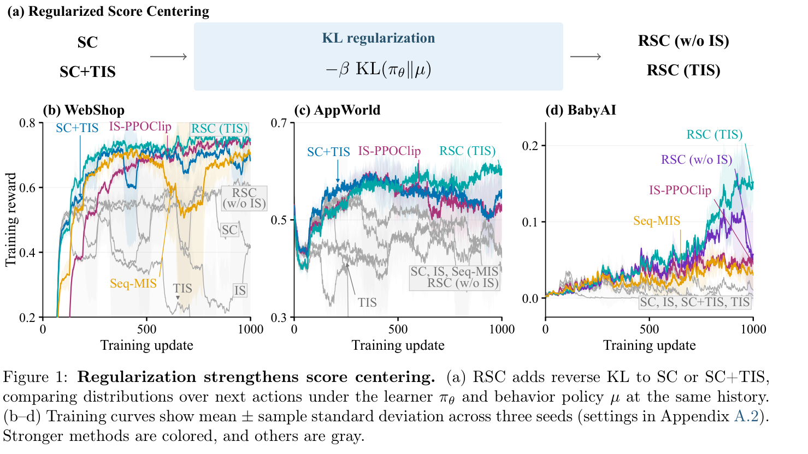
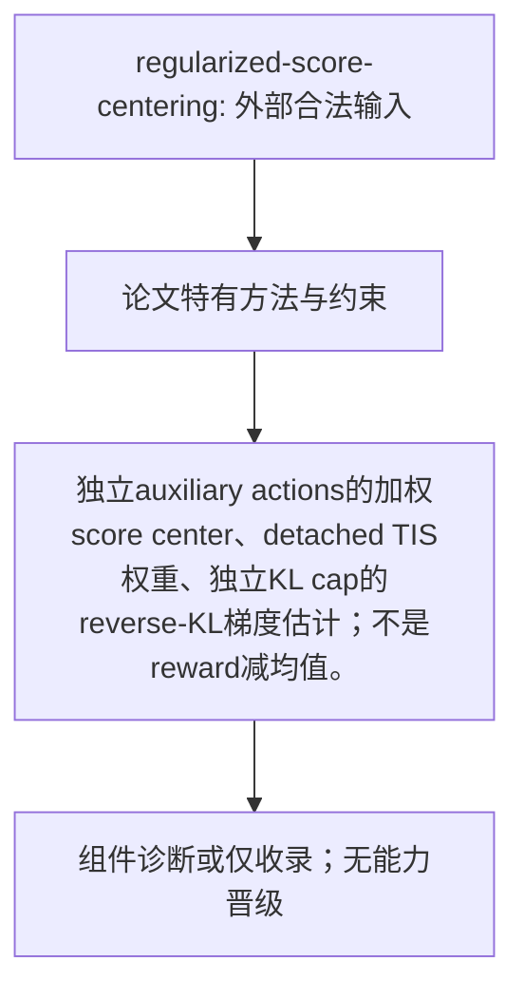

# Regularized Score Centering

[English](README-en.md)

> **l1_mechanism 独立组件，diagnostic only。** 完整实验成本过高，不复现（审查 DONE）；不自动重试、不进入Evolve晋级。

## 论文信息

| 字段 | 内容 |
| --- | --- |
| 论文链接 | [arXiv 2611.21791v1](https://arxiv.org/abs/2611.21791v1)；[固定v1原文](https://arxiv.org/html/2611.21791v1) |
| 公司 / 作者机构 | 一作 **Hao Bai**：**University of Illinois Urbana-Champaign**；不把所用Google/Meta模型当作者机构 |
| 首次公开日期 | **2026-11-16 19:12:50 UTC**，原始arXiv提交，不替换成公告或本次审查日期 |
| 原作者开源代码 | [作者仓库](https://github.com/BiEchi/rsc)；固定SHA `2fd280c420faa875809d4bb632ad1d2367e229cc`；未找到项目级许可，不复制上游源码。仅核对发布证据，未执行上游训练。 |
| 本地 adapter / key | `regularized-score-centering`；`adapter: null` |
| 本地复现代码 | `src/auto_research/post_training/regularized_score_centering.py` |

## 原始论文总结

### 背景与主要改动

不是。它减去同一history下behavior分布的加权log-policy梯度期望。response advantage本来可以已中心化，但behavior下score均值仍不一定为0。

不能默默混用。reward项sample与aux各自计算原ratio后TIS clip；KL项可用独立cap，所有系数对score surrogate detach，behavior在内层固定。

<!-- paper-figure:start -->
### 原论文关键图

[](https://arxiv.org/pdf/2611.21791v1#page=1)

图片来自[原论文](https://arxiv.org/pdf/2611.21791v1#page=1)第1页，版权归原作者所有；完整保留图与原图注，未重绘/改数值。来源、裁剪与SHA见[provenance](assets/provenance.json)。图表中的结果属于作者，不是本地实验。

<!-- paper-figure:end -->



### 核心公式

固定v1位置：PDFp1 author superscripts；§3 Eq.3–8；§5.2 and AppendixA sampling。

$$
g=A[\rho^{TIS}\psi-\mathbb E_\mu(\rho^{TIS}\psi\mid h)]-\beta\mathbb E_\mu[\rho^{KL}\log\rho^{KL}\psi\mid h],\quad \psi=\nabla_\theta\log\pi_\theta.
$$

### 论文离线与线上效果

作者在数学和6个Agent任务上研究陈旧行为策略与训练/推理数值偏移；SC能减弱baseline drift但仍可能远离behavior，reverse-KL补充约束。不同采样估计器成本、importance cap和刷新周期共同决定结果。未报告生产线上A/B。

## 本地复现

### 数据协议与代码映射

独立auxiliary actions的加权score center、detached TIS权重、独立KL cap的reverse-KL梯度估计；不是reward减均值。

返回的是具有原式梯度的detached-score surrogate，不是W的无偏数值估计。测试以小词表全动作枚举核梯度，并比较去掉center的负控，不报告Agent回报。

```bash
PYTHONPATH=src python -c 'from auto_research.post_training.regularized_score_centering import diagnostic; print(diagnostic(42, device="cpu"))'
PYTHONPATH=src python -m pytest -q tests/post_training/test_nov18_latest_post_components.py
```

### 结果、负控与边界

已实际执行CPU seeds42/43/44；[指标](metrics/component-cpu-seeds42-44.json)仅记录算子与负控，不含任务成功率。CUDA验证由统一批次真实A100/A30回执验收，未完成前不得称GPU已通过。

exact_action_enumeration_gradient、center_is_not_reward_mean、external_advantage_frozen、finite_gradient。

### 高成本完整实验

§5含Qwen3-32B、每题64个rollout、每token32/64/128辅助采样及6个多轮Agent环境；完整异步多任务训练不适合单卡短时验收。

**完整实验成本过高，不复现（审查 DONE）**。成本依据来自原文配置而非本地测速；只在明确小算子预算内工作，不为证明高成本探跑大模型。单卡A100/A30或Mac不能替代论文完整多模型/多任务/专家与系统对照。
