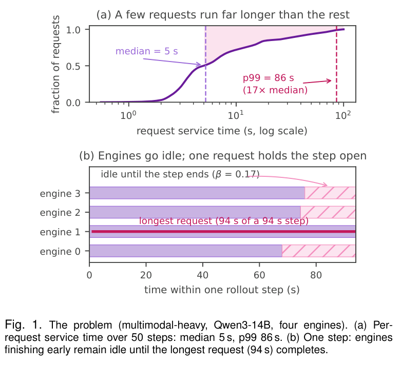

# TAILROLL: Tail-Aware Rollout Acceleration for RL-Based LLM Post-Training

[简体中文](README.md)

<!-- source-sha256: 0394379a4f37669f80acf0ec4381d69ee3156f9908c85f38b2b0afda0c3857f7 -->

> **Review only; no local model implementation.** Full experiments are not reproduced due to high cost (review DONE). No automatic retries or Evolve promotion.

## Paper information

| Field | Value |
| --- | --- |
| Paper | [arXiv 2611.22206v1](https://arxiv.org/abs/2611.22206v1); [fixed v1](https://arxiv.org/html/2611.22206v1) |
| First author / institution | Niloofar Gholipour; École de technologie supérieure, Canada |
| Original publication | 2026-11-17 04:44:20 UTC; original submission, not announcement/review date |
| Original source code | No verifiable method-source release found in fixed v1 or the bounded author entry points checked. Referenced trainers, models and libraries are not this paper's source release. |
| Local adapter / key | `tailroll`; `adapter: null` |
| Local code | None; no placeholder model |

## Original paper summary

### Background and defining changes

The longest tail response can set rollout-step duration. TailRoll migrates in-flight requests at chunk boundaries and separately terminates stragglers once enough siblings finish.

It uses stateless in-flight migration: the destination reconstructs state from prompt/generated tokens and resumes after one re-prefill, guarded by costs, reservations, hop limits and post-migration checks.

<!-- paper-figure:start -->
### Original paper figure

From [fixed v1](https://arxiv.org/pdf/2611.22206v1#page=1), PDF page 1. Copyright belongs to the original authors. The original panel and caption are preserved without scientific edits; source/crop/SHA are in [provenance](assets/provenance.json). Author results are not local measurements.

<!-- paper-figure:end -->

### Core equations

Read source locations: §V migration policy and sufficiency termination；§VI–VII Ascend setup and 300-step results.

$$
\text{migrate only if estimated tail benefit exceeds one re-prefill and transfer cost};\qquad\text{terminate straggler if }n_{completed}(group)\ge k_{min},\ \text{mask partial-output loss}.
$$

### Paper results and production evidence

The authors compare multi-engine 14B/32B runs on Ascend 910C and report improved bubble/imbalance and rollout/step time. Such gains require real queues and KV state; sufficiency termination also needs reward-retention controls. No recommendation-production A/B is reported.

## Cost decision and local status

### Data contract and code mapping

Review actual multi-engine in-flight migration, one-time re-prefill and partial-output loss masking; no offline scheduler simulation claims system speedups.

It lacks real multi-engine recovery, decode contention, re-prefill cost and training-reward effects. The source uses multiple Ascend 910Cs; a single A100/A30 numerical rule cannot establish that system result, so the full experiment is not reproduced.

### Results and limits

No local model run, checkpoint/data download, paid API call or invented metric file. Review DONE does not mean implementation completed.

### High-cost full experiment

The original configuration is recorded verbatim with source locations in the cost assessment. It involves Qwen3-14B/32B, multiple Ascend 910Cs and real engine migration/re-prefill across ten configurations and 300-step training.

**The high-cost full experiment is not reproduced (review DONE).** This is a source-configuration assessment, not a local timing claim. Only declared tiny-operator checks are allowed; no large-model probe is run to prove cost. No capability comparison or Evolve integration is claimed.
