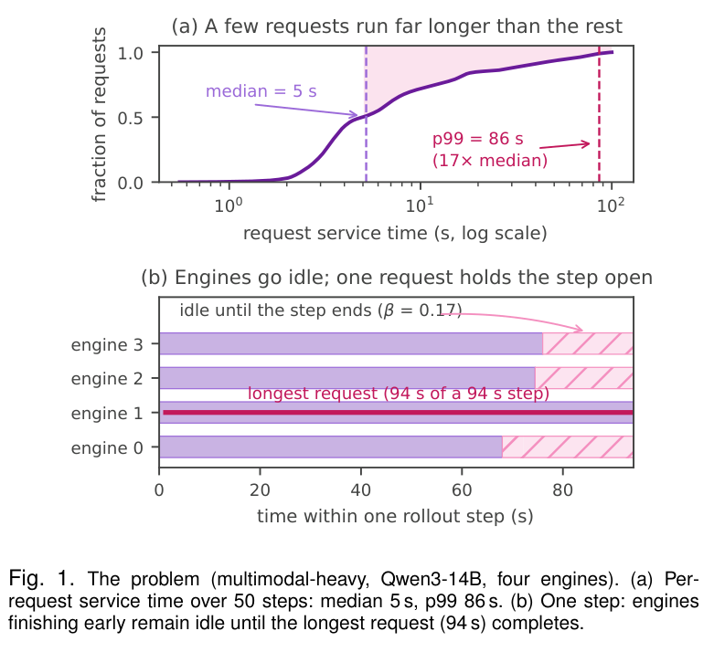
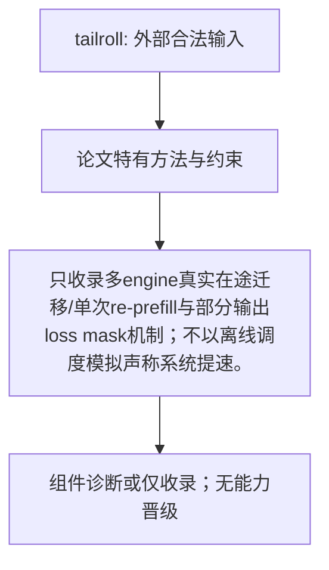

# TAILROLL: Tail-Aware Rollout Acceleration for RL-Based LLM Post-Training

[English](README-en.md)

> **仅方法与成本收录，无本地模型实现。** 完整实验成本过高，不复现（审查 DONE）；不自动重试、不进入Evolve晋级。

## 论文信息

| 字段 | 内容 |
| --- | --- |
| 论文链接 | [arXiv 2611.22206v1](https://arxiv.org/abs/2611.22206v1)；[固定v1原文](https://arxiv.org/html/2611.22206v1) |
| 公司 / 作者机构 | 一作 **Niloofar Gholipour**：**École de technologie supérieure, Canada**；不把所用Google/Meta模型当作者机构 |
| 首次公开日期 | **2026-11-17 04:44:20 UTC**，原始arXiv提交，不替换成公告或本次审查日期 |
| 原作者开源代码 | 固定v1及所核作者入口未找到可验证的本篇方法源码发布；引用的训练器、模型或库不算本篇开源。 |
| 本地 adapter / key | `tailroll`；`adapter: null` |
| 本地复现代码 | 无；完整实验不复现，不创建占位模型 |

## 原始论文总结

### 背景与主要改动

rollout step常被最长尾response决定，平均load无法反映尾长。TailRoll在chunk边界迁移在途请求，并用完成siblings足够后的终止处理straggler。

原方法用stateless in-flight migration，目标engine据prompt和已生成token重建状态，一次re-prefill后续写；有cost gate、reservation、hop limit和迁后核验。

<!-- paper-figure:start -->
### 原论文关键图

图片来自[原论文](https://arxiv.org/pdf/2611.22206v1#page=1)第1页，版权归原作者所有；完整保留图与原图注，未重绘/改数值。来源、裁剪与SHA见[provenance](assets/provenance.json)。图表中的结果属于作者，不是本地实验。

<!-- paper-figure:end -->

### 核心公式

固定v1位置：§V migration policy and sufficiency termination；§VI–VII Ascend setup and 300-step results。

$$
\text{migrate only if estimated tail benefit exceeds one re-prefill and transfer cost};\qquad\text{terminate straggler if }n_{completed}(group)\ge k_{min},\ \text{mask partial-output loss}.
$$

### 论文离线与线上效果

作者在Ascend910C上比较14B/32B多engine运行，报告bubble/imbalance和rollout/step time改善；量化系统收益需要真实排队与KV状态，sufficiency termination还需reward不退化对照。未报告搜广推生产线上A/B。

## 成本决策与本地状态

### 数据协议与代码映射

只收录多engine真实在途迁移/单次re-prefill与部分输出loss mask机制；不以离线调度模拟声称系统提速。

缺真实多engine请求恢复、decode contention、re-prefill成本和训练reward影响。论文硬件是多Ascend910C，当前单A100/A30只可做数值规则，无法支撑原系统结论，因此完整实验不复现。

### 结果、负控与边界

没有本地模型运行、checkpoint下载、数据集下载、付费API调用或伪造metrics文件。保留未复现状态，不将审查DONE改称实现完成。

### 高成本完整实验

§VI–VII在Ascend910C NPU上用Qwen3-14B/32B、多engine/KV迁移、10配置和300step真实RL；现有单卡A100/A30不具同构多engine硬件拓扑。

**完整实验成本过高，不复现（审查 DONE）**。成本依据来自原文配置而非本地测速；只在明确小算子预算内工作，不为证明高成本探跑大模型。单卡A100/A30或Mac不能替代论文完整多模型/多任务/专家与系统对照。
