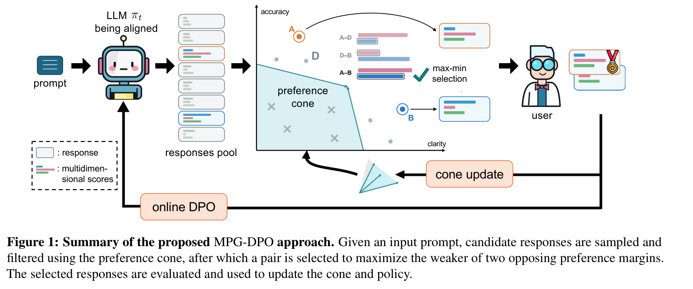

# Sample-efficient Personalization of Large Language Model Alignment with Multidimensional User Preference Data

[简体中文](README.md)

<!-- source-sha256: cf722f8c638aba9d3f193dc4f8919356a840e81179b2c0edc68f1bfc1f4d638c -->

> **Review only; no local model implementation.** Full experiments are not reproduced due to high cost (review DONE). No automatic retries or Evolve promotion.

## Paper information

| Field | Value |
| --- | --- |
| Paper | [arXiv 2611.22210v1](https://arxiv.org/abs/2611.22210v1); [fixed v1](https://arxiv.org/html/2611.22210v1) |
| First author / institution | Zhen-Yu Zhang; RIKEN Center for Advanced Intelligence Project |
| Original publication | 2026-11-17 04:47:45 UTC; original submission, not announcement/review date |
| Original source code | No verifiable method-source release found in fixed v1 or the bounded author entry points checked. Referenced trainers, models and libraries are not this paper's source release. |
| Local adapter / key | `mpg-dpo`; `adapter: null` |
| Local code | None; no placeholder model |

## Original paper summary

### Background and defining changes

Retained feedback directions generate a preference cone whose dual gives W. It filters confidently dominated answers and queries unresolved trade-offs instead of committing to one scalar weight vector.

Only when every old rule supports the opposite direction beyond tau is it discarded. Zero differences, trivial duals and insufficient survivors also need handling. One opposing rule does not mean unanimous opposition.

<!-- paper-figure:start -->
### Original paper figure

From [fixed v1](https://arxiv.org/pdf/2611.22210v1#page=2), PDF page 2. Copyright belongs to the original authors. The original panel and caption are preserved without scientific edits; source/crop/SHA are in [provenance](assets/provenance.json). Author results are not local measurements.

<!-- paper-figure:end -->

### Core equations

Read source locations: §3 Eq.2–6 and Algorithm1；§4 models and oracle settings.

$$
C_t=\operatorname{cone}\{o_s d_s/\|d_s\|\}_{retained},\quad C_t=\{x:W_tx\ge0\};\quad(i,j)=\arg\max_{i,j\in\mathcal N_t}\min\{\max_k LCB_k(i|j),-\min_k UCB_k(i|j)\}.
$$

### Paper results and production evidence

The study compares sample efficiency across several 7B models and preference oracles. Regret analysis relies on score/confidence and domination-coverage assumptions; the implementation caps retained rules unlike the full-cone theory. Adapting to one oracle does not establish arbitrary user personalization. No production A/B is reported.

## Cost decision and local status

### Data contract and code mapping

Review the complete cone, ridge-confidence and nondominated trade-off selection algorithm; a pair selector is not advertised as personalized DPO.

The full method includes double-description cones, an independent encoder, online scoring/preference queries and multi-seed 7B training. A single argmax omits the estimation chain, so the high-cost campaign is not reproduced and no capability metric is invented.

### Results and limits

No local model run, checkpoint/data download, paid API call or invented metric file. Review DONE does not mean implementation completed.

### High-cost full experiment

Section 4 states that all experiments run on one machine with four NVIDIA H100 80GB GPUs. The campaign includes three 7B families, eight responses per prompt, three seeds, an 86M DeBERTa encoder and several external preference oracles. This multi-card/model/query campaign exceeds the declared short single-A100/A30 budget.

**The high-cost full experiment is not reproduced (review DONE).** This is a source-configuration assessment, not a local timing claim. Only declared tiny-operator checks are allowed; no large-model probe is run to prove cost. No capability comparison or Evolve integration is claimed.
