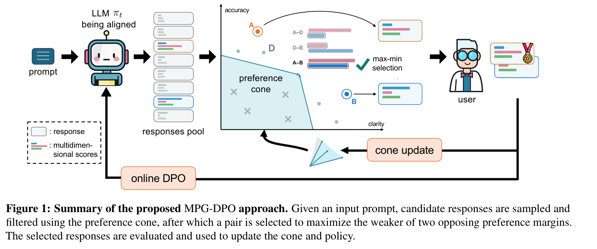
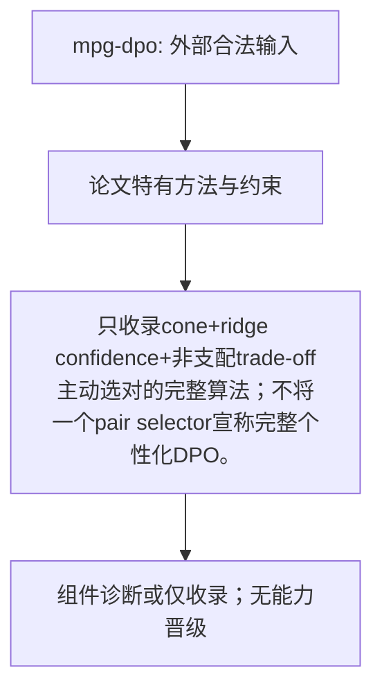

# Sample-efficient Personalization of Large Language Model Alignment with Multidimensional User Preference Data

[English](README-en.md)

> **仅方法与成本收录，无本地模型实现。** 完整实验成本过高，不复现（审查 DONE）；不自动重试、不进入Evolve晋级。

## 论文信息

| 字段 | 内容 |
| --- | --- |
| 论文链接 | [arXiv 2611.22210v1](https://arxiv.org/abs/2611.22210v1)；[固定v1原文](https://arxiv.org/html/2611.22210v1) |
| 公司 / 作者机构 | 一作 **Zhen-Yu Zhang**：**RIKEN Center for Advanced Intelligence Project**；不把所用Google/Meta模型当作者机构 |
| 首次公开日期 | **2026-11-17 04:47:45 UTC**，原始arXiv提交，不替换成公告或本次审查日期 |
| 原作者开源代码 | 固定v1及所核作者入口未找到可验证的本篇方法源码发布；引用的训练器、模型或库不算本篇开源。 |
| 本地 adapter / key | `mpg-dpo`；`adapter: null` |
| 本地复现代码 | 无；完整实验不复现，不创建占位模型 |

## 原始论文总结

### 背景与主要改动

用户反馈保留的方向生成偏好cone，dual generators形成W；以偏序筛除确定被支配回答，再选择尚有规则trade-off的回答对，避免先拍定单一权重。

只有所有旧规则都以超过τ的margin支持相反方向才丢弃；还要处理零score差、dual trivial和候选不足等边界。不能把任一规则反对误读成全体反对。

<!-- paper-figure:start -->
### 原论文关键图

图片来自[原论文](https://arxiv.org/pdf/2611.22210v1#page=2)第2页，版权归原作者所有；完整保留图与原图注，未重绘/改数值。来源、裁剪与SHA见[provenance](assets/provenance.json)。图表中的结果属于作者，不是本地实验。

<!-- paper-figure:end -->

### 核心公式

固定v1位置：§3 Eq.2–6 and Algorithm1；§4 models and oracle settings。

$$
C_t=\operatorname{cone}\{o_s d_s/\|d_s\|\}_{retained},\quad C_t=\{x:W_tx\ge0\};\quad(i,j)=\arg\max_{i,j\in\mathcal N_t}\min\{\max_k LCB_k(i|j),-\min_k UCB_k(i|j)\}.
$$

### 论文离线与线上效果

作者在多7B模型和多个偏好oracle下比较样本效率。regret论证依赖score模型、confidence与domination coverage假设，且实际规则上限不同于理论full cone；不能把适应某oracle的win rate当所有用户偏好。未报告生产线上A/B。

## 成本决策与本地状态

### 数据协议与代码映射

只收录cone+ridge confidence+非支配trade-off主动选对的完整算法；不将一个pair selector宣称完整个性化DPO。

完整定义包含double-description cone、独立编码器、在线评分/偏好查询和7B多seed训练。抽出一行argmax会漏核心估计链，故高成本完整campaign不复现且不造能力指标。

### 结果、负控与边界

没有本地模型运行、checkpoint下载、数据集下载、付费API调用或伪造metrics文件。保留未复现状态，不将审查DONE改称实现完成。

### 高成本完整实验

§4明确全部实验在一台4张NVIDIA H100 80GB机器上运行；含三个7B系列、每prompt8候选、3seed、86M DeBERTa独立编码器和多个外部LLM偏好oracle，在线score/cone与DPO交替训练。原文多卡、多模型和外部查询campaign超出本轮单A100/A30短预算。

**完整实验成本过高，不复现（审查 DONE）**。成本依据来自原文配置而非本地测速；只在明确小算子预算内工作，不为证明高成本探跑大模型。单卡A100/A30或Mac不能替代论文完整多模型/多任务/专家与系统对照。
