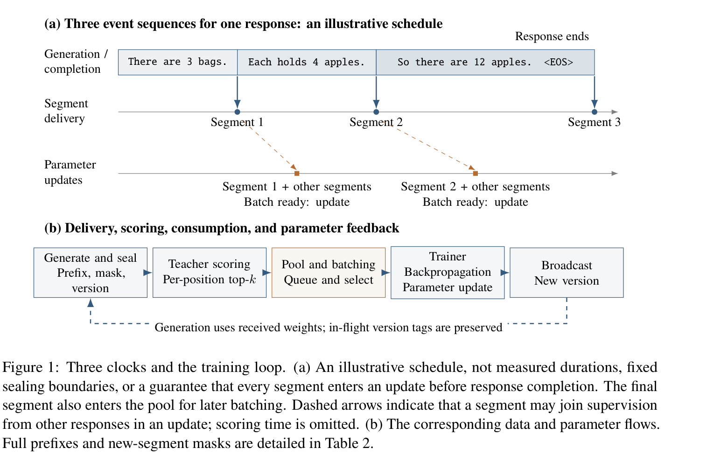

# Streaming On-Policy Distillation: Decoupling Three Clocks for Stage-Wise Supervision Consumption

[简体中文](README.md)

<!-- source-sha256: d1d113d64cd6d0a49407520af48c62e17235118dcd1455cfd973ce328d260e24 -->

> **l1_mechanism standalone component; diagnostic only.** Full experiments are not reproduced due to high cost (review DONE). No automatic retries or Evolve promotion.

## Paper information

| Field | Value |
| --- | --- |
| Paper | [arXiv 2611.22298v1](https://arxiv.org/abs/2611.22298v1); [fixed v1](https://arxiv.org/html/2611.22298v1) |
| First author / institution | Yun Zhu; Independent Researcher, China |
| Original publication | 2026-11-17 06:55:10 UTC; original submission, not announcement/review date |
| Original source code | No verifiable method-source release found in fixed v1 or the bounded author entry points checked. Referenced trainers, models and libraries are not this paper's source release. |
| Local adapter / key | `streaming-opd`; `adapter: null` |
| Local code | `src/auto_research/post_training/streaming_opd.py` |

## Original paper summary

### Background and defining changes

Local token supervision depends on the generated prefix, not future tokens. A segment may enter a candidate pool before response completion, then wait for a supervision budget rather than forcing one update per segment.

It sums only teacher-selected top-k entries without renormalizing full-vocabulary probabilities. This is not full KL; the partial sum may be negative, so the implementation floors logs and clips to [0,C].

<!-- paper-figure:start -->
### Original paper figure

[](https://arxiv.org/pdf/2611.22298v1#page=7)

From [fixed v1](https://arxiv.org/pdf/2611.22298v1#page=7), PDF page 7. Copyright belongs to the original authors. The original panel and caption are preserved without scientific edits; source/crop/SHA are in [provenance](assets/provenance.json). Author results are not local measurements.

<!-- paper-figure:end -->

### Core equations

Read source locations: §3 Eq.1–6, Table2, Definition1；§4.1 launch resources；§5 stage-wise interventions.

$$
m_t^{[a,b]}=\mathbf1(a\le t\le b),\quad \widetilde L_t=\operatorname{clip}_{[0,C]}\sum_{z\in TopK(q_t)}e^{\max(\log q_{tz},c)}[\max(\log q_{tz},c)-\max(\log p_{tz},c)],\quad L_u=\frac{\sum_iw_i\widetilde L_i}{\sum_iw_i}.
$$

### Paper results and production evidence

The study separates naive streaming, budget matching, filtering and synchronous continuation. Matching narrows an early gap, but the prototype does not establish equal-update end-to-end speedup. Continuation also resets the optimizer, so its effect is not attributable to scheduling alone. No production A/B is reported.

## Local component

### Data contract and code mapping

Full causal prefixes with new-segment loss masks and version tags, unrenormalized teacher-top-k clipped loss and supervision-weighted reduction.

A resumed response may mix versions after weight updates. Lag is a clue to distribution shift, not its magnitude; labeling every token with the final version falsely makes data fresh.

```bash
PYTHONPATH=src python -c 'from auto_research.post_training.streaming_opd import diagnostic; print(diagnostic(42, device="cpu"))'
PYTHONPATH=src python -m pytest -q tests/post_training/test_nov18_latest_post_components.py
```

### Results, negative controls and limits

CPU seeds 42/43/44 were executed. [Metrics](metrics/component-cpu-seeds42-44.json) contain operator/control results, not task-success rates. A real A100/A30 receipt must pass the batch GPU gate before CUDA validation is claimed.

full_prefix_not_truncated, sealing_not_eos, old_prefix_zero_loss_gradient, topk_not_renormalized, teacher_frozen, actual_versions_retained.

### High-cost full experiment

The original configuration is recorded verbatim with source locations in the cost assessment. It involves Qwen3-4B/0.6B and separate VERL/vLLM services allocating 4/1/1 or 2/1/1 GPUs to trainer/generator/teacher.

**The high-cost full experiment is not reproduced (review DONE).** This is a source-configuration assessment, not a local timing claim. Only declared tiny-operator checks are allowed; no large-model probe is run to prove cost. No capability comparison or Evolve integration is claimed.
