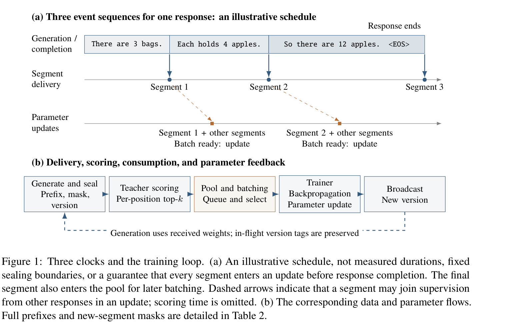
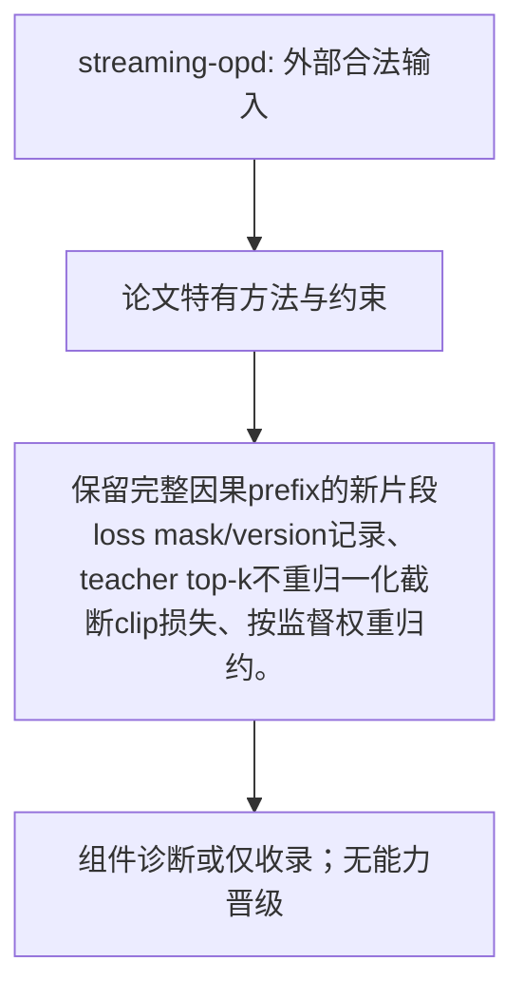

# Streaming On-Policy Distillation: Decoupling Three Clocks for Stage-Wise Supervision Consumption

[English](README-en.md)

> **l1_mechanism 独立组件，diagnostic only。** 完整实验成本过高，不复现（审查 DONE）；不自动重试、不进入Evolve晋级。

## 论文信息

| 字段 | 内容 |
| --- | --- |
| 论文链接 | [arXiv 2611.22298v1](https://arxiv.org/abs/2611.22298v1)；[固定v1原文](https://arxiv.org/html/2611.22298v1) |
| 公司 / 作者机构 | 一作 **Yun Zhu**：**Independent Researcher, China**；不把所用Google/Meta模型当作者机构 |
| 首次公开日期 | **2026-11-17 06:55:10 UTC**，原始arXiv提交，不替换成公告或本次审查日期 |
| 原作者开源代码 | 固定v1及所核作者入口未找到可验证的本篇方法源码发布；引用的训练器、模型或库不算本篇开源。 |
| 本地 adapter / key | `streaming-opd`；`adapter: null` |
| 本地复现代码 | `src/auto_research/post_training/streaming_opd.py` |

## 原始论文总结

### 背景与主要改动

token局部teacher监督只依赖已生成prefix，不依赖未来token。片段可先进入candidate pool，等监督预算凑齐才更新，而不必每片段一次更新或等整答案结束。

实现只在teacher选的top-k上求和，保留完整词表概率不重新归一化；这不是完整KL，部分和可为负，原文用log floor和[0,C]截断。

<!-- paper-figure:start -->
### 原论文关键图

[](https://arxiv.org/pdf/2611.22298v1#page=7)

图片来自[原论文](https://arxiv.org/pdf/2611.22298v1#page=7)第7页，版权归原作者所有；完整保留图与原图注，未重绘/改数值。来源、裁剪与SHA见[provenance](assets/provenance.json)。图表中的结果属于作者，不是本地实验。

<!-- paper-figure:end -->



### 核心公式

固定v1位置：§3 Eq.1–6, Table2, Definition1；§4.1 launch resources；§5 stage-wise interventions。

$$
m_t^{[a,b]}=\mathbf1(a\le t\le b),\quad \widetilde L_t=\operatorname{clip}_{[0,C]}\sum_{z\in TopK(q_t)}e^{\max(\log q_{tz},c)}[\max(\log q_{tz},c)-\max(\log p_{tz},c)],\quad L_u=\frac{\sum_iw_i\widetilde L_i}{\sum_iw_i}.
$$

### 论文离线与线上效果

作者区分naive streaming、预算匹配、筛选和同步续训；预算匹配缩小早期差距，但prototype未证明相同更新数下的端到端加速。续训还重置optimizer，不能只归因于schedule。未报告生产线上A/B。

## 本地复现

### 数据协议与代码映射

保留完整因果prefix的新片段loss mask/version记录、teacher top-k不重归一化截断clip损失、按监督权重归约。

途中权重更新后继续生成会形成混合版本prefix。version lag是分布漂移线索而非漂移大小，不能把全部token贴上最终版本以伪装fresh。

```bash
PYTHONPATH=src python -c 'from auto_research.post_training.streaming_opd import diagnostic; print(diagnostic(42, device="cpu"))'
PYTHONPATH=src python -m pytest -q tests/post_training/test_nov18_latest_post_components.py
```

### 结果、负控与边界

已实际执行CPU seeds42/43/44；[指标](metrics/component-cpu-seeds42-44.json)仅记录算子与负控，不含任务成功率。CUDA验证由统一批次真实A100/A30回执验收，未完成前不得称GPU已通过。

full_prefix_not_truncated、sealing_not_eos、old_prefix_zero_loss_gradient、topk_not_renormalized、teacher_frozen、actual_versions_retained。

### 高成本完整实验

§4.1为Qwen3-4B教师/Qwen3-0.6B学生、VERL/vLLM多服务，trainer/generator/teacher分配4/1/1或2/1/1 GPU；响应2048、多预算/陈旧度/续训对照。

**完整实验成本过高，不复现（审查 DONE）**。成本依据来自原文配置而非本地测速；只在明确小算子预算内工作，不为证明高成本探跑大模型。单卡A100/A30或Mac不能替代论文完整多模型/多任务/专家与系统对照。
