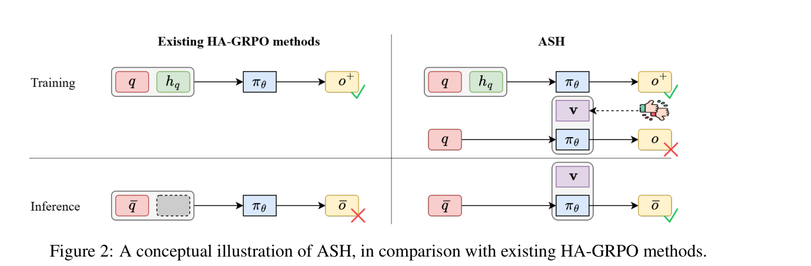

# Get Hint-Augmented GRPO Done Right Through Activation Steering

[简体中文](README.md)

<!-- source-sha256: 0c3c951817ec17351eaa32a8274b61ad0607f5dbbeaedd32ff25c2c6292f2319 -->

> **Review only; no local model implementation.** Full experiments are not reproduced due to high cost (review DONE). No automatic retries or Evolve promotion.

## Paper information

| Field | Value |
| --- | --- |
| Paper | [arXiv 2611.23124v1](https://arxiv.org/abs/2611.23124v1); [fixed v1](https://arxiv.org/html/2611.23124v1) |
| First author / institution | Khiem Le; University of Notre Dame |
| Original publication | 2026-11-17 17:43:28 UTC; original submission, not announcement/review date |
| Original source code | No verifiable method-source release found in fixed v1 or the bounded author entry points checked. Referenced trainers, models and libraries are not this paper's source release. |
| Local adapter / key | `ash-hint-steering`; `adapter: null` |
| Local code | None; no placeholder model |

## Original paper summary

### Background and defining changes

Training adds a hint from the first half of a reference solution and more easily obtains positive reward, but inference lacks it. ASH learns an injectable activation direction to recover a behavioral shift on plain inputs.

The steering loss must fit the model that generated the current hinted/plain samples. Updating the model first makes that relation stale. The final step updates steering only, avoiding a stale returned vector.

<!-- paper-figure:start -->
### Original paper figure

From [fixed v1](https://arxiv.org/pdf/2611.23124v1#page=5), PDF page 5. Copyright belongs to the original authors. The original panel and caption are preserved without scientific edits; source/crop/SHA are in [provenance](assets/provenance.json). Author results are not local measurements.

<!-- paper-figure:end -->

### Core equations

Read source locations: §4 Eq.4–5 and Algorithm1；§6 experimental settings.

$$
L(v)=-\frac1G\sum_i\log\sigma\{\beta[\log\pi_\theta^v(o_i^+|q)-\log\pi_\theta(o_i^+|q)-\log\pi_\theta^v(o_i|q)+\log\pi_\theta(o_i|q)]\}.
$$

### Paper results and production evidence

The authors report math and OOD pass@k on four 1B–4B models. Steering carries a behavioral shift into hint-free inference. The key assumption is transferable question-agnostic direction, not proof that all hint information becomes internal knowledge. No production A/B is reported.

## Cost decision and local status

### Data contract and code mapping

Review steering-before-GRPO order, separately normalized hint/plain advantages and final-step no-model-update rule; a DPO formula alone is not an implementation.

ASH requires trainable activation injection, two online rollout groups, steering-before-model co-training and hint-free inference. The full model matrix is high-cost; a formula or fixed vector cannot replace that core, review DONE.

### Results and limits

No local model run, checkpoint/data download, paid API call or invented metric file. Review DONE does not mean implementation completed.

### High-cost full experiment

Section 6 and Tables 4/5 state that all experiments use two NVIDIA A100 80GB GPUs and up to 4,096 response tokens. The campaign covers four 1B–4B policies, hinted/plain online groups, steering-then-GRPO every step and math/OOD pass@8 sweeps. The current short single-card budget does not cover that full campaign.

**The high-cost full experiment is not reproduced (review DONE).** This is a source-configuration assessment, not a local timing claim. Only declared tiny-operator checks are allowed; no large-model probe is run to prove cost. No capability comparison or Evolve integration is claimed.
