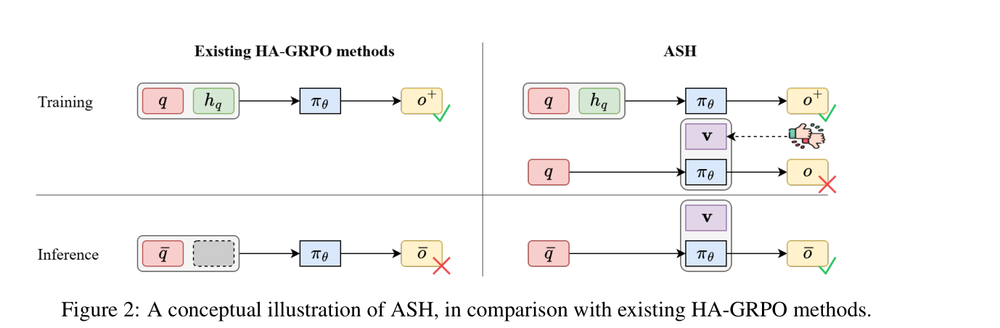
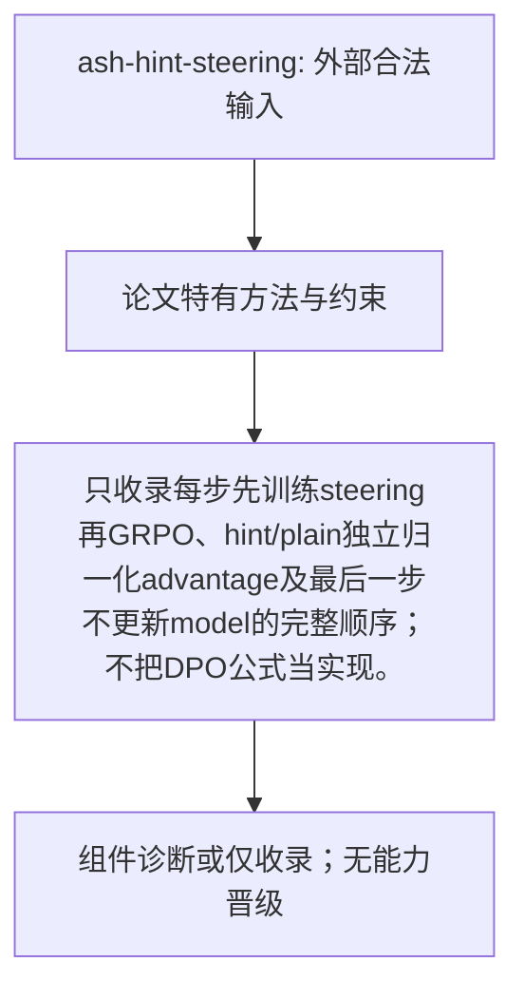

# Get Hint-Augmented GRPO Done Right Through Activation Steering

[English](README-en.md)

> **仅方法与成本收录，无本地模型实现。** 完整实验成本过高，不复现（审查 DONE）；不自动重试、不进入Evolve晋级。

## 论文信息

| 字段 | 内容 |
| --- | --- |
| 论文链接 | [arXiv 2611.23124v1](https://arxiv.org/abs/2611.23124v1)；[固定v1原文](https://arxiv.org/html/2611.23124v1) |
| 公司 / 作者机构 | 一作 **Khiem Le**：**University of Notre Dame**；不把所用Google/Meta模型当作者机构 |
| 首次公开日期 | **2026-11-17 17:43:28 UTC**，原始arXiv提交，不替换成公告或本次审查日期 |
| 原作者开源代码 | 固定v1及所核作者入口未找到可验证的本篇方法源码发布；引用的训练器、模型或库不算本篇开源。 |
| 本地 adapter / key | `ash-hint-steering`；`adapter: null` |
| 本地复现代码 | 无；完整实验不复现，不创建占位模型 |

## 原始论文总结

### 背景与主要改动

训练问题附带reference solution前半hint更易有正reward，但推理没有该hint。ASH学习可注入activation的行为方向，在无hint输入上重现部分偏移。

steering loss拟合产生当前hint/plain样本的同一模型。先改model再拟合会用stale对应关系；最后一步只更新steering不改model，避免返回过时向量。

<!-- paper-figure:start -->
### 原论文关键图

图片来自[原论文](https://arxiv.org/pdf/2611.23124v1#page=5)第5页，版权归原作者所有；完整保留图与原图注，未重绘/改数值。来源、裁剪与SHA见[provenance](assets/provenance.json)。图表中的结果属于作者，不是本地实验。

<!-- paper-figure:end -->

### 核心公式

固定v1位置：§4 Eq.4–5 and Algorithm1；§6 experimental settings。

$$
L(v)=-\frac1G\sum_i\log\sigma\{\beta[\log\pi_\theta^v(o_i^+|q)-\log\pi_\theta(o_i^+|q)-\log\pi_\theta^v(o_i|q)+\log\pi_\theta(o_i|q)]\}.
$$

### 论文离线与线上效果

作者在4个1B–4B模型上报告数学及OOD pass@k；steering在无hint推理时保留训练期行为偏移。核心假设是question-agnostic方向可迁移，并非证明所有hint信息被参数化。未报告生产线上A/B。

## 成本决策与本地状态

### 数据协议与代码映射

只收录每步先训练steering再GRPO、hint/plain独立归一化advantage及最后一步不更新model的完整顺序；不把DPO公式当实现。

ASH还要求可训练activation injection、双组在线rollout、先向量后模型两阶段和无hint推理。完整多模型训练矩阵高成本，不用公式或固定向量代替核心，审查DONE。

### 结果、负控与边界

没有本地模型运行、checkpoint下载、数据集下载、付费API调用或伪造metrics文件。保留未复现状态，不将审查DONE改称实现完成。

### 高成本完整实验

§6及Table4/5明确全部实验使用2张NVIDIA A100 80GB、最大响应4096token；涵盖四个1B/1.7B/3B/4B模型，每步hint与plain双组在线生成、先steering再GRPO，以及多个竞赛/OOD与pass@8矩阵。当前单卡短时预算不覆盖原文双卡完整campaign。

**完整实验成本过高，不复现（审查 DONE）**。成本依据来自原文配置而非本地测速；只在明确小算子预算内工作，不为证明高成本探跑大模型。单卡A100/A30或Mac不能替代论文完整多模型/多任务/专家与系统对照。
