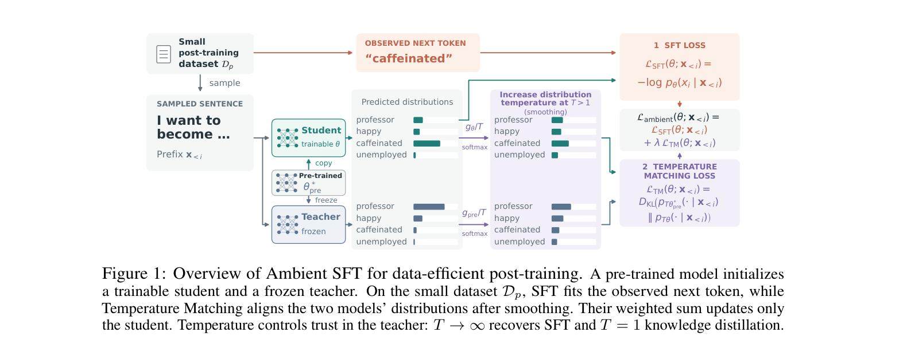

# Ambient LLMs: Data-Efficient Supervised Fine-tuning via Temperature Matching

[简体中文](README.md)

<!-- source-sha256: 122bffb005817572270b9840eef918640f086ca4a521a3714a47e7b3fe1aaa46 -->

> **l1_mechanism standalone component; diagnostic only.** Full experiments are not reproduced due to high cost (review DONE). No automatic retries or Evolve promotion.

## Paper information

| Field | Value |
| --- | --- |
| Paper | [arXiv 2611.23229v1](https://arxiv.org/abs/2611.23229v1); [fixed v1](https://arxiv.org/html/2611.23229v1) |
| First author / institution | Giannis Daras; Massachusetts Institute of Technology |
| Original publication | 2026-11-17 18:59:37 UTC; original submission, not announcement/review date |
| Original source code | No verifiable method-source release found in fixed v1 or the bounded author entry points checked. Referenced trainers, models and libraries are not this paper's source release. |
| Local adapter / key | `ambient-sft`; `adapter: null` |
| Local code | `src/auto_research/post_training/ambient_sft.py` |

## Original paper summary

### Background and defining changes

The aim is to retain a coarse distribution during small-data SFT, not copy every base-model detail. Temperature reduces trust in erroneous details while clean CE supplies the adaptation signal.

The source has no T-squared factor: KL vanishes as temperature grows, recovering SFT. Adding it changes that limit and the temperature-controlled bias–variance trade-off.

<!-- paper-figure:start -->
### Original paper figure

[](https://arxiv.org/pdf/2611.23229v1#page=2)

From [fixed v1](https://arxiv.org/pdf/2611.23229v1#page=2), PDF page 2. Copyright belongs to the original authors. The original panel and caption are preserved without scientific edits; source/crop/SHA are in [provenance](assets/provenance.json). Author results are not local measurements.

<!-- paper-figure:end -->

### Core equations

Read source locations: §3.1 Eq.4 and practical implementation；§4 Tables2–5.

$$
L=\operatorname{CE}(y,p_\theta)+\lambda D_{KL}(\operatorname{softmax}(z_0/T)\Vert\operatorname{softmax}(z_\theta/T)),\quad \lambda=(1-p_c)/p_c.
$$

### Paper results and production evidence

The authors compare a frozen base, vanilla SFT and temperature matching across domain adaptation, instruction tuning and reasoning. The Qwen3 1.7B–14B matrix reports average relative gains, but the temperature depends on task and data; the largest reported gain is not a universal guarantee. No production A/B is reported.

## Local component

### Data contract and code mapping

Exact CE and same-position tempered forward KL, frozen teacher and stochastic clean/matching branches; no T-squared multiplier.

No. They execute the exact loss, frozen-teacher and masked-gradient controls, without checkpoint adaptation or capability scores. The stochastic objective equals p_c times the stated objective in expectation, so learning-rate comparisons must disclose that overall scale.

```bash
PYTHONPATH=src python -c 'from auto_research.post_training.ambient_sft import diagnostic; print(diagnostic(42, device="cpu"))'
PYTHONPATH=src python -m pytest -q tests/post_training/test_nov18_latest_post_components.py
```

### Results, negative controls and limits

CPU seeds 42/43/44 were executed. [Metrics](metrics/component-cpu-seeds42-44.json) contain operator/control results, not task-success rates. A real A100/A30 receipt must pass the batch GPU gate before CUDA validation is claimed.

teacher_frozen, exact_unscaled_combination, masked_tokens_have_zero_gradient, high_temperature_recovers_sft, stochastic_branch_boundary.

### High-cost full experiment

The original configuration is recorded verbatim with source locations in the cost assessment. It involves Qwen3 1.7B–14B plus OLMo/Llama, multiple domains/temperature baselines and a frozen teacher forward.

**The high-cost full experiment is not reproduced (review DONE).** This is a source-configuration assessment, not a local timing claim. Only declared tiny-operator checks are allowed; no large-model probe is run to prove cost. No capability comparison or Evolve integration is claimed.
