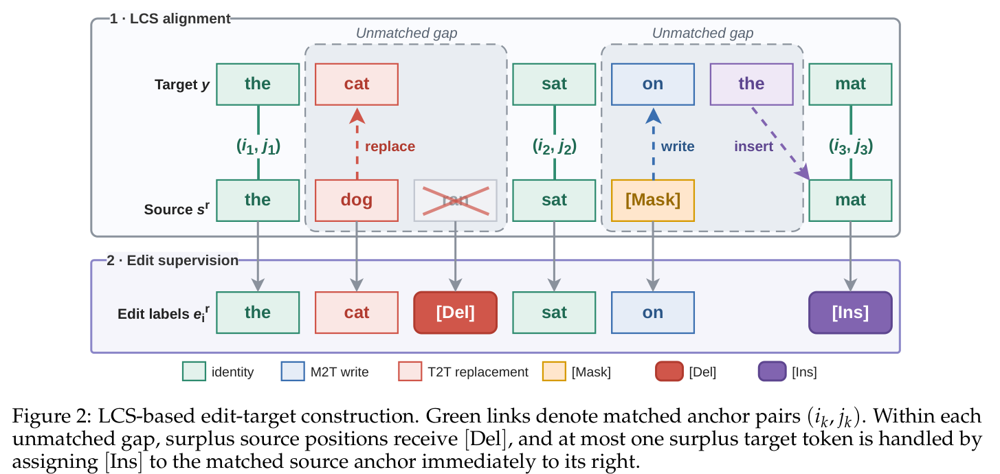

# Beyond Replacement: Levenshtein Editing for Diffusion Language Models

<!-- source-sha256: 25308054942444e05c5b053eb640c50cdec6d9639a26429efd15be4fb27ee02c -->

[简体中文](README.md)

> **Independent L1 mechanism component, diagnostic only.** The high-cost full experiment is not reproduced (review DONE), with no automatic retry or Evolve promotion.

## Paper information

| Field | Content |
| --- | --- |
| Paper link | [arXiv 2611.23750v1](https://arxiv.org/abs/2611.23750v1); [fixed v1](https://arxiv.org/html/2611.23750v1) |
| Company / author institution | First author **Shuaidi Wang**: **Southern University of Science and Technology / Inclusion AI, Ant Group**, verified from the fixed-v1 byline rather than cited model names |
| Original publication date | **2026-11-18T03:05:15Z** (UTC original submission); the November19 announcement/review is not the publication date |
| Original source code | No verifiable method-source release found in fixed v1 or the bounded author entry points checked. Referenced models and trainers are not this paper's source release. |
| Local adapter / key | `led-edits`; `adapter: null` |
| Local reproduction code | `src/auto_research/post_training/led_edits.py` |

## Original paper summary

### Background and main changes

Replacement-only editing repairs a missing or extra token inefficiently because the suffix becomes misaligned. LED adds [Ins]/[Del] to the output vocabulary but excludes them from input: deletion removes the current token; insertion places a fresh [Mask] before it while retaining the anchor token. The result is truncated or right-padded to fixed block length B.

Training targets are reconstructed by longest-common-subsequence alignment of the current source and clean target. Within each anchor gap, ordered pairs receive replacement targets, surplus source positions receive Del, and surplus target positions assign one Ins to the right matched anchor only for nonfinal gaps. Each gap emits at most one insertion per round. The full method also feeds predictions across training stages and adds a final editing-only stage; local code implements labels, selection and single-round transitions, not a diffusion trainer.

### Key original figure

[](https://arxiv.org/pdf/2611.23750v1#page=4)

Original figure and full caption from [fixed-v1 PDF page4](https://arxiv.org/pdf/2611.23750v1#page=4); copyright belongs to the original authors. No scientific content was redrawn or changed. Crop and hashes: [provenance](assets/provenance.json). Author results are not local experiments.

### Core formula

Source locations: §4.1–4.4; Appendix D Algorithms1–4; Appendix A scale.

$$
\pi^*=\operatorname{LCS}(s,y),\quad \ell_k=\min(|I_k|,|J_k|),\quad e_{I_k[p]}=\begin{cases}y_{J_k[p]},&p\le\ell_k,\\[Del],&p>\ell_k.\end{cases}\quad |J_k|>\ell_k,\ k<K\Rightarrow e_{i_{k+1}}=[Ins].
$$

### Paper results and online evidence

On 16B LLaDA2.1-Mini Base, the paper reports twelve-benchmark means of54.86 to57.10 under confidence-guided decoding, tokens per forward6.14 to7.05, and27.52 to47.19 under confidence-free decoding. These are fully trained author-model results, not conclusions from the local two-round LCS example. No production online A/B is reported.

### Relation to existing methods

ORL learns on model-induced residual states and requires its own inference chain. LED changes discrete length alignment and edit supervision using LCS targets. Both address training/inference state mismatch, but residual distributions are not edit actions, and their separate local boundaries do not combine into a complete model.

## Local reproduction

### Data protocol and code mapping

Fixed-block LCS edit targets, one Ins per gap, no fictitious terminal anchor, mask-threshold fallback, visible-token edit threshold and simultaneous edits followed by truncation/padding. No diffusion forward pass, multi-stage SFT or cycle-resampling decoder.

```bash
PYTHONPATH=src python -c 'from auto_research.post_training.led_edits import diagnostic; print(diagnostic(42))'
PYTHONPATH=src python -m pytest -q tests/post_training/test_nov19_post_components.py
```

### Results, negative controls and limits

Independent CPU seeds42/43/44 were executed: [metrics](../../research-audits/nov19-latest/independent-cpu-runs/led-edits.json). These test formulas, boundaries and negative controls, not capability or ranking performance.

This is a CPU scalar/sequence algorithm without an advertised CUDA path; GPU testing would not turn it into a model experiment.

No. The program executes deterministic LCS and edit transitions, with a clean target only for label construction. It has no model prediction, diffusion SFT, multi-stage training or benchmark answer generation, so it is an L1 mechanism diagnostic.

### High-cost full experiment

Appendix A uses 16B LLaDA2.1-Mini Base,745k examples,1.6B tokens per epoch for10 epochs,16k sequences and four-stage training, plus twelve benchmarks and extensive pass@k. About16B training tokens with multi-stage forwards are high cost for one A100/A30 or Mac; no download or probe is launched.

**High cost: not reproduced (review DONE).** Resource and timing statements come from the paper, not local measurements. No checkpoint/data download, full-experiment probe or automatic retry is performed. The budget is one A100 or A30, or a Mac; multiple GPUs or simultaneous hosts are not assumed.
