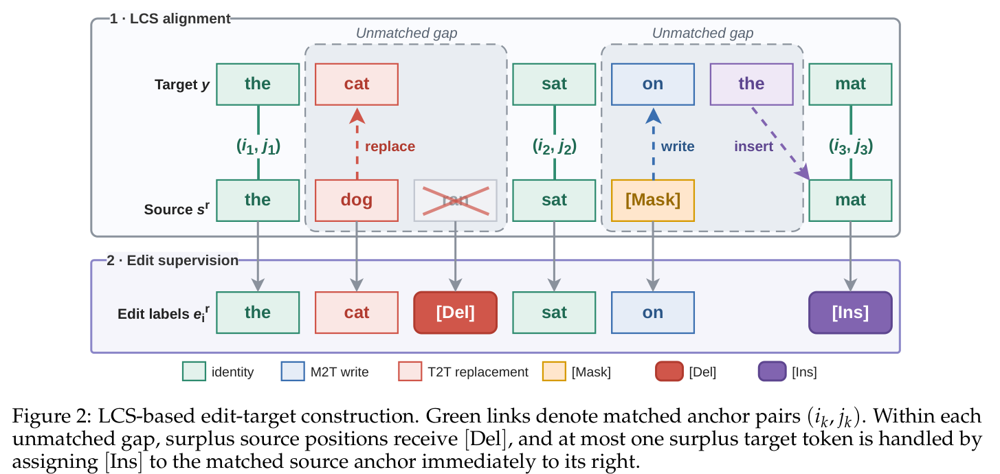

# Beyond Replacement: Levenshtein Editing for Diffusion Language Models

[English](README-en.md)

> **L1独立机制组件，diagnostic only。** 完整实验成本过高，不复现（审查 DONE）；不自动重试、不进入Evolve晋级。

## 论文信息

| 字段 | 内容 |
| --- | --- |
| 论文链接 | [arXiv 2611.23750v1](https://arxiv.org/abs/2611.23750v1)；[固定v1原文](https://arxiv.org/html/2611.23750v1) |
| 公司 / 作者机构 | 一作 **Shuaidi Wang**：**Southern University of Science and Technology / Inclusion AI, Ant Group**；由固定v1作者栏核对，不把引用模型当机构 |
| 首次公开日期 | **2026-11-18T03:05:15Z**（UTC，原始提交）；11月19日公告与本次审查不是首发日期 |
| 原作者开源代码 | 固定v1及所核作者入口未找到可验证的本篇方法源码发布；所用模型、训练库不算本篇开源。 |
| 本地 adapter / key | `led-edits`；`adapter: null` |
| 本地复现代码 | `src/auto_research/post_training/led_edits.py` |

## 原始论文总结

### 背景与主要改动

仅允许token替换时，一个遗漏或多余token会让整段后缀错位，需要许多位置分别修复。LED把[Ins]/[Del]加入输出词表、排除在输入词表外：删除当前token，或在其前插入新[Mask]，同时保留该锚点token。每轮之后截成固定B长或右侧补mask。

训练监督由当前source和clean target的最长公共子序列重建。匹配锚点之间先按顺序配对替换、多余source标Del；多余target只在非末尾gap的右匹配锚点标一个Ins，每gap每轮最多一个。论文还让多阶段输入接收此前预测并加入最终editing-only阶段；本地仅实现标签/选择/单轮变换，不伪装完整扩散训练。

<!-- paper-figure:start -->
### 原论文关键图

[](https://arxiv.org/pdf/2611.23750v1#page=4)

图片来自[原论文](https://arxiv.org/pdf/2611.23750v1#page=4)第4页，版权归原作者所有；保留完整图与原图注，未重绘或修改科学内容。裁剪与SHA见[provenance](assets/provenance.json)。图中的结果属于作者，不是本地实验。
<!-- paper-figure:end -->


### 核心公式

固定v1位置：§4.1–4.4；Appendix D Algorithms1–4；Appendix A scale。

$$
\pi^*=\operatorname{LCS}(s,y),\quad \ell_k=\min(|I_k|,|J_k|),\quad e_{I_k[p]}=\begin{cases}y_{J_k[p]},&p\le\ell_k,\\ \mathrm{[Del]},&p>\ell_k.\end{cases}\quad |J_k|>\ell_k,\ k<K\Rightarrow e_{i_{k+1}}=\mathrm{[Ins]}.
$$

### 论文离线与线上效果

在16B LLaDA2.1-Mini Base上，作者报告十二基准平均分：confidence-guided从54.86到57.10，tokens/forward从6.14到7.05；confidence-free从27.52到47.19。它们属于完整训练后的作者模型，不能从本地LCS两轮例子推出。未报告生产线上A/B。

### 与已有方法的关系

ORL让扩散模型在自身诱导的残差状态上学习并需专用推理链；LED改变离散序列的长度对齐与edit监督，插删由LCS提供标签。二者都处理训练/推理状态差异，但残差分布不等于编辑动作，两个review边界也不能互相补成完整模型。

## 本地复现

### 数据协议与代码映射

最长公共子序列的固定block edit标签、每gap单次Ins、末尾gap不造锚点、mask阈值fallback、visible-token edit阈值以及同时编辑后截断/补mask。没有扩散模型forward、多阶段SFT或循环重采样decoder。

```bash
PYTHONPATH=src python -c 'from auto_research.post_training.led_edits import diagnostic; print(diagnostic(42))'
PYTHONPATH=src python -m pytest -q tests/post_training/test_nov19_post_components.py
```

### 结果、负控与边界

已独立执行CPU seeds42/43/44：[指标](../../research-audits/nov19-latest/independent-cpu-runs/led-edits.json)。本地指标只检验公式、边界与负控，不是能力或排序效果。

此项仅CPU标量/序列算法，无CUDA广告路径，不需要以GPU测试冒充模型实验。

不是。当前程序真实执行确定性LCS与单轮编辑，gold target只用于监督标签构造；没有模型预测、扩散SFT、多阶段训练或基准答案生成，因此只属L1机制诊断。

### 高成本完整实验

Appendix A为16B LLaDA2.1-Mini Base、745k样本、每epoch1.6B token、10epoch、16k序列，4stage训练并测试十二基准及大规模pass@k。完整实验约16B训练token及多阶段模型前向，单A100/A30或Mac高成本，不下载或探跑。

**成本过高，不复现（审查 DONE）**。上述规模与时间依据来自原文，不是本地测速；不下载checkpoint/数据，不探跑完整实验，不加入自动重试队列。可用预算为单张A100或A30、或Mac，不假设多卡或两台同时使用。
