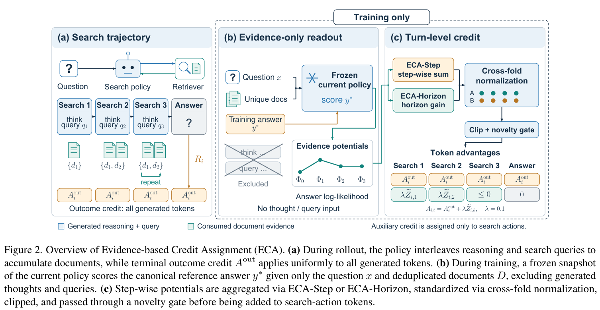

# Evidence-Based Credit Assignment for Search-Augmented Language Models

<!-- source-sha256: 25167093ccd4a0b569f3149946478ac17a51c59bb7c792588ef6fd482404a031 -->

[简体中文](README.md)

> **Independent L1 mechanism component, diagnostic only.** The high-cost full experiment is not reproduced (review DONE), with no automatic retry or Evolve promotion.

## Paper information

| Field | Content |
| --- | --- |
| Paper link | [arXiv 2611.23824v1](https://arxiv.org/abs/2611.23824v1); [fixed v1](https://arxiv.org/html/2611.23824v1) |
| Company / author institution | First author **Wen Wang**: **University of the Chinese Academy of Sciences / Tencent**, verified from the fixed-v1 byline rather than cited model names |
| Original publication date | **2026-11-18T04:24:51Z** (UTC original submission); the November19 announcement/review is not the publication date |
| Original source code | No verifiable method-source release found in fixed v1 or the bounded author entry points checked. Referenced models and trainers are not this paper's source release. |
| Local adapter / key | `eca-credit`; `adapter: null` |
| Local reproduction code | `src/auto_research/post_training/eca_credit.py` |

## Original paper summary

### Background and main changes

When every final answer is wrong, group-relative outcome rewards vanish even if some searches found useful evidence. ECA uses a frozen training-only policy to score the length-normalized likelihood of a reference answer from the question and deduplicated documents alone, excluding generated thoughts, queries and sibling trajectories.

ECA-Horizon preserves the total potential gain over the remaining fixed search horizon. ECA-Step clips each increment first and can break telescoping. Eight trajectories are randomly divided into two four-trajectory folds; each trajectory is standardized against the opposite fold's sample standard deviation. Repeated evidence cannot receive positive auxiliary credit. The residual applies only to the corresponding search's reasoning and query tokens, not observations or final answers.

### Key original figure

[](https://arxiv.org/pdf/2611.23824v1#page=4)

Original figure and full caption from [fixed-v1 PDF page4](https://arxiv.org/pdf/2611.23824v1#page=4); copyright belongs to the original authors. No scientific content was redrawn or changed. Crop and hashes: [provenance](assets/provenance.json). Author results are not local experiments.

### Core formula

Source locations: PDF p1 author superscripts; §3 Eq.2–9; §4 training and evaluation.

$$
U^H_{i,k}=\frac{\Phi(D_{i,3})-\Phi(D_{i,k-1})}{2\cdot3},\quad Z_{i,k}=\operatorname{clip}\!\left(\frac{U_{i,k}-\mu_{-f(i),k}}{\max(s_{-f(i),k},0.25)},-2,2\right),\quad A_{i,t}=A_i^{out}+0.1\sum_k M_{i,k,t}\widetilde Z_{i,k}.
$$

### Paper results and online evidence

Across seven Search QA benchmarks, the paper reports strict macro-EM gains of 1.03/4.80 percentage points over outcome-only GRPO for 3B/7B, plus separate MultiHop-RAG transfer. Checkpoints are selected only on an independent 1,024-question development set, not the seven test sets. No production online A/B is reported. These are author-model results, not local operator metrics.

### Relation to existing methods

OpCredit combines reused branch-outcome credit with answer-neighborhood frontier credit for KG operations. ECA uses a frozen model's answer likelihood from retrieved text as its potential. Both align training credit to operation spans, but their states and potentials are not interchangeable, and neither permits training gold in the actor.

## Local reproduction

### Data protocol and code mapping

Fixed G=8/H=3 suffix-potential returns, opposite-fold sample standard deviation with a 0.25 floor, novelty gating, search-local token advantages and the unclipped sequence-sum policy loss. No scorer checkpoint, retriever or full LLM trainer is implemented.

```bash
PYTHONPATH=src python -c 'from auto_research.post_training.eca_credit import diagnostic; print(diagnostic(42))'
PYTHONPATH=src python -m pytest -q tests/post_training/test_nov19_post_components.py
```

### Results, negative controls and limits

Independent CPU seeds42/43/44 were executed: [metrics](../../research-audits/nov19-latest/independent-cpu-runs/eca-credit.json). These test formulas, boundaries and negative controls, not capability or ranking performance.

The CUDA path requires this batch's actual frozen-source A100/A30 receipt; GPU acceptance is not claimed before that receipt exists.

No. It accepts external training-potential values, rewards and span masks, not answer text, and implements no evaluated agent. Reference answers belong only to an isolated training scorer; inference actors see legitimate questions, history and observations.

### High-cost full experiment

Section4 uses Qwen2.5-3B/7B, 8,192 training questions and 256 updates of 256 trajectories (65,536 per run), Wikipedia18/E5 retrieval, 51,713 test questions across seven suites, multiple methods and transfer tests. This full training/retrieval campaign exceeds the single-device, seconds-scale component budget.

**High cost: not reproduced (review DONE).** Resource and timing statements come from the paper, not local measurements. No checkpoint/data download, full-experiment probe or automatic retry is performed. The budget is one A100 or A30, or a Mac; multiple GPUs or simultaneous hosts are not assumed.
