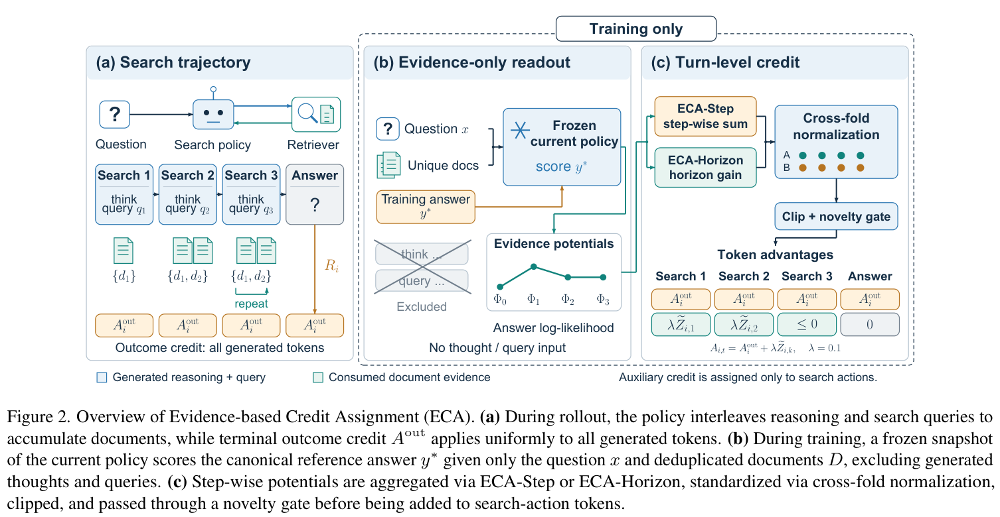

# Evidence-Based Credit Assignment for Search-Augmented Language Models

[English](README-en.md)

> **L1独立机制组件，diagnostic only。** 完整实验成本过高，不复现（审查 DONE）；不自动重试、不进入Evolve晋级。

## 论文信息

| 字段 | 内容 |
| --- | --- |
| 论文链接 | [arXiv 2611.23824v1](https://arxiv.org/abs/2611.23824v1)；[固定v1原文](https://arxiv.org/html/2611.23824v1) |
| 公司 / 作者机构 | 一作 **Wen Wang**：**University of the Chinese Academy of Sciences / Tencent**；由固定v1作者栏核对，不把引用模型当机构 |
| 首次公开日期 | **2026-11-18T04:24:51Z**（UTC，原始提交）；11月19日公告与本次审查不是首发日期 |
| 原作者开源代码 | 固定v1及所核作者入口未找到可验证的本篇方法源码发布；所用模型、训练库不算本篇开源。 |
| 本地 adapter / key | `eca-credit`；`adapter: null` |
| 本地复现代码 | `src/auto_research/post_training/eca_credit.py` |

## 原始论文总结

### 背景与主要改动

终止答案全错时，组相对奖励为零，但检索可能已经取得有价值证据。ECA用训练专用冻结策略在仅含问题与去重文档的上下文中，计算参考答案的长度归一化对数似然势函数；生成的思考、查询和其他轨迹不参与打分。

ECA-Horizon保留剩余固定搜索窗口的总势差；ECA-Step先逐增量截断，可能破坏望远镜求和。原文将8条轨迹随机分成两个4条fold，以对侧fold的样本标准差做归一化；无新文档的搜索只能保留负信用。辅助项只分配到该次搜索的思考与查询token，不分配到检索观察或最终答案。

<!-- paper-figure:start -->
### 原论文关键图

[](https://arxiv.org/pdf/2611.23824v1#page=4)

图片来自[原论文](https://arxiv.org/pdf/2611.23824v1#page=4)第4页，版权归原作者所有；保留完整图与原图注，未重绘或修改科学内容。裁剪与SHA见[provenance](assets/provenance.json)。图中的结果属于作者，不是本地实验。
<!-- paper-figure:end -->


### 核心公式

固定v1位置：PDF p1 author superscripts；§3 Eq.2–9；§4 training and evaluation。

$$
U^H_{i,k}=\frac{\Phi(D_{i,3})-\Phi(D_{i,k-1})}{2\cdot3},\quad Z_{i,k}=\operatorname{clip}\!\left(\frac{U_{i,k}-\mu_{-f(i),k}}{\max(s_{-f(i),k},0.25)},-2,2\right),\quad A_{i,t}=A_i^{out}+0.1\sum_k M_{i,k,t}\widetilde Z_{i,k}.
$$

### 论文离线与线上效果

原文七项Search QA的strict macro EM相对outcome-only GRPO在3B/7B上分别提高1.03/4.80个百分点，并另测MultiHop-RAG迁移。选择仅用独立1024题dev集，不能用七项测试集挑checkpoint。未报告生产线上A/B；这些是作者模型结果，不是本地算子指标。

### 与已有方法的关系

OpCredit在KG操作上组合复用分支结果的BOC与答案邻域的FTC；ECA在文本检索中用冻结模型对证据的答案似然做势函数。二者都把训练信用对齐到操作span，但不能互换状态定义、势函数或把训练gold放进Actor。

## 本地复现

### 数据协议与代码映射

固定G=8、H=3的势函数suffix return、对侧fold样本标准差/0.25 floor、novelty gate、search-local token advantage及无ratio clip的序列求和策略损失。冻结scorer打分、检索器和完整LLM训练未实现。

```bash
PYTHONPATH=src python -c 'from auto_research.post_training.eca_credit import diagnostic; print(diagnostic(42))'
PYTHONPATH=src python -m pytest -q tests/post_training/test_nov19_post_components.py
```

### 结果、负控与边界

已独立执行CPU seeds42/43/44：[指标](../../research-audits/nov19-latest/independent-cpu-runs/eca-credit.json)。本地指标只检验公式、边界与负控，不是能力或排序效果。

CUDA路径须由本轮真实A100/A30冻结源码回执验收；统一回执未完成前不称GPU已通过。

不会。组件只接收外部训练势函数数值、奖励和span mask，不实现或评测Agent，也不接收答案文本。参考答案只应供独立训练scorer；推理Actor只能看合法问题、自身历史和观察。

### 高成本完整实验

§4使用Qwen2.5-3B/7B、8192训练题、256更新×256轨迹=65536条轨迹/运行；Wikipedia18/E5检索服务、七测试集51713题、多方法与迁移对照。完整训练/检索评测超出本轮单卡秒级组件预算。

**成本过高，不复现（审查 DONE）**。上述规模与时间依据来自原文，不是本地测速；不下载checkpoint/数据，不探跑完整实验，不加入自动重试队列。可用预算为单张A100或A30、或Mac，不假设多卡或两台同时使用。
