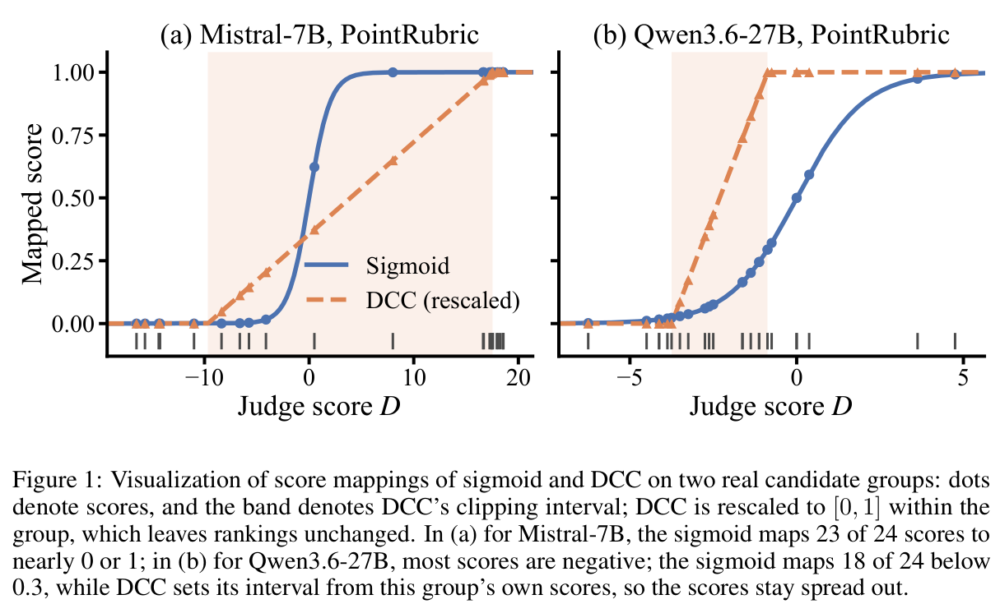

# How Reward Gain Imbalance Shapes Ranking: Rethinking Rubric-Based Reward Aggregation

<!-- source-sha256: c282369a45c9a59d57f58f3aa6bfc70ff414371a1dafca2015738f6608192778 -->

[简体中文](README.md)

> **Independent L1 mechanism component, diagnostic only.** The high-cost full experiment is not reproduced (review DONE), with no automatic retry or Evolve promotion.

## Paper information

| Field | Content |
| --- | --- |
| Paper link | [arXiv 2611.24005v1](https://arxiv.org/abs/2611.24005v1); [fixed v1](https://arxiv.org/html/2611.24005v1) |
| Company / author institution | First author **Zhengyuan Fan**: **Northwestern Polytechnical University**, verified from the fixed-v1 byline rather than cited model names |
| Original publication date | **2026-11-18T07:56:58Z** (UTC original submission); the November19 announcement/review is not the publication date |
| Original source code | No verifiable method-source release found in fixed v1 or the bounded author entry points checked. Referenced models and trainers are not this paper's source release. |
| Local adapter / key | `dcc-aggregation`; `adapter: null` |
| Local reproduction code | `src/auto_research/post_training/dcc_aggregation.py` |

## Original paper summary

### Background and main changes

Equal rubric weights do not imply equal contributions: each criterion's mean satisfied-versus-unsatisfied score gap is its reward gain. The paper decomposes pairwise reward differences into a base satisfaction signal, gain imbalance and residuals. Equalizing every gain to one can amplify noise in small-gain criteria.

DCC neither retrains the judge nor learns rubric weights. It pools all candidate-by-criterion scores for one prompt, fits exact one-dimensional two-medians by minimum absolute deviation and uses the two centers as a shared clipping interval, selecting the smallest split on ties. Scores are clipped before optional criterion-weighted averaging; weights do not influence the center fit.

### Key original figure

[](https://arxiv.org/pdf/2611.24005v1#page=7)

Original figure and full caption from [fixed-v1 PDF page7](https://arxiv.org/pdf/2611.24005v1#page=7); copyright belongs to the original authors. No scientific content was redrawn or changed. Crop and hashes: [provenance](assets/provenance.json). Author results are not local experiments.

### Core formula

Source locations: §3 Eq.1–7 reward decomposition; §4 Eq.8–13; Appendix C GRPO configuration.

$$
s^*=\arg\min_s\!\left[\sum_{m\le s}|d_{(m)}-\operatorname{median}(d_{(1:s)})|+\sum_{m>s}|d_{(m)}-\operatorname{median}(d_{(s+1:NK)})|\right],\quad R_i=\frac{\sum_k w_k\operatorname{clip}(d_{ik},c_-,c_+)}{\sum_k w_k}.
$$

### Paper results and online evidence

The authors compare aggregation on PointRubric, RubricHub-6 and WritingBench GRPO, reporting stronger ranking metrics and writing evaluation under the tested settings. The non-expansive bound does not guarantee improved rankings on arbitrary data: an isolated extreme can itself form the high-score cluster. No production online A/B is reported.

### Relation to existing methods

DynamicRubric changes evaluation criteria and weights while co-evolving with the policy. DCC treats rubric, judge and weights as given, fitting shared clipping endpoints from the current group's numeric scores. They address different levels—evaluator adaptation versus score-scale effects—and an aggregator is not a dynamic judge.

## Local reproduction

### Data protocol and code mapping

CPU exact 1D two-medians, shared clipping, constant-score degeneracy, smallest-split tie breaking and optional weighted reduction. It consumes existing legitimate judge scores, without calling or simulating a judge or training GRPO.

```bash
PYTHONPATH=src python -c 'from auto_research.post_training.dcc_aggregation import diagnostic; print(diagnostic(42))'
PYTHONPATH=src python -m pytest -q tests/post_training/test_nov19_post_components.py
```

### Results, negative controls and limits

Independent CPU seeds42/43/44 were executed: [metrics](../../research-audits/nov19-latest/independent-cpu-runs/dcc-aggregation.json). These test formulas, boundaries and negative controls, not capability or ranking performance.

This is a CPU scalar/sequence algorithm without an advertised CUDA path; GPU testing would not turn it into a model experiment.

Two-medians can isolate an extreme in its own cluster, making that value the upper endpoint. DCC offers a conditional contribution bound, not universal outlier removal or capability improvement.

### High-cost full experiment

Appendix C uses three 96GB RTX PRO6000 GPUs per GRPO run (two policy/rollout, one judge), a 7B policy and 27B judge, eight responses per prompt, three seeds and multiple aggregation controls. Full judge inference and RL are not run; scalar aggregation requires no GPU.

**High cost: not reproduced (review DONE).** Resource and timing statements come from the paper, not local measurements. No checkpoint/data download, full-experiment probe or automatic retry is performed. The budget is one A100 or A30, or a Mac; multiple GPUs or simultaneous hosts are not assumed.
