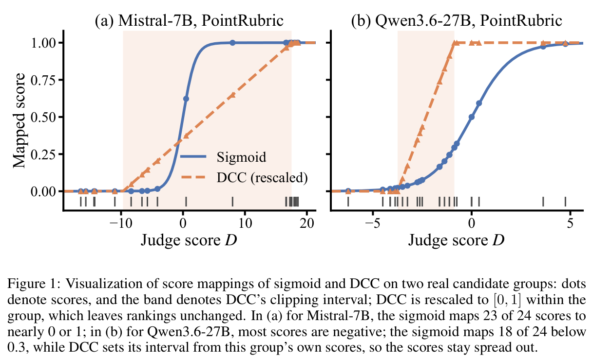

# How Reward Gain Imbalance Shapes Ranking: Rethinking Rubric-Based Reward Aggregation

[English](README-en.md)

> **L1独立机制组件，diagnostic only。** 完整实验成本过高，不复现（审查 DONE）；不自动重试、不进入Evolve晋级。

## 论文信息

| 字段 | 内容 |
| --- | --- |
| 论文链接 | [arXiv 2611.24005v1](https://arxiv.org/abs/2611.24005v1)；[固定v1原文](https://arxiv.org/html/2611.24005v1) |
| 公司 / 作者机构 | 一作 **Zhengyuan Fan**：**Northwestern Polytechnical University**；由固定v1作者栏核对，不把引用模型当机构 |
| 首次公开日期 | **2026-11-18T07:56:58Z**（UTC，原始提交）；11月19日公告与本次审查不是首发日期 |
| 原作者开源代码 | 固定v1及所核作者入口未找到可验证的本篇方法源码发布；所用模型、训练库不算本篇开源。 |
| 本地 adapter / key | `dcc-aggregation`；`adapter: null` |
| 本地复现代码 | `src/auto_research/post_training/dcc_aggregation.py` |

## 原始论文总结

### 背景与主要改动

等权rubric相加并不代表各维贡献相等：每维满足/不满足样本的平均分差形成reward gain。论文把候选奖励差精确拆成基础满足数量信号、gain imbalance项和残差；把gain全部归一成1反而可能放大小gain维度的噪声。

DCC不重新训练judge，也不学习rubric权重。它把当前prompt全部候选×标准的分数放在一起，精确扫描一维双median分簇，用最小绝对偏差确定两个公共clip端点；同成本取最小split。最后在公共区间clip，再按可选标准权重求平均；权重不参与端点拟合。

<!-- paper-figure:start -->
### 原论文关键图

[](https://arxiv.org/pdf/2611.24005v1#page=7)

图片来自[原论文](https://arxiv.org/pdf/2611.24005v1#page=7)第7页，版权归原作者所有；保留完整图与原图注，未重绘或修改科学内容。裁剪与SHA见[provenance](assets/provenance.json)。图中的结果属于作者，不是本地实验。
<!-- paper-figure:end -->


### 核心公式

固定v1位置：§3 Eq.1–7 reward decomposition；§4 Eq.8–13；Appendix C GRPO configuration。

$$
s^*=\arg\min_s\!\left[\sum_{m\le s}|d_{(m)}-\operatorname{median}(d_{(1:s)})|+\sum_{m>s}|d_{(m)}-\operatorname{median}(d_{(s+1:NK)})|\right],\quad R_i=\frac{\sum_k w_k\operatorname{clip}(d_{ik},c_-,c_+)}{\sum_k w_k}.
$$

### 论文离线与线上效果

作者在PointRubric、RubricHub-6及WritingBench的GRPO实验比较不同聚合，报告DCC在所比较配置上的排序指标和写作评估更好。公共区间非扩张界不保证任意数据排序都改善，特别是孤立极端分数可能自行形成高分簇。未报告生产线上A/B。

### 与已有方法的关系

DynamicRubric改变评估维度和权重，并与policy共进化；DCC把rubric、judge和权重视为给定，仅根据当前候选组数值拟合共享clip端点。二者解决评估器适应与分数量纲影响两个不同层次，不可把聚合核当动态judge。

## 本地复现

### 数据协议与代码映射

CPU精确1D two-medians、共享clip区间、相同分数退化、最小split tie-break与可选权重归约。只处理已存在的合法judge分数，不调用或伪造judge，也不训练GRPO。

```bash
PYTHONPATH=src python -c 'from auto_research.post_training.dcc_aggregation import diagnostic; print(diagnostic(42))'
PYTHONPATH=src python -m pytest -q tests/post_training/test_nov19_post_components.py
```

### 结果、负控与边界

已独立执行CPU seeds42/43/44：[指标](../../research-audits/nov19-latest/independent-cpu-runs/dcc-aggregation.json)。本地指标只检验公式、边界与负控，不是能力或排序效果。

此项仅CPU标量/序列算法，无CUDA广告路径，不需要以GPU测试冒充模型实验。

two-medians可让孤立极端值自成一簇，因此共享区间上界就等于该极值。DCC提供条件性的贡献上界，不是保证移除所有outlier或提高任务能力。

### 高成本完整实验

Appendix C每个GRPO运行用3张96GB RTX PRO 6000（两张policy/rollout、一张judge），7B policy、27B judge，8响应/题，三seed和多聚合对照。完整judge推理与RL矩阵不运行；纯标量聚合无需GPU。

**成本过高，不复现（审查 DONE）**。上述规模与时间依据来自原文，不是本地测速；不下载checkpoint/数据，不探跑完整实验，不加入自动重试队列。可用预算为单张A100或A30、或Mac，不假设多卡或两台同时使用。
