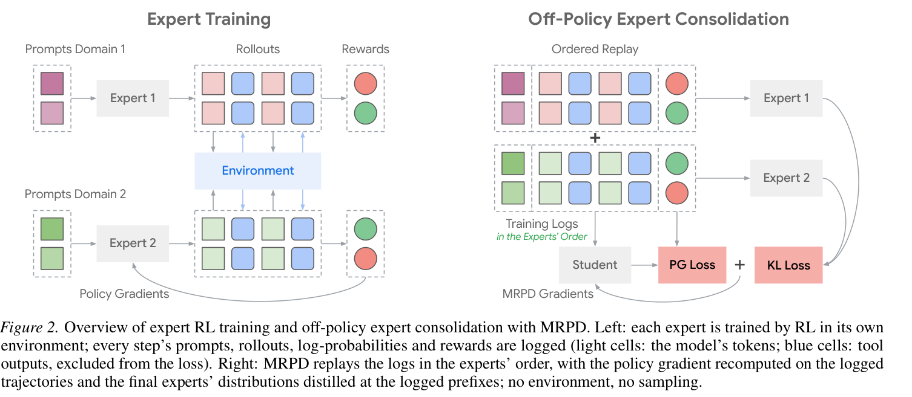

# Replay, Don't Resample: Off-Policy Consolidation of Long-Horizon RL Experts

<!-- source-sha256: d6fd4cb967ed5da07b26e1a2be058067588d926517ce97f941f0f4880df8901e -->

[简体中文](README.md)

> **Independent L1 mechanism component, diagnostic only.** The high-cost full experiment is not reproduced (review DONE), with no automatic retry or Evolve promotion.

## Paper information

| Field | Content |
| --- | --- |
| Paper link | [arXiv 2611.24059v1](https://arxiv.org/abs/2611.24059v1); [fixed v1](https://arxiv.org/html/2611.24059v1) |
| Company / author institution | First author **Zhenrui Yue**: **University of Illinois Urbana-Champaign**, verified from the fixed-v1 byline rather than cited model names |
| Original publication date | **2026-11-18T08:51:39Z** (UTC original submission); the November19 announcement/review is not the publication date |
| Original source code | The paper supplies an [author repository URL](https://github.com/Yueeeeeeee/MRPD), but the official GitHub API returned404 in this review. No accessible method source, licence or fixed commit was verified; a validated open-source release is not claimed. |
| Local adapter / key | `mrpd-replay`; `adapter: null` |
| Local reproduction code | `src/auto_research/post_training/mrpd_replay.py` |

## Original paper summary

### Background and main changes

MRPD treats expert RL logs as a step-indexed curriculum, not a shuffled offline mixture. Student and experts share an SFT initialization. At step k, the student combines each domain's step-k log, uses the logging policy's probabilities in importance ratios and recomputes the asymmetric clipped group-relative policy gradient.

Final domain experts supply distributions only at logged prefixes; no new rollout or environment call is required. The default dense term forms teacher top-256 atoms plus the remaining-mass tail and computes reverse KL from student to teacher. It enters the loss directly, not the advantage or PG ratio clip. Model tokens are averaged within each response, then responses are averaged.

### Key original figure

[](https://arxiv.org/pdf/2611.24059v1#page=4)

Original figure and full caption from [fixed-v1 PDF page4](https://arxiv.org/pdf/2611.24059v1#page=4); copyright belongs to the original authors. No scientific content was redrawn or changed. Crop and hashes: [provenance](assets/provenance.json). Author results are not local experiments.

### Core formula

Source locations: §3 Eq.1–3; Appendix A dense KL/reduction/parallelism; §4 experiments.

$$
r_t=\exp(\log\pi_\theta(y_t)-\log\pi_{log}(y_t)),\quad L=\mathbb E_i\frac1{|M_i|}\sum_{t\in M_i}\!\left[-\min(r_t A_i,\operatorname{clip}(r_t,.8,1.28)A_i)+\beta KL(\widetilde p_\theta\Vert\widetilde p_T)\right].
$$

### Paper results and online evidence

The paper compares online RL, MOPD and replay across long-horizon reasoning, search and SQL, reporting a favorable performance/cost trade-off and degradation after log shuffling. Timings come from eight H100s and do not establish single-A100 speedups. No production online A/B is reported.

### Relation to existing methods

Streaming OPD decouples generation, delivery and updates on fresh student prefixes; its partial top-k loss has no tail atom and is clipped. MRPD generates no new trajectory, replays expert steps in order and forms a complete coarsened top-k-plus-tail distribution for reverse KL. A shared top-k label does not justify sharing their losses.

## Local reproduction

### Data protocol and code mapping

Explicit chronological-log schedule checks, teacher-top-k-plus-tail reverse KL, logging-policy ratios, asymmetric 0.2/0.28 clipping, response-mean reduction and frozen teacher/logging gradients. No real expert log, trainer or environment integration.

```bash
PYTHONPATH=src python -c 'from auto_research.post_training.mrpd_replay import diagnostic; print(diagnostic(42))'
PYTHONPATH=src python -m pytest -q tests/post_training/test_nov19_post_components.py
```

### Results, negative controls and limits

Independent CPU seeds42/43/44 were executed: [metrics](../../research-audits/nov19-latest/independent-cpu-runs/mrpd-replay.json). These test formulas, boundaries and negative controls, not capability or ranking performance.

The CUDA path requires this batch's actual frozen-source A100/A30 receipt; GPU acceptance is not claimed before that receipt exists.

Only that tiny tensor operators, teacher/logging detachment, observation masks and reduction work on CUDA. It does not train Qwen3 or consolidate experts. The author-provided repository returned 404, so obtaining the training source is not claimed.

### High-cost full experiment

Appendix A uses Qwen3-4B, three experts trained for 300 steps each and about 460k logged trajectories, 1,536 examples per replay step, up to 16k context, eight H100s and TP=2, plus expert training and multi-domain tools. The full campaign is outside the single-A100/A30 budget.

**High cost: not reproduced (review DONE).** Resource and timing statements come from the paper, not local measurements. No checkpoint/data download, full-experiment probe or automatic retry is performed. The budget is one A100 or A30, or a Mac; multiple GPUs or simultaneous hosts are not assumed.
