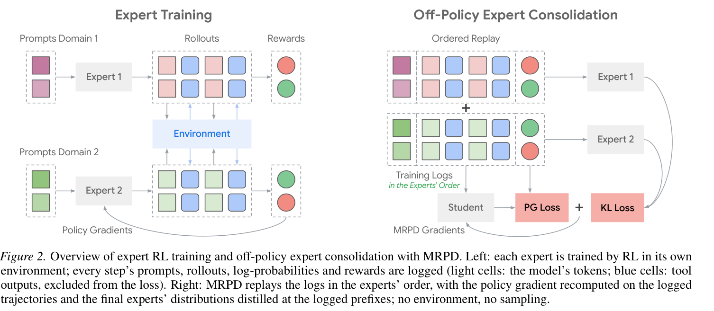

# Replay, Don't Resample: Off-Policy Consolidation of Long-Horizon RL Experts

[English](README-en.md)

> **L1独立机制组件，diagnostic only。** 完整实验成本过高，不复现（审查 DONE）；不自动重试、不进入Evolve晋级。

## 论文信息

| 字段 | 内容 |
| --- | --- |
| 论文链接 | [arXiv 2611.24059v1](https://arxiv.org/abs/2611.24059v1)；[固定v1原文](https://arxiv.org/html/2611.24059v1) |
| 公司 / 作者机构 | 一作 **Zhenrui Yue**：**University of Illinois Urbana-Champaign**；由固定v1作者栏核对，不把引用模型当机构 |
| 首次公开日期 | **2026-11-18T08:51:39Z**（UTC，原始提交）；11月19日公告与本次审查不是首发日期 |
| 原作者开源代码 | 论文提供[作者仓库地址](https://github.com/Yueeeeeeee/MRPD)，但本轮官方GitHub API返回404；未验证可获取本篇源码、许可或固定commit，不称开源已验收。 |
| 本地 adapter / key | `mrpd-replay`；`adapter: null` |
| 本地复现代码 | `src/auto_research/post_training/mrpd_replay.py` |

## 原始论文总结

### 背景与主要改动

MRPD把专家RL训练日志当作随训练步变化的课程，而非混洗后的离线数据池。学生与专家同一SFT初始化；第k步合并各域专家第k步日志，使用日志采样策略的log-prob做importance ratio，重算组相对奖励的非对称clipped PG。

最终域专家只在日志prefix上提供分布，不重新采样或调用环境。默认dense项取教师top-256词以及剩余质量构成的tail atom，计算student到teacher的reverse KL；它直接加入损失，不先变成advantage，也不经过PG的ratio clip。每条响应先按模型token取均值，再跨响应平均。

<!-- paper-figure:start -->
### 原论文关键图

[](https://arxiv.org/pdf/2611.24059v1#page=4)

图片来自[原论文](https://arxiv.org/pdf/2611.24059v1#page=4)第4页，版权归原作者所有；保留完整图与原图注，未重绘或修改科学内容。裁剪与SHA见[provenance](assets/provenance.json)。图中的结果属于作者，不是本地实验。
<!-- paper-figure:end -->


### 核心公式

固定v1位置：§3 Eq.1–3；Appendix A dense KL/reduction/parallelism；§4 experiments。

$$
r_t=\exp(\log\pi_\theta(y_t)-\log\pi_{log}(y_t)),\quad L=\mathbb E_i\frac1{|M_i|}\sum_{t\in M_i}\!\left[-\min(r_t A_i,\operatorname{clip}(r_t,.8,1.28)A_i)+\beta KL(\widetilde p_\theta\Vert\widetilde p_T)\right].
$$

### 论文离线与线上效果

作者在reasoning/search/SQL三个长程域比较在线RL、MOPD与日志重放，报告MRPD在综合能力和训练开销间更优；打乱日志导致下降。时间测量来自8张H100，不能直接换算为单A100加速。未报告生产线上A/B。

### 与已有方法的关系

Streaming OPD在新学生生成prefix上拆开生成、交付、更新时钟，top-k部分KL不补tail且作截断；MRPD不生成新轨迹，按专家日志顺序重放，top-k和tail合成完整粗粒化分布，并使用reverse KL。二者不能仅因都写top-k而共用损失。

## 本地复现

### 数据协议与代码映射

显式chronological log schedule检查、teacher-top-k加tail的reverse KL、日志策略ratio与0.2/0.28非对称clip、response-mean损失和冻结teacher/logging policy梯度。无真实专家日志/训练器/环境集成。

```bash
PYTHONPATH=src python -c 'from auto_research.post_training.mrpd_replay import diagnostic; print(diagnostic(42))'
PYTHONPATH=src python -m pytest -q tests/post_training/test_nov19_post_components.py
```

### 结果、负控与边界

已独立执行CPU seeds42/43/44：[指标](../../research-audits/nov19-latest/independent-cpu-runs/mrpd-replay.json)。本地指标只检验公式、边界与负控，不是能力或排序效果。

CUDA路径须由本轮真实A100/A30冻结源码回执验收；统一回执未完成前不称GPU已通过。

只证明小张量算子、teacher/logging detach、工具观察零梯度和归约在CUDA可运行；没有训练Qwen3、多专家合并或验证论文能力。原作者仓库链接本轮404，不能称已取得其训练源码。

### 高成本完整实验

Appendix A使用Qwen3-4B、三个专家各300步，约46万日志轨迹；1536条/step、最长16k，8张H100、TP=2，需专家训练与多域工具服务。完整多专家campaign不在单A100/A30预算内。

**成本过高，不复现（审查 DONE）**。上述规模与时间依据来自原文，不是本地测速；不下载checkpoint/数据，不探跑完整实验，不加入自动重试队列。可用预算为单张A100或A30、或Mac，不假设多卡或两台同时使用。
