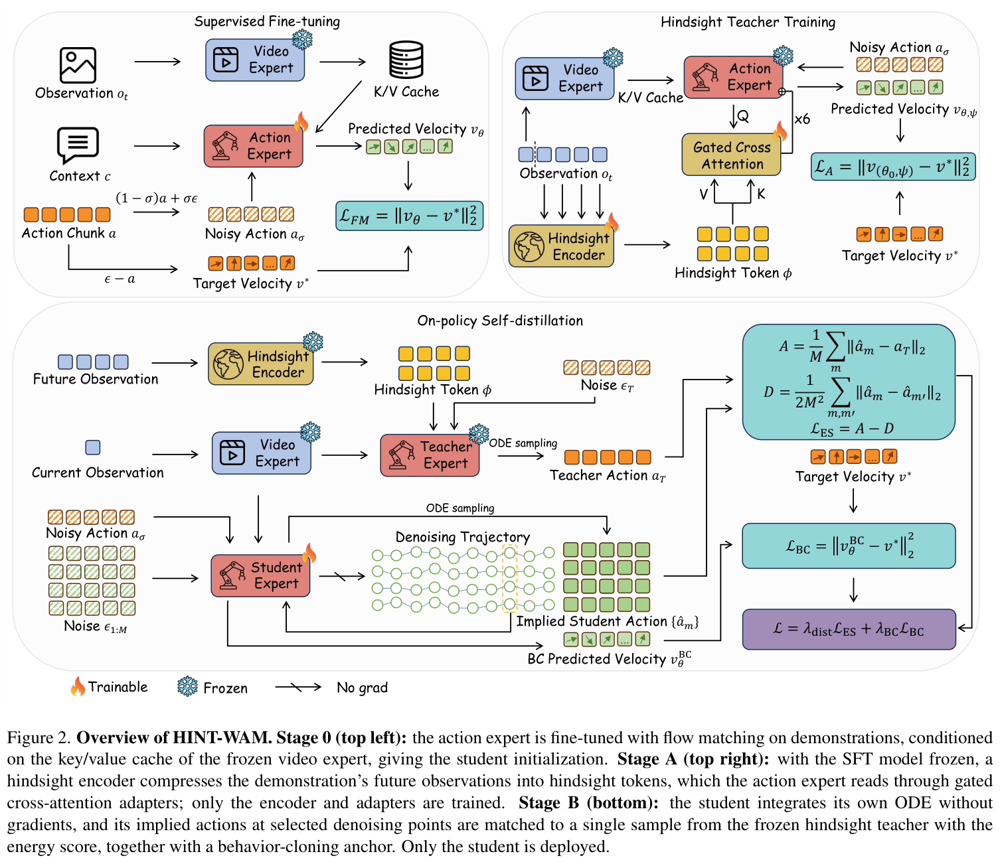

# HINT-WAM: Hindsight-Informed Training for World Action Models

<!-- source-sha256: 80b9df690f43af3700f2118ee0fdb42780d284a3f6e804455dce25b959beb2a3 -->

[简体中文](README.md)

> **Research reference only; no local implementation.** The high-cost full experiment is not reproduced (review DONE), with no automatic retry or Evolve promotion.

## Paper information

| Field | Content |
| --- | --- |
| Paper link | [arXiv 2611.24789v1](https://arxiv.org/abs/2611.24789v1); [fixed v1](https://arxiv.org/html/2611.24789v1) |
| Company / author institution | First author **Phuong Tuan Dat**: **National University of Singapore**, verified from the fixed-v1 byline rather than cited model names |
| Original publication date | **2026-11-18T17:36:15Z** (UTC original submission); the November19 announcement/review is not the publication date |
| Original source code | No verifiable method-source release found in fixed v1 or the bounded author entry points checked. Referenced models and trainers are not this paper's source release. |
| Local adapter / key | `hint-wam`; `adapter: null` |
| Local reproduction code | No algorithm implementation; only this write-up and catalog record, without a placeholder model |

## Original paper summary

### Background and main changes

HINT-WAM first fine-tunes the action expert, then freezes that same backbone while training a hindsight encoder and gated adapters on demonstration-future video. The teacher drops the current frame and retains the time axis; the student and deployed policy never observe the future. Finally, the student is re-evaluated at selected points along its own ODE trajectories to match the frozen teacher's action distribution.

Velocity MSE can average over future-dependent modes invisible to the student. The energy score combines attraction to one teacher sample with repulsion among student samples, alongside a behavior-cloning anchor. Gradients do not traverse the ODE rollout. Its finite-M plug-in repulsion uses1/(2M²), slightly weaker than the unbiased U-statistic; silently changing that estimator changes the method.

### Key original figure

Original figure and full caption from [fixed-v1 PDF page4](https://arxiv.org/pdf/2611.24789v1#page=4); copyright belongs to the original authors. No scientific content was redrawn or changed. Crop and hashes: [provenance](assets/provenance.json). Author results are not local experiments.

### Core formula

Source locations: §3 Eq.1–9 and Algorithm1; Appendix A architecture; Appendix B measured training cost.

$$
\widehat a_{m,k}=a^m_{\sigma_k}-\sigma_k v_\theta(a^m_{\sigma_k},\sigma_k,o),\quad L_{ES}=\sum_k\bar w_k\left[\frac1M\sum_m\|\widehat a_{m,k}-a_T\|_2-\frac1{2M^2}\sum_{m,m'}\|\widehat a_{m,k}-\widehat a_{m',k}\|_2\right],\quad L_B=\lambda_{dist}L_{ES}+\lambda_{BC}L_{FM}.
$$

### Paper results and online evidence

The paper reports85.18% LIBERO-90 success for HINT-WAM versus81.24% for full SFT, with different full-pipeline cost and trainable parameters; it also provides initialization/step-matched BC controls and RoboTwin evaluation. Table4 reports71.6 hours and572 GPU-hours for the full HINT-WAM pipeline. Robot success is not production-user A/B; none is reported.

### Relation to existing methods

Video-OPSD uses annotated evidence frames to supervise text tokens through a privileged self-teacher. HINT-WAM's privilege is demonstration future, its target is an action-chunk distribution and its teacher must share the student's backbone. An existing Video-OPSD checkpoint evidence-view audit does not establish HINT-WAM training.

## Local reproduction

### Data protocol and code mapping

Review only: same-backbone hindsight teacher, energy score on student ODE states, BC anchor, costs and limitations. No local model, operator or metrics; static action samples do not substitute for WAM distillation.

No execution command. Cataloging is not an executable adapter or Evolve operator.

### Results, negative controls and limits

This intake records the method, original figure, costs and limits only. There is no model implementation, capability metric or pending GPU-acceptance task.

The defining method requires the real backbone, hindsight-teacher training and student ODE trajectories. The reported cost is eight GPUs for71.6 hours. An energy-score formula on static random actions is not that chain, so this is review-only DONE, without pending GPU acceptance or automatic retry.

### High-cost full experiment

Appendices A/B specify a Wan2.2-TI2V-5B video expert plus1.02B action expert on eight24GB GPUs. The LIBERO-90 pipeline costs71.6 hours/572 GPU-hours, StageB alone33.7 hours. This campaign is high cost for one A100/A30 or Mac: no download or probe; not reproduced, review DONE.

**High cost: not reproduced (review DONE).** Resource and timing statements come from the paper, not local measurements. No checkpoint/data download, full-experiment probe or automatic retry is performed. The budget is one A100 or A30, or a Mac; multiple GPUs or simultaneous hosts are not assumed.
