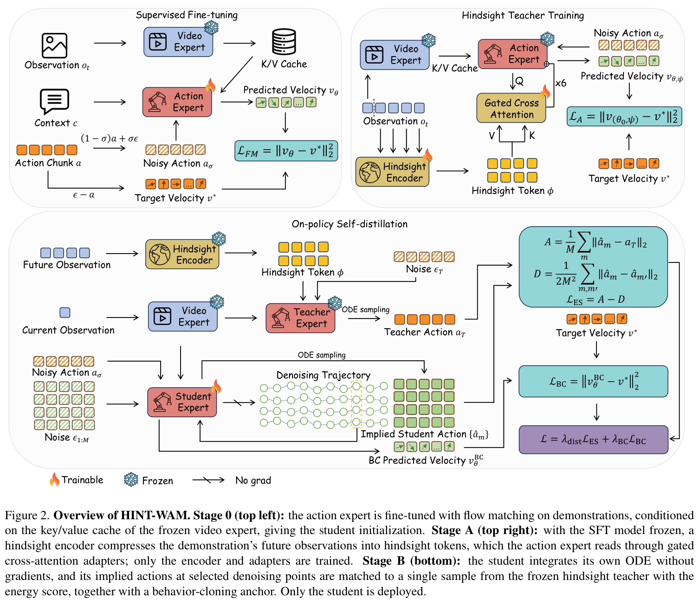

# HINT-WAM: Hindsight-Informed Training for World Action Models

[English](README-en.md)

> **仅研究资料，无本地实现。** 完整实验成本过高，不复现（审查 DONE）；不自动重试、不进入Evolve晋级。

## 论文信息

| 字段 | 内容 |
| --- | --- |
| 论文链接 | [arXiv 2611.24789v1](https://arxiv.org/abs/2611.24789v1)；[固定v1原文](https://arxiv.org/html/2611.24789v1) |
| 公司 / 作者机构 | 一作 **Phuong Tuan Dat**：**National University of Singapore**；由固定v1作者栏核对，不把引用模型当机构 |
| 首次公开日期 | **2026-11-18T17:36:15Z**（UTC，原始提交）；11月19日公告与本次审查不是首发日期 |
| 原作者开源代码 | 固定v1及所核作者入口未找到可验证的本篇方法源码发布；所用模型、训练库不算本篇开源。 |
| 本地 adapter / key | `hint-wam`；`adapter: null` |
| 本地复现代码 | 无算法实现；仅本文与catalog资料，不创建占位模型 |

## 原始论文总结

### 背景与主要改动

HINT-WAM先SFT动作专家，再冻结同一backbone，只训练hindsight encoder与gated adapters读取示范未来视频。teacher去掉当前帧并保留时间轴，学生与部署策略从来不看未来。最后学生在自身ODE采样轨迹上重新评估少量去噪点，匹配冻结teacher的动作分布。

直接velocity MSE可能把学生看不到的多模态未来压成均值。论文用energy score：到teacher单样本的吸引项减去学生样本间排斥项，同时保留behavior-cloning anchor；不通过整条ODE rollout反传。有限M的plug-in排斥系数为1/(2M²)，它比无偏U-statistic略弱，不能悄悄替换。

<!-- paper-figure:start -->
### 原论文关键图

图片来自[原论文](https://arxiv.org/pdf/2611.24789v1#page=4)第4页，版权归原作者所有；保留完整图与原图注，未重绘或修改科学内容。裁剪与SHA见[provenance](assets/provenance.json)。图中的结果属于作者，不是本地实验。
<!-- paper-figure:end -->

### 核心公式

固定v1位置：§3 Eq.1–9 and Algorithm1；Appendix A architecture；Appendix B measured training cost。

$$
\widehat a_{m,k}=a^m_{\sigma_k}-\sigma_k v_\theta(a^m_{\sigma_k},\sigma_k,o),\quad L_{ES}=\sum_k\bar w_k\left[\frac1M\sum_m\|\widehat a_{m,k}-a_T\|_2-\frac1{2M^2}\sum_{m,m'}\|\widehat a_{m,k}-\widehat a_{m',k}\|_2\right],\quad L_B=\lambda_{dist}L_{ES}+\lambda_{BC}L_{FM}.
$$

### 论文离线与线上效果

作者LIBERO-90的HINT-WAM成功率85.18%，完整SFT对照81.24%，但完整pipeline成本和可训练参数不同；论文另有匹配初始化/步数的BC对照与RoboTwin评测。表4给出完整HINT-WAM 71.6小时、572 GPU小时。机器人成功率不是生产用户A/B，未报告线上A/B。

### 与已有方法的关系

Video-OPSD用人工证据帧为文本token提供特权自教师监督；HINT-WAM的特权是示范未来，目标是动作chunk分布而非文本token，且teacher必须与学生同一backbone。旧Video-OPSD的证据视图checkpoint审计不等于HINT-WAM训练。

## 本地复现

### 数据协议与代码映射

只收录同源hindsight teacher、学生ODE状态上的energy-score与BC anchor、成本和限制。无本地模型/算子/指标，不用静态动作样本替代真实WAM蒸馏。

无运行命令。方法收录不代表可执行adapter或Evolve operator。

### 结果、负控与边界

本轮只完成方法、原图、成本与边界收录；无模型实现、能力指标或GPU待验收任务。

完整方法需要真实backbone、未来teacher训练和学生ODE轨迹。原文测得8GPU×71.6小时；静态随机动作的energy-score公式不等于该训练链。因此只收录并审查DONE，无待验收GPU或自动重试。

### 高成本完整实验

Appendix A/B明确Wan2.2-TI2V-5B视频专家+1.02B动作专家、8张24GB GPU；LIBERO-90完整流程71.6小时/572 GPU小时，StageB单独33.7小时。单A100/A30或Mac无法承担同等campaign，本轮不下载、不探跑，成本过高，不复现（审查 DONE）。

**成本过高，不复现（审查 DONE）**。上述规模与时间依据来自原文，不是本地测速；不下载checkpoint/数据，不探跑完整实验，不加入自动重试队列。可用预算为单张A100或A30、或Mac，不假设多卡或两台同时使用。
