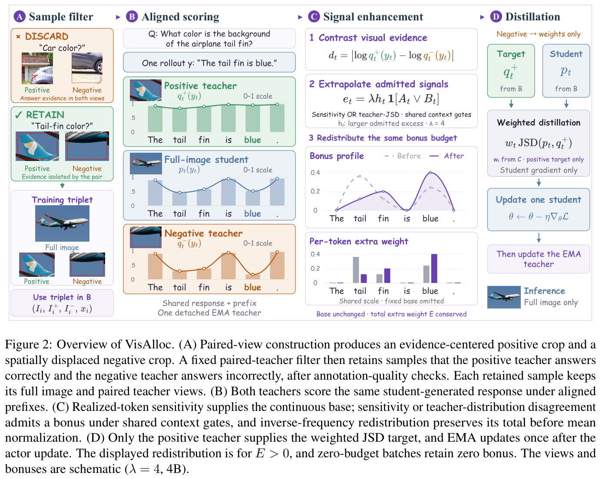

# VisAlloc: Allocating Visual Supervision for On-Policy Self-Distillation

<!-- source-sha256: fd1802383ffcafddcacf3fef5efa4b1071f0ea6b945eb3c1744af7dd31b7763e -->

[简体中文](README.md)

> **Independent L1 mechanism component, diagnostic only.** High-cost full experiments are not reproduced (review DONE); no automatic retry or Evolve promotion.

## Paper information

| Field | Content |
| --- | --- |
| Paper link | [arXiv 2611.25069v1](https://arxiv.org/abs/2611.25069v1); [fixed-v1 text](https://arxiv.org/html/2611.25069v1) |
| Company / author institution | First author **Haoran Xu**: **Zhejiang University**, checked from the fixed-v1 byline rather than the model provider |
| Original publication date | **2026-11-18T19:12:00Z** (UTC); the November20 announcement/review is not publication |
| Original source code | [Public author source](https://github.com/Kaelyn01/VisAlloc), Apache-2.0. Actor and weighting helpers were checked at commit `212b5f6f88645815d1369876f7801c58a5cad24a`; upstream training was not executed. |
| Local adapter / key | `visalloc`; `adapter: null`, an independent component rather than a full trainer |
| Local reproduction code | `src/auto_research/post_training/visalloc.py` |

## Original paper summary

### Background and main changes

VisAlloc separates fixed sample selection from online token allocation. Geometry-matched crops retain examples where the positive teacher is correct, the negative teacher is wrong and annotation checks pass; this occurs before optimization. The student generates from the full image. The same detached EMA teacher scores that response under aligned student prefixes with an evidence-centered crop and a displaced crop. The negative teacher is not a second distillation target.

Student top100 vocabulary entries plus a residual-mass bucket define shared support for all three distributions. Absolute realized-token log-probability differences give a continuous base. Sensitivity above valid-token p80 or teacher JSD above p90 admits a bonus, subject to all three shared gates: frozen selection rate at least0.12, non-template bigram, and student-positive-teacher JSD above its median. Only the bonus is redistributed by inverse frequency, conserving its total. Final weights average to one over valid positions. The positive teacher alone supplies weighted JSD targets.

### Key original figure

[](https://arxiv.org/pdf/2611.25069v1#page=4)

Original Figure 2 and complete caption from fixed-v1 PDF page4; copyright belongs to the authors. Visually checked, with no scientific-content changes. [Source](https://arxiv.org/pdf/2611.25069v1#page=4); [crop and SHA256 provenance](assets/provenance.json). This illustrates the author's method, not local results.

### Core formula

Source locations: PDF p1 byline; Section3 Eq.1-15; AppendixA; fixed upstream actor and visalloc_utils.

$$
\mathcal L=\frac{\sum_t M_t\operatorname{sg}(w_t\rho_t c_t)J_t}{\sum_t M_t},\qquad \widetilde e_t=\begin{cases}E\frac{e_t(n_{y_t}+50)^{-1/2}}{\sum_j e_j(n_{y_j}+50)^{-1/2}},&E>0,\\0,&E=0.\end{cases}
$$

E is the local micro-batch's total valid bonus; quantiles likewise exclude padding and unavailable negative views. The current/old ratio is capped at2, and all weights, ratios and corrections are stop-gradient. Positions without a negative view retain baseline weight1. Frozen priors use the p90 dual-signal product within groups of16 training responses, rate(k+5)/(n+50) rounded to four decimals, and template bigrams occurring in at least25% of responses, counted at most once per response.

### Paper results and online evidence

The paper reports eight-benchmark means81.44/84.92 for4B/9B versus80.47/84.40 for matched Vision-OPD reproductions, gains of0.97/0.52 points. These use only seed42, not a measured stable multi-seed gain. Not every task improves:4B MMVP77.00 trails78.00 and POPE89.03 trails89.27. No production online A/B is reported. Local tensor controls do not verify these model results.

### Relation to existing methods

Existing VAG uses sign consistency between visual contrast and teacher correction to add a bounded term to verifier-based GRPO advantages. VisAlloc instead allocates a continuous base and conserved bonus to positive-teacher JSD. Two-view EMA teachers do not make their objectives interchangeable, nor does this implementation upgrade the review-only VAG entry.

## Local reproduction

### Data protocol and code mapping

Training-verdict filtering, shared-support top100-plus-tail JSD on explicit logits, frozen priors and templates, valid-only quantiles, complete OR/shared gates, conserved inverse-frequency bonus and positive-only JSD with detached importance/correction. Float16/bfloat16 are promoted to float32 before log-softmax, differences and quantile statistics; float64 precision is retained. Random and finite plus/minus60000 controls check finite outputs, frozen teachers and valid student gradients. There is no full-image VLM, crop constructor, answer checker, EMA model update, rollout or trainer. Supplying tensors is not execution of those networks.

```bash
PYTHONPATH=src python -c 'from auto_research.post_training.visalloc import diagnostic; print(diagnostic(42))'
PYTHONPATH=src python -m pytest -q tests/post_training/test_nov20_post_components.py
```

### Results, negative controls and limits

Independent CPU seeds42/43/44 were executed: [actual artifacts](../../research-audits/nov20-latest/independent-cpu-runs/visalloc-mixed-precision-fixed.json). They test formulas, gradients, masks and negative controls, not full-model capabilities. The CUDA path requires this batch's actual frozen-source A100/A30 receipt; GPU acceptance is not claimed before completion.

Quantiles and redistribution use only valid positions with negative views. Valid response positions without a negative view retain baseline weight1; padding loss and gradients are zero. Teachers and weight construction stay frozen. Promote half precision before log-softmax and subtraction, not after overflow; retain float64 precision.

### High-cost full experiment

The fixed upstream commit defaults to four GPUs per node: Qwen3.5-4B/9B,5,795 retained images,96 prompts times8 rollouts,60 updates and1,024 generation tokens, plus frozen-prior preparation and a gpt-oss-120b evaluation judge. There are96×8×60=46,080 nominal response slots per configuration, not a local measurement. One A100/A30 does not undertake the full two-model matrix.

**High cost: not reproduced (review DONE).** No checkpoint/data download, paid API, full training or expanded probe is run; no automatic retry queue. Each small component is capped at30 seconds per seed on one A100 or A30, or a Mac, without assuming multiple GPUs or both hosts simultaneously.
