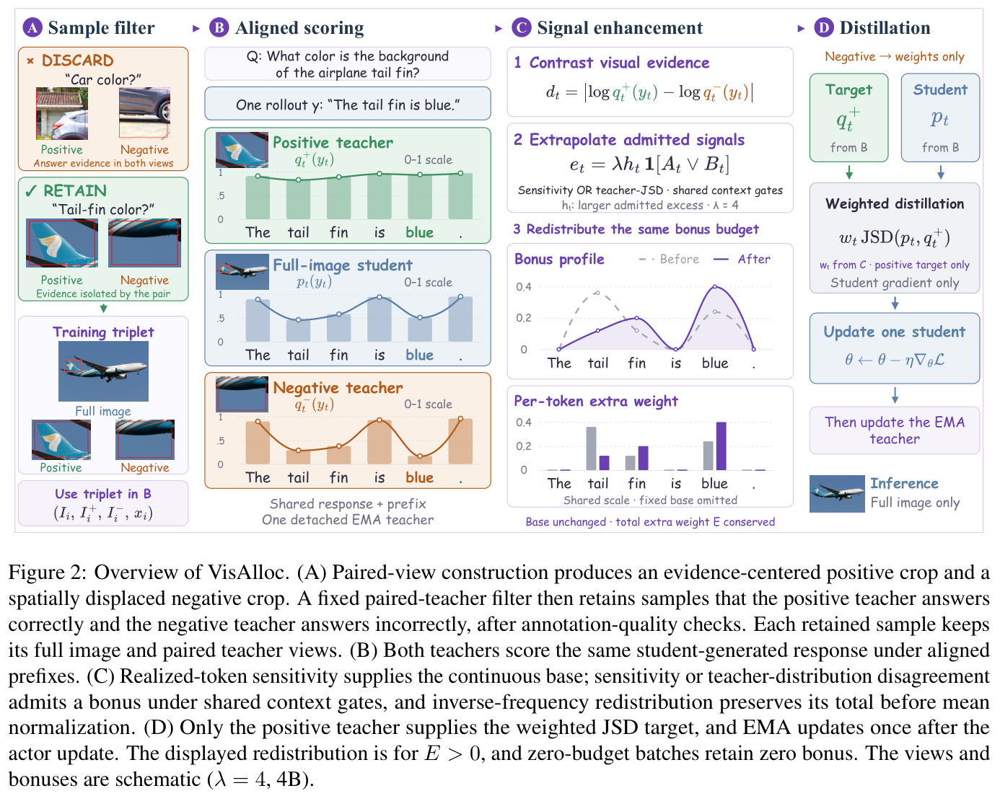
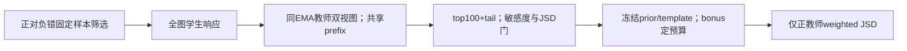

# VisAlloc: Allocating Visual Supervision for On-Policy Self-Distillation

[English](README-en.md)

> **L1独立机制组件，diagnostic only。** 完整实验成本过高，不复现（审查 DONE）；不自动重试、不进入Evolve晋级。

## 论文信息

| 字段 | 内容 |
| --- | --- |
| 论文链接 | [arXiv 2611.25069v1](https://arxiv.org/abs/2611.25069v1)；[固定v1全文](https://arxiv.org/html/2611.25069v1) |
| 公司 / 作者机构 | 一作 **Haoran Xu**：**Zhejiang University**；固定v1作者栏核对，不以所用模型推定机构 |
| 首次公开日期 | **2026-11-18T19:12:00Z**（UTC）；本轮11月20日公告/复核不等于首发日期 |
| 原作者开源代码 | [作者公开源码](https://github.com/Kaelyn01/VisAlloc)，Apache-2.0；核对固定commit `212b5f6f88645815d1369876f7801c58a5cad24a` 的actor和weight helper，未执行上游训练。 |
| 本地 adapter / key | `visalloc`；`adapter: null`，独立组件不是完整训练adapter |
| 本地复现代码 | `src/auto_research/post_training/visalloc.py` |

## 原始论文总结

### 背景与主要改动

VisAlloc把视觉监督分成固定样本筛选和在线token分配。先用几何匹配的正/负裁剪，保留正教师答对、负教师答错且注释质量合格的样本；该筛选发生在优化前。训练时学生从全图生成响应，同一个detached EMA教师在同一学生prefix上分别读证据中心裁剪和空间移位裁剪，负教师不是第二个蒸馏目标。

实现取学生top100词及所有其余概率的tail bucket，三条分布共享support。已生成token的双视图log概率绝对差给连续base；超过有效token敏感度p80或教师间JSD p90可入额外bonus，但都还必须通过冻结选中率≥0.12、非模板bigram、学生-正教师JSD超过median三个门。只对bonus按逆频率重新分配，并保持其总预算，最后有效位置平均weight=1。只有正教师提供加权JSD目标。

<!-- paper-figure:start -->
### 原论文关键图

[](https://arxiv.org/pdf/2611.25069v1#page=4)

图片来自[原论文](https://arxiv.org/pdf/2611.25069v1#page=4)第4页Figure 2及完整图注，版权归原作者所有；已视觉检查，无科学内容改动。[裁剪与SHA256](assets/provenance.json)。图示属于作者方法，不是本地结果。
<!-- paper-figure:end -->



### 核心公式

来源：PDF p1 byline；Section3 Eq.1-15；AppendixA；fixed upstream actor and visalloc_utils。

$$
\mathcal L=\frac{\sum_t M_t\operatorname{sg}(w_t\rho_t c_t)J_t}{\sum_t M_t},\qquad \widetilde e_t=\begin{cases}E\frac{e_t(n_{y_t}+50)^{-1/2}}{\sum_j e_j(n_{y_j}+50)^{-1/2}},&E>0,\\0,&E=0.\end{cases}
$$

这里E是本地micro-batch有效位置的bonus总和；分位数也只看有效且有负视图的位置。current/old importance ratio上限为2，所有weight/ratio/correction都stop-gradient；无负视图的位置保留weight1的基线蒸馏。冻结prior使用每16条训练响应的双信号乘积p90，平滑rate=(k+5)/(n+50)并保留四位小数；模板bigram按每条响应至多计1次，覆盖至少25%响应。

### 论文离线与线上效果

原文4B/9B八基准平均为81.44/84.92，对齐的Vision-OPD复现为80.47/84.40，即+0.97/+0.52个百分点；仅seed42，不能说已测得稳定多种子提升。并非每项都提高：4B MMVP77.00低于78.00，POPE89.03低于89.27。未报告生产线上A/B；本地张量负控不验证这些模型效果。

### 与已有方法的关系

已有VAG以视觉对比和教师修正的同号门控，给verifier的GRPO advantage加有界项；VisAlloc不以这个同号规则调制verifier，而是给正教师JSD分配连续base和守恒bonus。不能只因都使用双视图EMA教师就复用其loss或把VAG资料条目改成已实现。

## 本地复现

### 数据协议与代码映射

训练用sample verdict过滤、显式logits上的同support top100+tail JSD、冻结prior与模板构建、有效位置分位数、完整OR/shared gates、定预算逆频率bonus、positive-only JSD和detached importance/correction。fp16/bf16在log-softmax、差值与分位数统计前升为fp32，float64保持精度；随机及有限±60000极值负控检查有限输出、冻结教师与有效学生梯度。没有全图VLM、几何裁剪器、教师答案判分、EMA模型更新、rollout或trainer；提供张量不等于执行这些核心网络。

```bash
PYTHONPATH=src python -c 'from auto_research.post_training.visalloc import diagnostic; print(diagnostic(42))'
PYTHONPATH=src python -m pytest -q tests/post_training/test_nov20_post_components.py
```

### 结果、负控与边界

已独立执行CPU seeds42/43/44：[实际产物](../../research-audits/nov20-latest/independent-cpu-runs/visalloc-mixed-precision-fixed.json)。它们只检验公式、梯度、mask和负控，不是完整模型能力比较。CUDA路径须等待本轮真实A100/A30冻结源码回执；在回执完成前不声称GPU已通过。

分位数和频率重分配只看有效且有负视图的位置；缺负视图的有效响应仍以weight1做基线蒸馏，padding损失与梯度为0。教师与权重构造必须冻结。半精度需在log-softmax和差值前升fp32，不能等溢出后再cast；float64保持精度。

### 高成本完整实验

官方固定commit默认每节点4GPU，Qwen3.5-4B/9B、5795保留图像、96题×8rollouts、60步、1024生成token，另需冻结prior和gpt-oss-120b评测judge。名义训练响应槽为96×8×60=46080/模型配置，不是本地实测；单A100/A30不承担完整双模型矩阵。

**成本过高，不复现（审查 DONE）**。本轮不下载checkpoint/数据，不调用付费API，不启动完整训练或试探性扩规模，不进入自动重试队列。小组件预算为每seed不超过30秒，可用资源是一张A100或A30、或Mac，不能假设多卡或两台同时可用。
