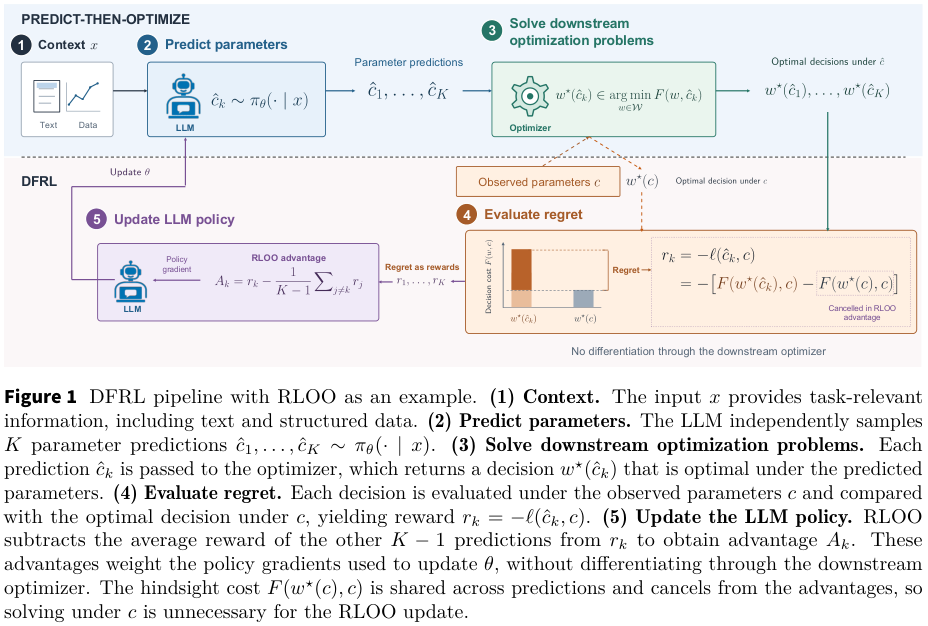

# Decision-Focused Reinforcement Learning for LLM Post-Training

<!-- source-sha256: 897844a59cfe062c84c423073f75dd192b69ce998bdab4331fa01a47bce6ff39 -->

[简体中文](README.md)

> **L1 mechanism component, diagnostic only; not LLM capability or a full paper reproduction.** CPU only, with no advertised CUDA path or Evolve-promotion evidence. High-cost full experiments are not reproduced (review DONE).

## Paper information

| Field | Value |
| --- | --- |
| Paper | [arXiv:2611.25597v1](https://arxiv.org/abs/2611.25597v1); [fixed-v1 text](https://arxiv.org/html/2611.25597v1) |
| First author / institution | **Haotian Zhai**, **The University of Texas at Austin** |
| Original publication | **2026-11-19T06:44:35Z**; selected from the overlap pool on2026-11-21, not a Nov20/21 first release |
| Original author code | As of2026-11-21, no verified paper-specific author code repository was found in the fixed-v1 author entry or full text; cited projects do not establish release of this method. |
| Local adapter / key | `dfrl`; `adapter: null`, independent CPU component |
| Local code | `src/auto_research/post_training/dfrl.py` |

## Original paper

### Background and method

Lower prediction error need not imply lower induced decision cost. DFRL passes an LLM's parameter prediction to a downstream optimizer, evaluates the decision under observed parameters, and post-trains with negative decision regret without differentiating through the optimizer. It specifies an objective and feedback pipeline, not an optimizer replacing RLOO. With K at least two independent predictions per instance, the within-instance leave-one-out baseline cancels the common hindsight optimum, so the update need not solve the problem under the observed parameters.

Two schemes reduce expensive feedback. Heuristic warm-starting first uses costs of cheap feasible decisions and switches to exact costs at a validation-selected boundary; its early gradient is biased. Reward correction draws one Bernoulli(p) for the entire M-by-K batch: selected batches solve every exact decision and apply inverse-probability correction, while unselected batches use cheap estimates alone. Cheap estimates may be biased; expectation over the batch switch recovers the exact gradient but introduces variance, not a guaranteed speedup.

### Key original figure

[](https://arxiv.org/pdf/2611.25597v1#page=5)

Original Figure 1, complete screenshot from fixed-v1 PDF page5; copyright belongs to the authors. Visually checked, without scientific-content changes. [Original source](https://arxiv.org/pdf/2611.25597v1#page=5); [crop and SHA256 provenance](assets/provenance.json). This depicts the authors' method, not local results.

### Core formula

$$
A_{mk}=-C_{mk}+\frac{1}{K-1}\sum_{j\ne k}C_{mj},\qquad \widehat A_{mk}=\widetilde A_{mk}+\frac{I}{p}(A_{mk}-\widetilde A_{mk}),\qquad I\sim\operatorname{Bernoulli}(p).
$$

One I is shared by the whole batch, not sampled independently per token or candidate while claiming Equation12. I=0 neither requires nor invokes the exact solver. Do not additionally standardize advantages by group standard deviation: that changes the analyzed estimator. Lower cost yields higher advantage; cost is not a positive reward. Very small p can cause large single-batch corrections.

### Reported results

On H&M inventory planning, the paper's best reasoning configuration reduces decision regret by31.4% relative to SFT and12.4% relative to the strongest conventional forecasting baseline. These are offline decision-regret results, not predictive accuracy or production A/B; no online A/B is reported. Exact-solve time and the bias/variance of cheap feedback determine net efficiency. Local tiny-problem gradient checks do not verify4B-model business improvements.

### Relationship to existing methods

Existing RLOO treats a complete response as an action, baselines its reward against the other responses, and may add KL shaping. DFRL specifies downstream realized decision cost as feedback; its RLOO analysis cancels the common hindsight constant, and batch-switch reward correction reduces expensive feedback calls. RLOO does not define business regret automatically, and DFRL does not make arbitrary normalization, clipping or candidate-dependent baselines unbiased. They concern an objective/feedback pipeline and an estimator, not mutually exclusive algorithms.

## Local implementation

### Data protocol and code mapping

Pure-standard-library, CPU-only realized-cost RLOO advantages, one-batch Bernoulli inverse-probability correction with a lazy whole-batch exact-cost callback, an explicit warm-start boundary, and tiny exact knapsack enumeration. Diagnostics compute observed costs of real feasible decisions for three sampleable parameter predictions, enumerate the score-gradient expectation of two independent categorical samples, and compare it with the analytic gradient. Biased cheap costs are explicit negative-control inputs, not a trained estimator. No LLM, token generation, parameter-JSON parser, H&M pipeline, Adam training, capability evaluation or Evolve operator is supplied.

```bash
PYTHONPATH=src python -c 'from auto_research.post_training.dfrl import diagnostic; print(diagnostic(42))'
PYTHONPATH=src python -m pytest -q tests/test_nov21_dfrl.py
```

### Results, controls and limits

The unified three-seed CPU artifact is[`metrics/component-cpu-seeds42-44.json`](metrics/component-cpu-seeds42-44.json). It checks mechanism definitions and controls, with no data/checkpoint download, model training or benchmark-gain claim. Unit tests are not capability evaluation. The public CPU path rejects`device="cuda"`; no GPU validation is fabricated. Any future advertised CUDA path requires separate real A100/A30 validation.

### High-cost full experiment

AppendixB.5 uses Qwen3.5-4B and4,013 SFT instances; each of four non-thinking RL conditions has64 updates times16 instances times8 responses, or8,192 training responses, plus learning-rate selection, a reasoning teacher, extra SFT and evaluation. Separate synthetic-problem, multi-seed and one-hour-budget studies add cost. This matrix exceeds this batch's30-second-per-seed CPU component budget.8,192 is configuration arithmetic, not a local measurement; no model, H&M data or teacher API is downloaded or called.

**High cost: not reproduced (review DONE).** No lengthy probe, expanded training or automatic retry queue. Available resources are one A100 or A30, or a local Mac. This batch runs only CPU components capped at30 seconds per seed, without assuming multiple GPUs or simultaneous access to both hosts.
