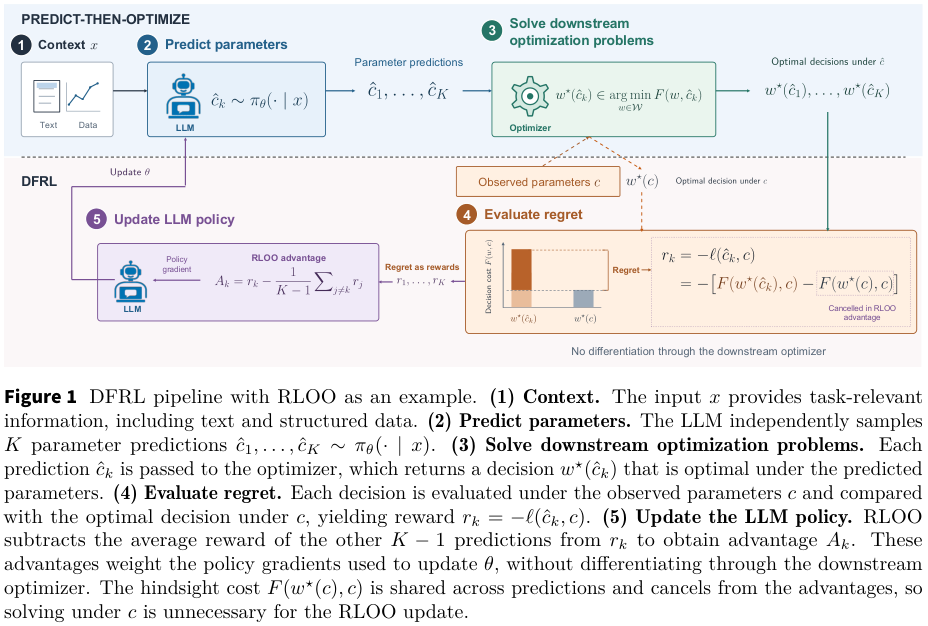
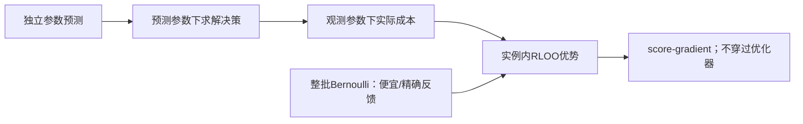

# Decision-Focused Reinforcement Learning for LLM Post-Training

[English](README-en.md)

> **L1核心机制组件，diagnostic only；不是LLM能力或完整论文复现。** 纯CPU，无CUDA宣传路径；不作为Evolve晋级证据。完整实验成本过高，不复现（审查 DONE）。

## 论文信息

| 字段 | 内容 |
| --- | --- |
| 论文链接 | [arXiv:2611.25597v1](https://arxiv.org/abs/2611.25597v1)；[固定v1原文](https://arxiv.org/html/2611.25597v1) |
| 公司 / 作者机构 | 一作 **Haotian Zhai**；**The University of Texas at Austin** |
| 首次公开日期 | **2026-11-19T06:44:35Z**；本轮2026-11-21为重叠池新选题，不是11月20/21新首发 |
| 原作者开源代码 | 截至2026-11-21，固定v1作者入口与全文未找到已核实的本篇方法源码仓库；引用项目不等于本篇开源。 |
| 本地 adapter / key | `dfrl`；`adapter: null`，独立CPU组件 |
| 本地复现代码 | `src/auto_research/post_training/dfrl.py` |

## 原始论文总结

### 背景与主要改动

预测误差小不保证由预测触发的决策成本低。DFRL把LLM生成的参数预测交给下游优化器，以真实观测参数评估该决策，再把负决策regret用于后训练；不对优化器求导。它是目标/反馈框架，不是另一个替代RLOO的策略优化器。对同一实例独立生成K≥2条预测时，RLOO的实例内leave-one-out baseline抵消共同的hindsight最优成本，因此更新不必额外求真实参数下的最优解。

昂贵精确反馈有两种处理：heuristic warm-start先用便宜可行决策的成本，按validation确定的边界切换精确成本；它有偏。reward correction则为整批M×K预测只抛一个Bernoulli(p)：选中时求全部精确成本并作逆概率校正，没选中时只用便宜估计。便宜估计可以有偏，校正对该批随机开关求期望恢复精确梯度，但增大方差，不保证更快收敛。

<!-- paper-figure:start -->
### 原论文关键图

[](https://arxiv.org/pdf/2611.25597v1#page=5)

图片来自[原论文](https://arxiv.org/pdf/2611.25597v1#page=5)第5页Figure 1完整截图，版权归原作者所有；已视觉核对，无科学内容改动。[原图裁剪与SHA256](assets/provenance.json)。图示属于作者方法，不是本地运行结果。
<!-- paper-figure:end -->



### 核心公式

$$
A_{mk}=-C_{mk}+\frac{1}{K-1}\sum_{j\ne k}C_{mj},\qquad \widehat A_{mk}=\widetilde A_{mk}+\frac{I}{p}(A_{mk}-\widetilde A_{mk}),\qquad I\sim\operatorname{Bernoulli}(p).
$$

这里单个I共享给整批，不是对每token或候选独立选择后仍声称复刻Eq.12。I=0时不要求也不调用精确求解器；优势不可再做组内标准差归一化，否则不再是所分析的无偏估计。成本越低优势越高，不能把成本当正奖励。p过小可能使单批校正极大。

### 论文离线与线上效果

原文在H&M库存规划中报告带reasoning的最佳配置相对SFT减少31.4% regret、相对最强常规预测基线减少12.4%。这两项是离线决策regret，不是预测准确率或生产A/B；未报告线上A/B。便宜反馈的方差/偏差与精确求解时间决定净收益，本地小问题解析梯度检查不验证4B模型的业务改善。

### 与已有方法的关系

已有RLOO实现把整条response作为action，用其他response的奖励均值作baseline，并可加KL shaping。DFRL在这里指定奖励来自下游真实决策成本；其文中RLOO分析抵消共同hindsight常数，reward correction用整批开关减少昂贵反馈调用。RLOO没有自动定义什么是业务regret；DFRL也没有使任意归一化、clipping或候选相关baseline都保持无偏。两者是目标/反馈与估计器两个维度，而非互斥算法。

## 本地复现

### 数据协议与代码映射

纯stdlib、CPU-only的实际成本RLOO优势、单批共享Bernoulli逆概率校正与lazy整批精确成本回调、显式warm-start边界、小规模枚举knapsack。诊断对三个可采样参数预测的真实可行决策计算观测成本，穷举两个独立categorical样本的score-gradient期望并与解析梯度比较；偏置cheap成本仅为明确的负控输入，不冒充训练好的估计器。没有LLM、token生成、参数JSON解析器、H&M处理、Adam训练或能力评测；非Evolve算子。

```bash
PYTHONPATH=src python -c 'from auto_research.post_training.dfrl import diagnostic; print(diagnostic(42))'
PYTHONPATH=src python -m pytest -q tests/test_nov21_dfrl.py
```

### 结果、负控与边界

统一三种子CPU产物为[`metrics/component-cpu-seeds42-44.json`](metrics/component-cpu-seeds42-44.json)。这里只检查定义核与负控；没有下载数据或权重，没有训练模型或宣称benchmark收益。单元测试不能替代真实模型能力评测。公开的CPU路径显式拒绝`device="cuda"`，因此不伪造GPU验收；若未来新增CUDA宣传路径，必须另做真实A100/A30验证。

### 高成本完整实验

AppendixB.5使用Qwen3.5-4B、4013个SFT实例，四个non-thinking RL条件各64更新×16实例×8响应=8192条训练响应，并有学习率选择、reasoning教师/额外SFT与评测；另有三合成问题、多种子与一小时预算实验。完整矩阵远超本轮30秒/seed的CPU定义核预算。8192是论文配置计算，不是本机实测；不下载模型、H&M或调用教师。

**成本过高，不复现（审查 DONE）**。不尝试长时探针、不扩大训练、不加入自动重试队列。可用预算是一张A100或A30，或本地Mac；本轮仅运行每seed最多30秒的CPU组件，不假设多卡或两台同时可用。
