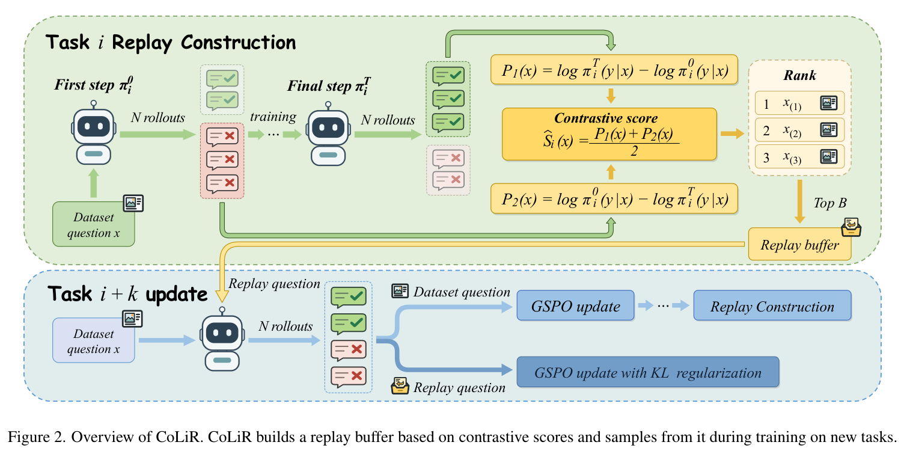

# Policy Improvement-Guided Replay for Continual Reinforcement Learning

<!-- source-sha256: b49323cf277810e110f192851ab26765bc97c094f390dfc64aed205ffcfddecd -->

[简体中文](README.md)

> **Independent L1 mechanism component, diagnostic only.** High-cost full experiments are not reproduced (review DONE); no automatic retry or Evolve promotion.

## Paper information

| Field | Content |
| --- | --- |
| Paper link | [arXiv 2611.25989v1](https://arxiv.org/abs/2611.25989v1); [fixed-v1 text](https://arxiv.org/html/2611.25989v1) |
| Company / author institution | First author **Qin-Wen Luo**: **Nanjing University of Aeronautics and Astronautics**, checked from the fixed-v1 byline rather than the model provider |
| Original publication date | **2026-11-19T12:12:19Z** (UTC); the November20 announcement/review is not publication |
| Original source code | No verifiable method-source release found in fixed v1 or bounded author entry points. Cited GSPO/CPO implementations are not CoLiR source. |
| Local adapter / key | `colir-replay`; `adapter: null`, an independent component rather than a full trainer |
| Local reproduction code | `src/auto_research/post_training/colir_replay.py` |

## Original paper summary

### Background and main changes

Continual RL should not simply preserve old model outputs: the current policy must act again on historical tasks. At each task boundary, CoLiR reuses correct responses generated by the final policy and incorrect responses generated by the initial policy. It obtains cross-policy sequence log likelihoods and ranks prompts by equally weighting reinforcement of final correct responses and suppression of initial incorrect responses. This is neither length-averaged scoring nor accuracy-gain ranking.

Eligible prompts have mixed correctness in the final rollout group and at least one initial incorrect response. At most80 prompts are retained per historical task. Subsequent replay allocates uniformly across historical tasks and generates new responses with the current policy, rather than replaying old responses. KL applies only to replayed prompts, using a reference policy frozen at the current task's start. Memory construction adds cross-policy scoring but no response generation.

### Key original figure

[](https://arxiv.org/pdf/2611.25989v1#page=5)

Original Figure 2 and complete caption from fixed-v1 PDF page5; copyright belongs to the authors. Visually checked, with no scientific-content changes. [Source](https://arxiv.org/pdf/2611.25989v1#page=5); [crop and SHA256 provenance](assets/provenance.json). This illustrates the author's method, not local results.

### Core formula

Source locations: PDF p1 byline; Section4.3 Eq.15 and eligibility; Section5.1; AppendixB.3 Table6.

$$
\widehat S_i(x)=\frac12\operatorname{mean}_{y\in\mathcal Y^+_{T,x}}[\log\pi_i^T(y|x)-\log\pi_i^0(y|x)]+\frac12\operatorname{mean}_{y\in\mathcal Y^-_{0,x}}[\log\pi_i^0(y|x)-\log\pi_i^T(y|x)].
$$

All-correct or all-wrong final groups and all-correct initial groups are ineligible. A positive score is not an unconditional improvement guarantee: the paper's decomposition includes nonnegative conditional-distribution KL terms, and its sufficient guarantee requires a bound on that discrepancy. The replay KL coefficient is0.01. Local code only gates supplied KL terms; it does not guess the full trainer's reduction.

### Paper results and online evidence

On the corrected five-task MRCL sequence, Table1 reports MFN55.32/69.35/68.17 for2B/4B/8B, versus51.11/61.59/58.18 for CPO, a9.99-point8B gap. MFN averages the five tasks after the final stage; not every task wins:8B FinMME45.06 trails CPO47.12. MFT measures new-task acquisition, with8B CoLiR72.44 close to CPO72.51. No production online A/B is reported. These are author full-model results.

### Relation to existing methods

TAR builds a diverse bank of correct base-policy responses and applies suppression-gated weighted NLL to old trajectories and tokens. CoLiR selects historical prompts from cross-policy likelihood changes on initial incorrect and final correct responses, then generates fresh current-policy responses and applies KL only to replay. Both allocate historical replay budgets, but the units are stored behaviors versus historical questions, and the signals are current suppression versus improvement during the original task. Cost comparisons must separately include TAR bank construction, CoLiR cross-policy scoring and subsequent fresh rollouts. No extra generation for CoLiR memory construction does not mean generation-free training.

## Local reproduction

### Data protocol and code mapping

Four explicit sets of cached cross-policy sequence log likelihoods, eligibility, per-task top-B selection, task-uniform then prompt-uniform replay and token gating of supplied replay KL. Exact ties retain input order. This component explicitly samples historical tasks with replacement; the paper does not specify that batching policy. No VLM scorer, MRCL trainer, GSPO update, capability evaluation or executable Evolve integration is provided.

```bash
PYTHONPATH=src python -c 'from auto_research.post_training.colir_replay import diagnostic; print(diagnostic(42))'
PYTHONPATH=src python -m pytest -q tests/post_training/test_nov20_post_components.py
```

### Results, negative controls and limits

Independent CPU seeds42/43/44 were executed: [actual artifacts](../../research-audits/nov20-latest/independent-cpu-runs/colir-replay.json). They test formulas, gradients, masks and negative controls, not full-model capabilities. The CUDA path requires this batch's actual frozen-source A100/A30 receipt; GPU acceptance is not claimed before completion.

Do not fill memory with all-correct/all-wrong final groups or all-correct initial groups. New-task and padding KL gradients must be zero. External training log likelihoods are inputs, not a fabricated scorer or agent success rate.

### High-cost full experiment

The paper uses Qwen3-VL-2B/4B/8B, five tasks of600 steps each,32 prompts times8 responses per step, plus nine methods and OOD evaluation. One configuration has a nominal5×600×32×8=768,000 response slots; actual generation requires training logs, so this arithmetic is not a measurement. The full matrix is far beyond a seconds-scale component budget on one A100/A30.

**High cost: not reproduced (review DONE).** No checkpoint/data download, paid API, full training or expanded probe is run; no automatic retry queue. Each small component is capped at30 seconds per seed on one A100 or A30, or a Mac, without assuming multiple GPUs or both hosts simultaneously.
