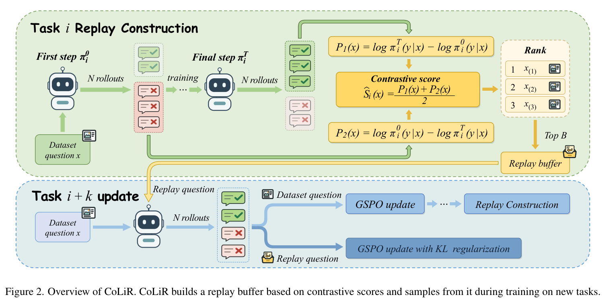
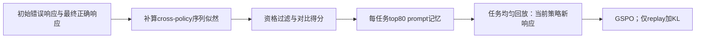

# Policy Improvement-Guided Replay for Continual Reinforcement Learning

[English](README-en.md)

> **L1独立机制组件，diagnostic only。** 完整实验成本过高，不复现（审查 DONE）；不自动重试、不进入Evolve晋级。

## 论文信息

| 字段 | 内容 |
| --- | --- |
| 论文链接 | [arXiv 2611.25989v1](https://arxiv.org/abs/2611.25989v1)；[固定v1全文](https://arxiv.org/html/2611.25989v1) |
| 公司 / 作者机构 | 一作 **Qin-Wen Luo**：**Nanjing University of Aeronautics and Astronautics**；固定v1作者栏核对，不以所用模型推定机构 |
| 首次公开日期 | **2026-11-19T12:12:19Z**（UTC）；本轮11月20日公告/复核不等于首发日期 |
| 原作者开源代码 | 固定v1作者入口和全文未找到可验证的本篇官方源码发布；引用的GSPO/CPO代码不等于CoLiR源码。 |
| 本地 adapter / key | `colir-replay`；`adapter: null`，独立组件不是完整训练adapter |
| 本地复现代码 | `src/auto_research/post_training/colir_replay.py` |

## 原始论文总结

### 背景与主要改动

持续RL不应只保存旧模型的输出：新策略仍需在历史任务分布上重新行动。CoLiR在任务结束时复用已有rollout，分别取最终策略生成的正确响应和初始策略生成的错误响应；各自补算另一策略的序列log-likelihood，以正确响应被强化和错误响应被压低两个半权重均值排序prompt。不是按答案长度平均，也不是只看正确率提升。

仅保留最终组有对有错、且初始组至少有一条错误响应的prompt，每个历史任务最多80条。以后对历史任务均匀分配回放，再由当前策略重新生成响应；不是直接重放旧响应。KL只作用于回放prompt，参考策略冻结在当前任务开始时。排序需要额外cross-policy评分，但不需要为构建记忆额外生成响应。

<!-- paper-figure:start -->
### 原论文关键图

[](https://arxiv.org/pdf/2611.25989v1#page=5)

图片来自[原论文](https://arxiv.org/pdf/2611.25989v1#page=5)第5页Figure 2及完整图注，版权归原作者所有；已视觉检查，无科学内容改动。[裁剪与SHA256](assets/provenance.json)。图示属于作者方法，不是本地结果。
<!-- paper-figure:end -->



### 核心公式

来源：PDF p1 byline；Section4.3 Eq.15 and eligibility；Section5.1；AppendixB.3 Table6。

$$
\widehat S_i(x)=\frac12\operatorname{mean}_{y\in\mathcal Y^+_{T,x}}[\log\pi_i^T(y|x)-\log\pi_i^0(y|x)]+\frac12\operatorname{mean}_{y\in\mathcal Y^-_{0,x}}[\log\pi_i^0(y|x)-\log\pi_i^T(y|x)].
$$

最终组全对或全错、初始组全对都不进入候选池。得分为正不无条件证明能力提高：原文分解还含非负的条件分布KL项，充分保证需要对该偏移作界。论文回放KL系数为0.01；本地仅返回其门控项，不猜测完整trainer的归约。

### 论文离线与线上效果

原文Table1在修正后的MRCL五任务序列上报告2B/4B/8B的MFN为55.32/69.35/68.17，CPO为51.11/61.59/58.18；8B差值9.99个百分点。MFN是最后阶段的五任务平均，不是每个任务都获胜：8B的FinMME为45.06，低于CPO的47.12。MFT衡量新任务学习，8B CoLiR72.44与CPO72.51接近。未报告生产线上A/B；这些是作者完整模型的结果。

### 与已有方法的关系

TAR先从base正确响应构建分散原型bank，按当前策略相对base的压制程度，对旧轨迹和token做门控加权NLL；CoLiR用初始错误与最终正确响应的cross-policy似然变化筛选历史prompt，后续由当前策略生成新响应，并只对replay施加KL。两者都分配历史回放预算，但单位是旧响应行为与历史问题，筛选依据是当前压制与原任务策略改进。比较成本必须分别计入TAR建bank、CoLiR补评分以及后续新rollout；CoLiR构建记忆免额外生成，不等于训练全程不再生成。

## 本地复现

### 数据协议与代码映射

显式缓存的四组cross-policy序列log-likelihood、候选资格、每任务top-B、任务均匀/任务内均匀抽样和回放KL token门控。保留精确并列时的输入顺序；跨任务抽样本组件显式用有放回策略，论文未指定替换规则。没有VLM评分器、MRCL训练器、GSPO更新或能力评测，不能称为Evolve已接入。

```bash
PYTHONPATH=src python -c 'from auto_research.post_training.colir_replay import diagnostic; print(diagnostic(42))'
PYTHONPATH=src python -m pytest -q tests/post_training/test_nov20_post_components.py
```

### 结果、负控与边界

已独立执行CPU seeds42/43/44：[实际产物](../../research-audits/nov20-latest/independent-cpu-runs/colir-replay.json)。它们只检验公式、梯度、mask和负控，不是完整模型能力比较。CUDA路径须等待本轮真实A100/A30冻结源码回执；在回执完成前不声称GPU已通过。

最终全对/全错或初始全对的prompt不得填满buffer；新任务和padding的KL梯度必须为0。排序依赖外部训练log-likelihood，不是伪造scorer或Agent成功率。

### 高成本完整实验

原文使用Qwen3-VL-2B/4B/8B，五个任务每任务600步、每步32题×8响应，另有九种方法和OOD评测。单一模型配置的名义采样槽为5×600×32×8=768000，实际生成量需训练日志确认，不能把这个计算当实测；全部矩阵远超单A100/A30的秒级组件预算。

**成本过高，不复现（审查 DONE）**。本轮不下载checkpoint/数据，不调用付费API，不启动完整训练或试探性扩规模，不进入自动重试队列。小组件预算为每seed不超过30秒，可用资源是一张A100或A30、或Mac，不能假设多卡或两台同时可用。
