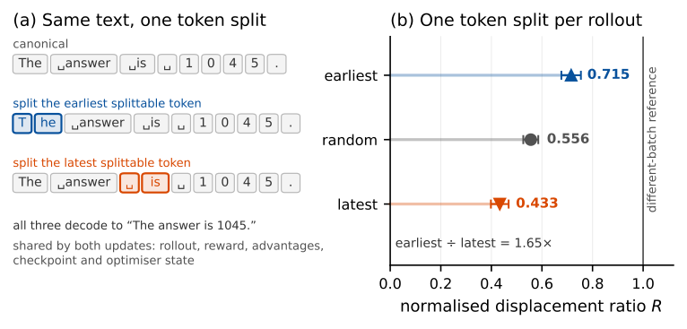
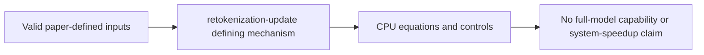

# How Far Does Lossless Re-tokenization Move an RLVR Update?

<!-- source-sha256: 414fe7e23ed0cb58275987eb2d1b5e73c1946d9eb1eecc8297d0c79292bdcdb9 -->

[简体中文](README.md)

> **L1 core-mechanism component, diagnostic only; not LLM capability or a full reproduction. CPU only, with no CUDA path or Evolve promotion evidence.** Full experiments are high-cost and not reproduced (review DONE), with no automatic retry.

## Paper information

| Field | Value |
| --- | --- |
| Paper | [arXiv:2611.27083v1](https://arxiv.org/abs/2611.27083v1); [fixed-v1 full text](https://arxiv.org/html/2611.27083v1) |
| Company / author institution | First author **Zhe Dong**; **University of Maine at Presque Isle / Stanford University**. Using Google/Meta models does not establish author affiliation. |
| Original publication | **2026-11-20T03:53:22Z**; v1 update time equals original submission. Discovered/reviewed2026-11-23; announcement date not independently confirmed. This is not a claim of publication today. |
| Author source code | No verified release found. As of2026-11-23, no verified repository URL was found in the fixed-v1 text or official abstract. A statement that data accompany code is not a verified release link. |
| Local adapter / key | `retokenization-update`; `adapter: null` |
| Local reproduction code | `src/auto_research/post_training/retokenization_update.py` |

## Original paper summary

### Background and main changes

The intervention changes token IDs, not rewards. Text, reward, advantage and checkpoint stay fixed while a splittable token becomes two vocabulary items with the same decoded text. Shared-parameter model probes compare canonical, re-encoded and different-batch updates. A separate prefix-softmax policy for each tokenization proves a structural mismatch: a fine policy leaves an unvisited prefix's conditional odds unchanged, whereas a whole-string softmax changes unsampled logits under the full gradient.

<!-- paper-figure:start -->
### Original paper figure

[](https://arxiv.org/html/2611.27083v1/fig_teaser.svg)

From the [fixed-v1 original asset](https://arxiv.org/html/2611.27083v1/fig_teaser.svg); copyright remains with its authors. The complete figure was visually reviewed without scientific modification. Source and SHA256 are in [provenance](assets/provenance.json). Its numbers are authors' results, not local experiments.
<!-- paper-figure:end -->



### Core equations

$$
c(u,v)=\frac{\|u-v\|}{(\|u\|+\|v\|)/2},\qquad R=\frac{\operatorname{mean}_b c_{\mathrm{re},b}}{\operatorname{mean}_b c_{\mathrm{ref},b}}.\qquad \Delta\log\frac{\pi(ba)}{\pi(bb)}=-\lambda[\pi(ba)-\pi(bb)]\ \text{(coarse)}.
$$

Sources: Section2, Eqs.1–2; Section4, Proposition1; AppendixE. Sampling ab gives the coarse full-score step λ(e_ab−π). The fine policy updates only the root and a-successor rows, leaving the b row and ba/bb odds fixed. When π(ba)≠π(bb), agreement requires a zero step. The uniform symmetric exception violates that premise, so a universal no-nonzero-step claim would be false. AppendixE separately describes a weaker sampled-logit-only simulator; local code uses the full softmax gradient instead.

### Reported offline and online results

For Qwen2.5-0.5B three-digit addition, one random split per rollout, about4.07% of tokens, yields R=0.556; earliest/latest policies give0.715/0.433, without isolating token identity from location. Actual decode/re-encode audits affect up to5.2% of rollouts but only0.08% of tokens, much less than the intervention dose. Canonical wins14 of18 pre-registered fixed-rollout training pairs, but the all-pair mean-gap95% interval includes zero; the exclusion rule favors canonical. This is not evidence of universal capability improvement. No online A/B is reported.

### Relation to existing methods

DFRL changes downstream decision-cost feedback, and RLOO cancels a shared within-instance constant. This paper holds rewards and advantages fixed and asks how encoding changes score gradients. Baseline cancellation does not equalize different token-path Jacobians; unchanged rewards do not imply unchanged updates.

## Local reproduction

### Data protocol and code mapping

CPU prefix-softmax tables are initialized by the chain rule from one strictly positive complete string distribution and execute full λ_t(e_token−π_row) gradients. Checks cover unvisited rows, coarse unsampled logits and the resulting string distributions. The c and ratio-of-means R utilities are implemented separately; independent tabular parameter spaces are never presented as shared LLM parameters for R. R accepts externally measured updates in one common parameter space. A nonzero matching step under a uniform distribution is a symmetric positive control. No real BPE, LoRA, AdamW, rollout generation or repair algorithm is provided. This is a mechanism diagnostic, not a post-training capability.

### Results, controls and limits

```bash
PYTHONPATH=src python -c 'from auto_research.post_training.retokenization_update import diagnostic; print(diagnostic(42))'
PYTHONPATH=src:scripts python -m pytest -q tests/test_nov23_post_training.py
```

Targeted tests actually executed CPU diagnostics for three seeds. The batch's auditable artifact is [component-cpu-seeds42-44.json](metrics/component-cpu-seeds42-44.json). It records equations, numerical boundaries and controls, not real model scores; multiple seeds do not upgrade a mechanism diagnostic into capability evidence. `device="cuda"` is explicitly rejected. No GPU path, fabricated GPU receipt or Evolve integration is supplied.

### High-cost full experiments

AppendixC's paired probes cover four0.5B/1.7B/8B/8B models, doses, locations and objectives, with8/32/64 warmup updates,16/32/64 batches per cell and four inner epochs per update. The pre-registered0.5B training alone has18 pairs×2 arms×300 updates=10800 updates, plus sampling/evaluation. These are configuration counts, not locally measured time. The full matrix is high-cost for one A100/A30 or a Mac; weights and long probes are not downloaded or run. Only the four-string CPU theorem and measurement arithmetic execute.

**High cost: not reproduced (review DONE).** Available resources are one A100 or A30, or a local Mac, without assuming multiple GPUs or simultaneous hosts. CPU components have a30-second-per-seed cap. Passing components does not change the terminal full-experiment disposition.
