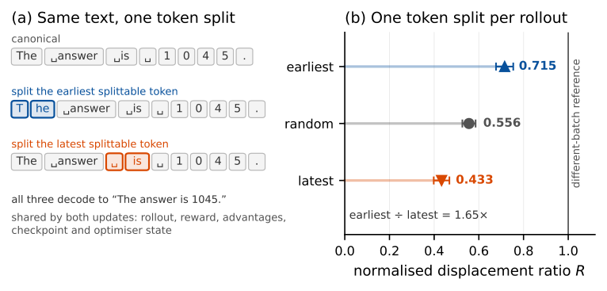
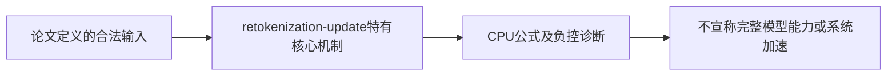

# How Far Does Lossless Re-tokenization Move an RLVR Update?

[English](README-en.md)

> **L1核心机制组件，diagnostic only；不是LLM能力或完整论文复现。纯CPU、无CUDA路径，不作为Evolve晋级证据。** 完整实验成本过高，不复现（审查 DONE）；不自动重试。

## 论文信息

| 字段 | 内容 |
| --- | --- |
| 论文链接 | [arXiv:2611.27083v1](https://arxiv.org/abs/2611.27083v1)；[固定v1全文](https://arxiv.org/html/2611.27083v1) |
| 公司 / 作者机构 | 一作 **Zhe Dong**；**University of Maine at Presque Isle / Stanford University**；不以所用Google/Meta模型推定作者机构 |
| 首次公开日期 | **2026-11-20T03:53:22Z**；固定v1修订时间同首发；发现/审查为2026-11-23，公告日期未独立确认，不称今天新发 |
| 原作者开源代码 | 未找到已核实发布入口；截至2026-11-23，固定v1全文和官方abstract未找到已核实的本篇源码仓库URL；文内称代码附带数据不等于已核验发布入口。 |
| 本地 adapter / key | `retokenization-update`；`adapter: null` |
| 本地复现代码 | `src/auto_research/post_training/retokenization_update.py` |

## 原始论文总结

### 背景与主要改动

研究对象不是奖励变化，而是同一rollout的token ID变化。保留文本、reward、advantage和checkpoint，仅将可拆token替换成两个拼回原文本的词表项。论文从共享参数checkpoint比较canonical、re-encoded和不同batch的更新，另在每种分词各自一套prefix-softmax表上证明：未访问prefix的条件概率比保持不变，但整词softmax的未采样logit仍被完整梯度改变。

<!-- paper-figure:start -->
### 原论文关键图

[](https://arxiv.org/html/2611.27083v1/fig_teaser.svg)

图片来自[原论文](https://arxiv.org/html/2611.27083v1/fig_teaser.svg)，版权归原作者所有；原图完整保留，已视觉核对，无科学内容修改。出处与SHA256见[provenance](assets/provenance.json)。图中数值是作者结果，不是本地实验。
<!-- paper-figure:end -->



### 核心公式

$$
c(u,v)=\frac{\|u-v\|}{(\|u\|+\|v\|)/2},\qquad R=\frac{\operatorname{mean}_b c_{\mathrm{re},b}}{\operatorname{mean}_b c_{\mathrm{ref},b}}.\qquad \Delta\log\frac{\pi(ba)}{\pi(bb)}=-\lambda[\pi(ba)-\pi(bb)]\ \text{(coarse)}.
$$

来源：§2 Eq.1–2、§4 Proposition1及AppendixE。采样ab时，coarse完整score步为λ(e_ab−π)；fine只更新root和a后继行，b行不动，所以fine的ba/bb比不变。若π(ba)≠π(bb)，共同更新仅能为零；均匀分布的对称例外不满足这个前提，不能宣称所有分布绝无非零一致步。论文AppendixE还明确区分仅更新sampled-logit的较弱模拟器，本地使用完整softmax梯度而非该替代。

### 论文离线与线上效果

Qwen2.5-0.5B三位数加法每rollout随机拆一个token约4.07%时，R=0.556；earliest与latest为0.715/0.433，位置与token身份未隔离。真实decode/re-encode审计最多影响5.2%rollout、0.08%token，远小于干预剂量。18对预注册固定rollout训练有14对canonical领先，但全部pair平均差的95%区间包含0；排除规则偏向canonical，不能据此声称普遍能力改善。未报告线上A/B。

### 与已有方法的关系

DFRL改变奖励来自何种下游决策成本，RLOO消去同一实例共有常数；本篇固定奖励和优势，检查编码怎样改变score-gradient。baseline消去共同regret常数并不使不同token路径的Jacobian相同；不能把reward不变误写成更新不变。

## 本地复现

### 数据协议与代码映射

纯CPU prefix-softmax表从同一正的完整字符串分布按chain rule初始化，执行λ_t(e_token−π_row)完整梯度；检验未访问行、coarse未采样logit和字符串分布差异。独立实现c及ratio-of-means R，但不把两套独立tabular参数假装成共享LLM参数来计算R；R函数仅接受调用方已在同一参数空间测得的更新。包含均匀分布非零一致步的对称正控，避免过度概括定理。没有真实BPE、LoRA、AdamW、rollout或修复算法；这是一项机制诊断，不是后训练能力实现。

### 结果、负控与边界

```bash
PYTHONPATH=src python -c 'from auto_research.post_training.retokenization_update import diagnostic; print(diagnostic(42))'
PYTHONPATH=src:scripts python -m pytest -q tests/test_nov23_post_training.py
```

本轮针对性测试已实际执行三种子CPU诊断；统一可审计产物为[component-cpu-seeds42-44.json](metrics/component-cpu-seeds42-44.json)。只记录公式、数值边界与负控，不含真实模型分数；多seed不把机制诊断升级为能力比较。显式拒绝`device="cuda"`，因此无GPU宣传路径与伪GPU回执。未接Evolve。

### 高成本完整实验

AppendixC的配对探针覆盖0.5B/1.7B/8B/8B四模型、多剂量/位置/目标，单cell有8/32/64 warmup、16/32/64 batch、每update4个inner epoch；预注册0.5B训练18对×2臂×300更新=10800更新，另采样及评测。该数是配置计算，不是本机耗时测量；完整矩阵在单A100/A30或Mac预算下成本过高，不下载权重、不做长时试探。只执行四字符串CPU表格定理与测量算术。

**成本过高，不复现（审查 DONE）**。可用资源是一张A100或A30，或本地Mac，不假设多卡或两台同时可用。低成本组件预算每seed不超过30秒；完整实验的终态不因组件通过而改变。
