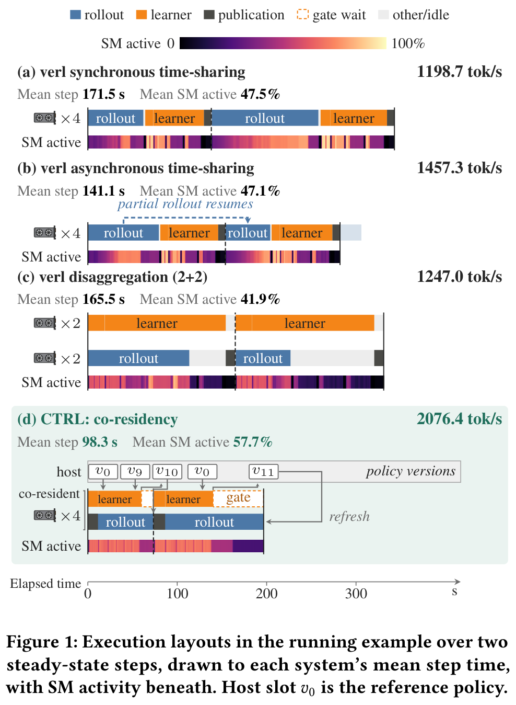
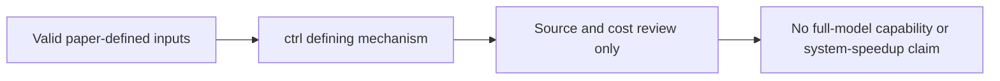

# CTRL: Concurrent Training and Rollout for LLM Reinforcement Learning via GPU Co-Residency

<!-- source-sha256: 2e8ebbc76609c6fbfd4f3c0f9fcfc80ddab1c06412478058206b8d2c43297ef4 -->

[简体中文](README.md)

> **Review only, with no local system implementation or CUDA validation. High cost: not reproduced, review DONE.** Full experiments are high-cost and not reproduced (review DONE), with no automatic retry.

## Paper information

| Field | Value |
| --- | --- |
| Paper | [arXiv:2611.27119v1](https://arxiv.org/abs/2611.27119v1); [fixed-v1 full text](https://arxiv.org/html/2611.27119v1) |
| Company / author institution | First author **Ruijia Yang**; **The Hong Kong University of Science and Technology (Guangzhou)**. Using Google/Meta models does not establish author affiliation. |
| Original publication | **2026-11-20T04:42:26Z**; v1 update time equals original submission. Discovered/reviewed2026-11-23; announcement date not independently confirmed. This is not a claim of publication today. |
| Author source code | No verified release found. As of2026-11-23, no verified CTRL repository was found in the fixed-v1 text or official author entry. Cited verl/vLLM/Slime repositories are not a CTRL release. |
| Local adapter / key | `ctrl`; `adapter: null` |
| Local reproduction code | `None: documentation review only; no local reproduction-code directory` |

## Original paper summary

### Background and main changes

CTRL co-resides a learner rank and persistent rollout shard on every GPU, sharing SMs through CUDA MPS. Optimizer state and immutable policy versions live on the host while a bounded layer window streams to the GPU. It trains a ready batch before waiting for due cohorts at publication, overlapping the rollout tail. Completing an update and publishing it to rollout are distinct events. Refresh retains partial responses, original sampling log probabilities and the earliest behavior version.

<!-- paper-figure:start -->
### Original paper figure

From the [fixed-v1 original asset](https://arxiv.org/html/2611.27119v1/intro_modes.png); copyright remains with its authors. The complete figure was visually reviewed without scientific modification. Source and SHA256 are in [provenance](assets/provenance.json). Its numbers are authors' results, not local experiments.
<!-- paper-figure:end -->

### Core equations

$$
\sigma(B)=(g-1)-\min_{y\in B}b(y)\le T,\qquad P\ge\max(L,S/T)\ (T\ge1),\qquad P\ge L+S\ (T=0).
$$

Sources: Section3.3, Eq.1 and publication gate; Section3.4, Eq.3. b(y) is the earliest behavior version, including across resumed generation, not the completion version. Publication of g waits while requests dispatched at p satisfy g−p+1≥T; FIFO consumption with W≤T warmup closes the staleness bound. The lower bound on P guides measurement and SM-share selection. It does not guarantee attainability or permit a CPU scheduling sketch to establish throughput gains.

### Reported offline and online results

Across24 workloads, the complete system reaches1.11–2.24× the stronger verl asynchronous baseline and1.23× on eight H100s. Same-learner controls show co-residency does not always beat splitting: RTX4090 MBPP at N=64 reaches only0.86× the2+2 split. Disabling MPS retains residency but loses concurrent execution and lowers throughput; bandwidth, L2 and power contention remain. These are authors' system measurements, not local results. No production online A/B is reported.

### Relation to existing methods

CoLiR selects historical prompts and later regenerates responses with the current policy. CTRL controls hardware sharing and publication for training and generation. Data-budget/memory selection and system-layout/version contracts are separate axes. Reusing rollouts to build CoLiR memory does not remove later generation cost, so its savings cannot simply multiply CTRL's system speedups.

## Local reproduction

### Data protocol and code mapping

Review-only catalog entry and cost assessment: no local CTRL implementation, CUDA path, benchmark, metric receipt or Evolve operator. Neither equations nor CPU timing fixtures are presented as a CUDA co-residency system. Fixed-version facts, mechanism, original figure and non-winning regimes are preserved without fabricated metrics.

### Results, controls and limits

No paper experiment ran and no local metrics are supplied. Documentation completeness or unit tests are not system validation. `component_implemented=false`; no automatic implementation/retry queue.

### High-cost full experiments

Section4.1 defaults to four H10080GB, four A80080GB or four RTX4090 24GB GPUs, dual-CPU hosts with1–2TiB RAM; it also includes eight-H100 scaling, Qwen3-8B/14B, DAPO-Math/MBPP,24 workloads, share/layout sweeps and three seeds. One A100/A30 or a Mac cannot faithfully validate this full system matrix. No MPS trial, multi-GPU training or weight download is launched. High cost: not reproduced, review DONE, no automatic retry.

**High cost: not reproduced (review DONE).** Available resources are one A100 or A30, or a local Mac, without assuming multiple GPUs or simultaneous hosts. CPU components have a30-second-per-seed cap. Passing components does not change the terminal full-experiment disposition.
