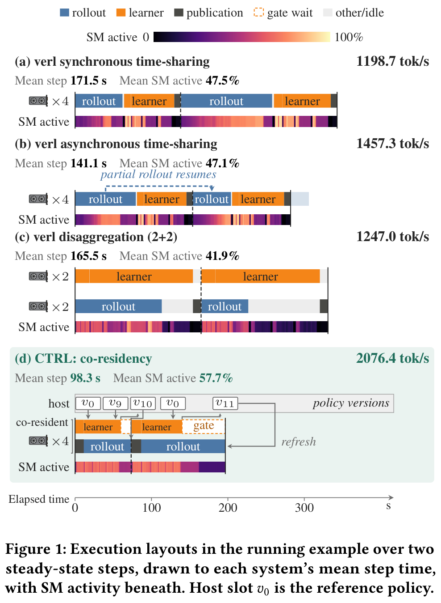
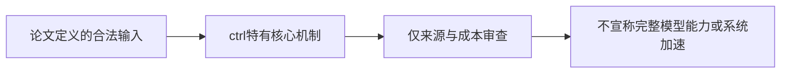

# CTRL: Concurrent Training and Rollout for LLM Reinforcement Learning via GPU Co-Residency

[English](README-en.md)

> **仅收录、无本地系统实现、无CUDA验收；成本过高，不复现（审查 DONE）。** 完整实验成本过高，不复现（审查 DONE）；不自动重试。

## 论文信息

| 字段 | 内容 |
| --- | --- |
| 论文链接 | [arXiv:2611.27119v1](https://arxiv.org/abs/2611.27119v1)；[固定v1全文](https://arxiv.org/html/2611.27119v1) |
| 公司 / 作者机构 | 一作 **Ruijia Yang**；**The Hong Kong University of Science and Technology (Guangzhou)**；不以所用Google/Meta模型推定作者机构 |
| 首次公开日期 | **2026-11-20T04:42:26Z**；固定v1修订时间同首发；发现/审查为2026-11-23，公告日期未独立确认，不称今天新发 |
| 原作者开源代码 | 未找到已核实发布入口；截至2026-11-23，固定v1全文与官方作者入口未找到已核实的CTRL源码仓库；引用verl/vLLM/Slime不等于本篇开源。 |
| 本地 adapter / key | `ctrl`；`adapter: null` |
| 本地复现代码 | `无：仅文档审查，无本地复现代码目录` |

## 原始论文总结

### 背景与主要改动

CTRL让每张GPU同时驻留learner rank和持续rollout shard，在CUDA MPS下共享SM。为腾出显存，优化器和immutable policy版本保存在host，learner仅流式装入有限层窗口。训练ready batch后才在发布前等待到期cohort，避免先暴露全部rollout tail；更新完成和对rollout发布是两个事件。刷新时保留partial响应、旧采样logp及最早behavior版本。

<!-- paper-figure:start -->
### 原论文关键图

图片来自[原论文](https://arxiv.org/html/2611.27119v1/intro_modes.png)，版权归原作者所有；原图完整保留，已视觉核对，无科学内容修改。出处与SHA256见[provenance](assets/provenance.json)。图中数值是作者结果，不是本地实验。
<!-- paper-figure:end -->

### 核心公式

$$
\sigma(B)=(g-1)-\min_{y\in B}b(y)\le T,\qquad P\ge\max(L,S/T)\ (T\ge1),\qquad P\ge L+S\ (T=0).
$$

来源：§3.3 Eq.1及publication gate、§3.4 Eq.3。b(y)是包括跨刷新续写时的最早behavior版本，而非最终完成时版本。publication g在仍有dispatch p且g−p+1≥T的请求时等待；FIFO消费与W≤T warmup一起支撑陈旧度界。P的下界指导测量和SM share选择，不保证下界可达，也不是CPU调度模拟可以证实的吞吐收益。

### 论文离线与线上效果

24个工作负载中，完整CTRL系统相对更强的verl异步基线为1.11–2.24×，8×H100为1.23×；同learner对照揭示不是所有共驻留都胜split：RTX4090 MBPP N=64仅为2+2 split的0.86×。MPS关闭仍驻留但不并行，吞吐下降；共享会争用带宽/L2/power。原文系统测量不等于本地结果；未报告生产线上A/B。

### 与已有方法的关系

CoLiR选择应回放哪些历史prompt、后续由当前策略生成新响应；CTRL决定同一批训练与生成怎样共享硬件和发布时间。一个是数据预算/记忆选择，一个是系统布局/版本合同，互不替代。免额外生成来构建CoLiR记忆也不消除训练rollout成本，不能据此把CTRL系统加速直接叠乘。

## 本地复现

### 数据协议与代码映射

本篇仅收录和成本审查：没有本地CTRL实现、CUDA路径、benchmark、指标回执或Evolve算子。未将paper公式或CPU时序fixture宣传为CUDA共驻留系统。保存固定版本事实、机制、原图及失败/不占优条件，不生成伪实验metrics。

### 结果、负控与边界

未运行本论文实验，无本地metrics；不把文档完整或单元测试当作系统验收。`component_implemented=false`，不进入自动实现/重试队列。

### 高成本完整实验

§4.1默认4×H100 80GB、4×A800 80GB或4×RTX4090 24GB，双CPU host 1–2TiB RAM；另含8×H100扩展、Qwen3-8B/14B、DAPO-Math/MBPP、24工作负载、多share/布局及三seed。单A100/A30或Mac无法忠实验证该完整系统矩阵；不做MPS试跑、不启动多GPU训练、不下载权重。本篇成本过高，不复现（审查 DONE），无自动重试。

**成本过高，不复现（审查 DONE）**。可用资源是一张A100或A30，或本地Mac，不假设多卡或两台同时可用。低成本组件预算每seed不超过30秒；完整实验的终态不因组件通过而改变。
