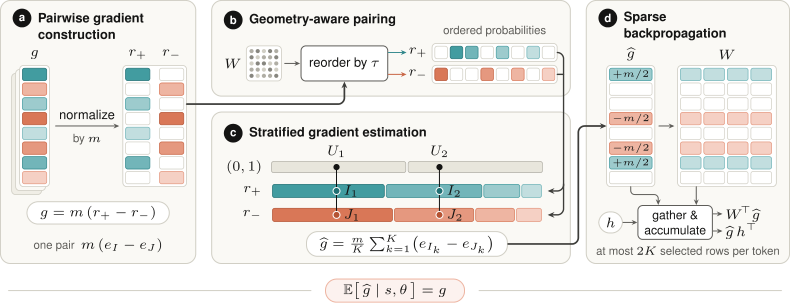

# Distillation with Errors: Sparse Unbiased Backpropagation for Knowledge Distillation

<!-- source-sha256: 48e7185b2ab6a4e58919f8a244caa11dd5e569a2b82826f7b1e98141b226b342 -->

[简体中文](README.md)

> **L1 core-mechanism component, diagnostic only; not LLM capability or a full reproduction. CPU only, with no CUDA path or Evolve promotion evidence.** Full experiments are high-cost and not reproduced (review DONE), with no automatic retry.

## Paper information

| Field | Value |
| --- | --- |
| Paper | [arXiv:2611.27131v1](https://arxiv.org/abs/2611.27131v1); [fixed-v1 full text](https://arxiv.org/html/2611.27131v1) |
| Company / author institution | First author **Yuyang Zhang**; **University of Science and Technology of China**. Using Google/Meta models does not establish author affiliation. |
| Original publication | **2026-11-20T05:06:05Z**; v1 update time equals original submission. Discovered/reviewed2026-11-23; announcement date not independently confirmed. This is not a claim of publication today. |
| Author source code | [Author repository](https://github.com/dwe-lab/DWE). Author repository verified at commit 481223f3704607b2c9cb21741bfd3fde8822299b; its README declares Apache-2.0. Read only; upstream code was not executed. |
| Local adapter / key | `dwe`; `adapter: null` |
| Local reproduction code | `src/auto_research/post_training/dwe.py` |

## Original paper summary

### Background and main changes

DWE does not change the teacher, sampling policy or KL objective. It estimates the full output-head gradient at fixed inputs and parameters. Softmax logit gradients sum to zero, so their positive and negative parts share mass m. Normalize each part and pair equal, opposite coefficients. A fixed vocabulary order from the initial student head's leading principal component couples both signs at shared quantiles; one draw from each of K strata reduces variance. At most 2K rows per token enter output-head backpropagation, preserving the original gradient in expectation.

<!-- paper-figure:start -->
### Original paper figure

[](https://arxiv.org/html/2611.27131v1/dwe-mechanism.svg)

From the [fixed-v1 original asset](https://arxiv.org/html/2611.27131v1/dwe-mechanism.svg); copyright remains with its authors. The complete figure was visually reviewed without scientific modification. Source and SHA256 are in [provenance](assets/provenance.json). Its numbers are authors' results, not local experiments.
<!-- paper-figure:end -->


### Core equations

$$
g=p-q,\quad m=\tfrac12\|g\|_1,\quad r_+=g_+/m,\quad r_-=g_-/m,\quad \widehat g=\frac mK\sum_{k=1}^K(e_{I(U_k)}-e_{J(U_k)}),\quad \mathbb E\widehat g=g.
$$

Sources: Section 2, Eqs.2–3; Section 3, Eqs.4–15. Each U_k is independent uniform on ((k−1)/K,k/K), shared between the positive and negative CDFs. Backpropagation computes Wᵀĝ and ĝhᵀ from selected rows; masking a previously computed dense backward pass does not implement its savings. Reverse-KL gradients p_i[log(p_i/q_i)−KL(p‖q)] also sum to zero. The cached order approximates geometry; it is not rebuilt each step, and teacher/student token IDs must align.

### Reported offline and online results

The authors report 63.5% and 57.9% lower hidden-state and output-weight gradient MSE than IS at matched sampling budgets; off-policy output-head speedup reaches 1.95× and training time falls 10.4–15.7%. OPD reaches 2.20× output-head speedup, but mean end-to-end update time falls only 1.53%, from 688.54 to 678.03 seconds. A local kernel gain is not a 2.20× training gain. These are the authors' H100 results, not local measurements. No production online A/B is reported.

### Relation to existing methods

SimOPD matches answer-to-answer similarity distributions in separate representation spaces, changing supervision. DWE retains a chosen KL objective and changes its backward estimator and row computation. They could be composed in principle, but this does not establish a real LLM integration or joint-training result.

## Local reproduction

### Data protocol and code mapping

Pure-standard-library CPU code executes positive/negative pairing, a centered-PCA cached order, shared stratified quantiles, forward/reverse-KL logit gradients and selected-row hidden/weight gradients. Multiple-start power iteration on tiny matrices differs from upstream randomized PCA but preserves the paper's principal-direction mechanism. Exact integration over all CDF intervals checks unbiasedness; finite differences independently verify KL gradients. Discarded top-coordinate gradients are a biased negative control. No Transformer, CUDA kernel, real teacher cache, student generation, capability benchmark or throughput measurement is provided.

### Results, controls and limits

```bash
PYTHONPATH=src python -c 'from auto_research.post_training.dwe import diagnostic; print(diagnostic(42))'
PYTHONPATH=src:scripts python -m pytest -q tests/test_nov23_post_training.py
```

Targeted tests actually executed CPU diagnostics for three seeds. The batch's auditable artifact is [component-cpu-seeds42-44.json](metrics/component-cpu-seeds42-44.json). It records equations, numerical boundaries and controls, not real model scores; multiple seeds do not upgrade a mechanism diagnostic into capability evidence. `device="cuda"` is explicitly rejected. No GPU path, fabricated GPU receipt or Evolve integration is supplied.

### High-cost full experiments

Section4.1 and AppendixB.1 use 0.6B/1.7B/4B students, 4B/8B/32B teachers, 80M FineWeb-Edu tokens per configuration, one H100 80GB and three seeds; training timings exclude teacher-cache construction. OPD uses a 1.7B student/4B teacher, 100 updates of 256 prompts and up to8192 response tokens. Table10's688.54 seconds/update implies about19.1 hours per method/seed, arithmetic from the paper rather than a local measurement, before long-generation evaluation on13 benchmarks. Full experiments exceed the one-A100/A30-or-Mac budget; no download or trial is launched.

**High cost: not reproduced (review DONE).** Available resources are one A100 or A30, or a local Mac, without assuming multiple GPUs or simultaneous hosts. CPU components have a30-second-per-seed cap. Passing components does not change the terminal full-experiment disposition.
