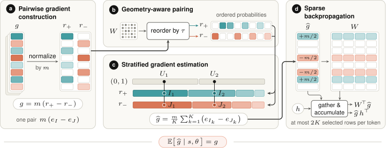

# Distillation with Errors: Sparse Unbiased Backpropagation for Knowledge Distillation

[English](README-en.md)

> **L1核心机制组件，diagnostic only；不是LLM能力或完整论文复现。纯CPU、无CUDA路径，不作为Evolve晋级证据。** 完整实验成本过高，不复现（审查 DONE）；不自动重试。

## 论文信息

| 字段 | 内容 |
| --- | --- |
| 论文链接 | [arXiv:2611.27131v1](https://arxiv.org/abs/2611.27131v1)；[固定v1全文](https://arxiv.org/html/2611.27131v1) |
| 公司 / 作者机构 | 一作 **Yuyang Zhang**；**University of Science and Technology of China**；不以所用Google/Meta模型推定作者机构 |
| 首次公开日期 | **2026-11-20T05:06:05Z**；固定v1修订时间同首发；发现/审查为2026-11-23，公告日期未独立确认，不称今天新发 |
| 原作者开源代码 | [https://github.com/dwe-lab/DWE](https://github.com/dwe-lab/DWE)；已核实原作者仓库；固定提交481223f3704607b2c9cb21741bfd3fde8822299b，README声明Apache-2.0许可。仅阅读，未运行上游代码。 |
| 本地 adapter / key | `dwe`；`adapter: null` |
| 本地复现代码 | `src/auto_research/post_training/dwe.py` |

## 原始论文总结

### 背景与主要改动

DWE不改变蒸馏教师、采样者或KL目标，而是在相同输入和参数下估计输出头的完整梯度。softmax的logit梯度和为零，正负部分各有质量m；分别归一化后配成等量异号的坐标对。以学生初始输出头的首主成分构造固定词表顺序，用同一quantile耦合正负坐标，再在K个等宽区间分别取样。每token最多2K行参与输出头反传，期望保留原梯度。

<!-- paper-figure:start -->
### 原论文关键图

[](https://arxiv.org/html/2611.27131v1/dwe-mechanism.svg)

图片来自[原论文](https://arxiv.org/html/2611.27131v1/dwe-mechanism.svg)，版权归原作者所有；原图完整保留，已视觉核对，无科学内容修改。出处与SHA256见[provenance](assets/provenance.json)。图中数值是作者结果，不是本地实验。
<!-- paper-figure:end -->


### 核心公式

$$
g=p-q,\quad m=\tfrac12\|g\|_1,\quad r_+=g_+/m,\quad r_-=g_-/m,\quad \widehat g=\frac mK\sum_{k=1}^K(e_{I(U_k)}-e_{J(U_k)}),\quad \mathbb E\widehat g=g.
$$

来源：§2 Eq.2–3；§3 Eq.4–15。U_k独立均匀分布于((k−1)/K,k/K)，正负CDF共用U_k。反传实际计算Wᵀĝ与ĝhᵀ；不能先做完整稠密反传再屏蔽。reverse KL的logit梯度为p_i[log(p_i/q_i)−KL(p‖q)]，同样和为零。固定顺序可近似几何，但不是每步重排或把教师/学生词表ID混用。

### 论文离线与线上效果

作者报告与同采样预算IS相比，hidden-state和output-weight梯度MSE分别下降63.5%和57.9%；off-policy输出头最高1.95×，训练时间下降10.4–15.7%。OPD输出头最高2.20×，但端到端平均update仅下降1.53%（688.54至678.03秒），不能把局部加速写成全训练2.20×。这些是作者H100结果，不是本地测量；未报告生产线上A/B。

### 与已有方法的关系

SimOPD在各自表示空间匹配回答间的相似度分布，改变监督目标；DWE保持既定KL目标，只改变反向梯度估计和输出行计算。二者可在设计上组合，但SimOPD的关系分布不是DWE已经支持的真实LLM路径；本轮也未验证联合训练。

## 本地复现

### 数据协议与代码映射

纯stdlib CPU实现完整正负配对、centered PCA固定顺序、共享分层quantile、forward/reverse KL logit梯度、仅选中行的hidden/weight梯度。小矩阵以多坐标起点的power iteration估计首主成分，与上游随机PCA实现不同但保留论文定义的几何顺序机制。精确积分所有CDF区间检验无偏性，有限差分独立核对KL梯度；top-coordinate丢弃是有偏负控。没有Transformer、CUDA kernel、真实teacher cache、学生生成、能力benchmark或吞吐测量。

### 结果、负控与边界

```bash
PYTHONPATH=src python -c 'from auto_research.post_training.dwe import diagnostic; print(diagnostic(42))'
PYTHONPATH=src:scripts python -m pytest -q tests/test_nov23_post_training.py
```

本轮针对性测试已实际执行三种子CPU诊断；统一可审计产物为[component-cpu-seeds42-44.json](metrics/component-cpu-seeds42-44.json)。只记录公式、数值边界与负控，不含真实模型分数；多seed不把机制诊断升级为能力比较。显式拒绝`device="cuda"`，因此无GPU宣传路径与伪GPU回执。未接Evolve。

### 高成本完整实验

§4.1及AppendixB.1使用0.6B/1.7B/4B学生与4B/8B/32B教师、每配置80M FineWeb-Edu token、1×H100 80GB和三种子，训练计时排除teacher cache构建。OPD为1.7B学生/4B教师、100更新×256题、最大8192token；Table10每更新约688.54秒，单方法单seed约19.1小时（配置算术，不是本机实测），另有13benchmark长生成。相对单A100/A30或Mac预算完整实验成本过高，不下载、不试跑。

**成本过高，不复现（审查 DONE）**。可用资源是一张A100或A30，或本地Mac，不假设多卡或两台同时可用。低成本组件预算每seed不超过30秒；完整实验的终态不因组件通过而改变。
