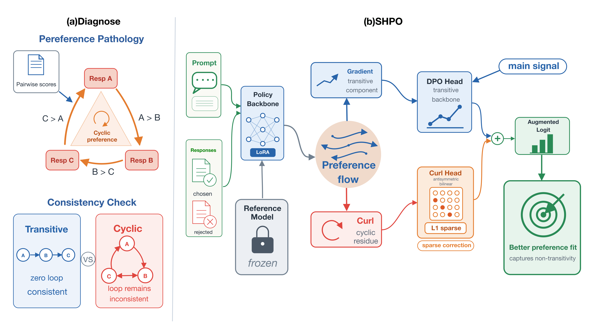

# Sparse Hodge Preference Optimization: Fine-Tuning Language Models toward Alignment beyond Transitive Preferences

<!-- source-sha256: 16c25987e520b0041afe08f5ecacb871bcb5fe8959915db85f4befd985737e98 -->

[简体中文](README.md)

> **L1 core-mechanism component, diagnostic only; not complete LLM training or capability evidence. CPU-only, without an advertised CUDA path or Evolve promotion.** Full experiments are high-cost and not reproduced (review DONE), without automatic retries.

## Paper information

| Field | Value |
| --- | --- |
| Paper | [arXiv:2611.30135v1](https://arxiv.org/abs/2611.30135v1); [fixed-v1 full text](https://arxiv.org/html/2611.30135v1) |
| Company / author institution | First author **Yiming Liu**, **Jinan University**. Author institutions: Jinan University, Harbin Institute of Technology, Peking University.  |
| Original publication | **2026-11-23T06:44:15Z**; v1 update equals original submission. Discovered/reviewed2026-11-24; announcement date not independently confirmed. Not a claim of first publication today. |
| Author source code | No verified method repository was found in fixed-v1 full text, its data-availability statement or checked author sources. Cited PEFT, Accelerate and AlpacaEval repositories are not a SHPO release. |
| Local adapter / key | `shpo`; `adapter: null` |
| Local reproduction code | `src/auto_research/post_training/shpo.py` |

## Original paper summary

### Background and main changes

DPO expresses preferences as differences of scalar response potentials; triangle circulation telescopes to zero, preventing local A-over-B-over-C-over-A cycles. SHPO retains DPO and mean-pools final-layer states over response tokens, projects them through a bias-free W to2K dimensions, and normalizes them. Weighted oriented areas in two-dimensional planes yield an antisymmetric residual. An L1 penalty suppresses inactive plane coefficients. Gradients reach W, gamma and shared-policy hidden states, rather than merely reranking fixed scores.

<!-- paper-figure:start -->
### Original paper figure

[](https://arxiv.org/html/2611.30135v1/full_figure.svg)

From the [fixed-v1 original SVG](https://arxiv.org/html/2611.30135v1/full_figure.svg); the complete figure was preserved and visually checked without scientific modification. Copyright remains with its authors. [Source and SHA256](assets/provenance.json). This is the paper's method, not local training or results.
<!-- paper-figure:end -->


### Core equations

$$
v=\frac{W^\top h}{\|W^\top h\|_2},\quad c_{ij}=\sum_{k=1}^K\gamma_k(v_{i,2k-1}v_{j,2k}-v_{i,2k}v_{j,2k-1}),\quad \ell_{ij}=\beta(\log\tfrac{\pi_i}{\pi_{ref,i}}-\log\tfrac{\pi_j}{\pi_{ref,j}})+\alpha c_{ij},\quad L=\operatorname{mean}\operatorname{softplus}(-\ell_{+-})+\lambda_{reg}\|\gamma\|_1.
$$

Sources: SectionIII-B, Eqs.3–5; SectionIII-C, Eqs.6–8; SectionIII-D. The paper sets v=0 at zero projection. Locally, the backward derivative there and the L1 subgradient at gamma=0 are chosen as zero, explicit boundary conventions rather than upstream defaults. Remark3 states that this parametric head need not equal the graph's orthogonal Hodge-curl projection. Harmonic-free comparison structures are assumed; this is not an exact arbitrary-global-cycle decomposition. Alpha can be absorbed into gamma, but L1 regularization makes that rescaling affect effective sparsity strength.

### Reported offline and online results

Three-seed policy-only pair accuracy acc_pi is0.505±0.007 versus0.449±0.049 for SHPO versus DPO on HH-RLHF, and0.532±0.010 versus0.436±0.009 on UltraFeedback. Policy accuracy, reference-corrected acc_dpo and augmented-head acc_dpo+c are different metrics; a head's preference classification is not generation capability. The authors also use GPT-4o judging; no judge calls or model scores are reproduced locally. No production online A/B is reported.

### Relation to existing methods

DPO retains a scalar potential through reference-relative log ratios. SHPO adds antisymmetric local-cycle capacity to that logit while retaining shared-hidden gradients. Additional pairwise capacity does not mean generation directly uses the curl head, which is why the paper separates acc_pi from acc_dpo+c. The local three-point teaching cycle is not a real-preference-data improvement.

## Local reproduction

### Data protocol and code mapping

CPU code executes response-only pooling, bias-free d-by-2K projection, L2 normalization, antisymmetric plane features, DPO-plus-curl logistic loss and gamma L1 subgradients. Analytic derivatives are returned for W, gamma, input hidden states and sequence log probabilities, with no hidden-state detachment. Independent finite differences check every head/hidden derivative; a three-response cycle and zero-curl DPO reduction are controls. There is no language model, QLoRA update, GPT judge, real preference-data training or graph-level Hodge solver.

### Results, controls and boundaries

```bash
PYTHONPATH=src python -c 'from auto_research.post_training.shpo import diagnostic; print(diagnostic(42))'
PYTHONPATH=src:scripts python -m pytest -q tests/test_nov24_post_training.py
```

Targeted tests actually executed CPU formula/control diagnostics for three seeds. The batch's frozen artifact is [component-cpu-seeds42-44.json](metrics/component-cpu-seeds42-44.json). Multiple seeds do not upgrade mechanism diagnostics into capability comparisons. No data/weight download, real response generation, model training or judge call is included. `device="cuda"` is explicitly rejected without fabricated GPU receipts. Finite differences and analytic expectations check function contracts, not the full paper benchmarks.

### High-cost full experiments

SectionV-A and AppendixC TableS.7 use Qwen2.5-7B QLoRA4-bit,512 tokens,10000 pairs per dataset for three epochs, three datasets and six main methods across three seeds:54 nominal training runs and1.62 million pair presentations, excluding HPO/detach/MLP ablations, sweeps and GPT-4o evaluation. A uniform GPU model/wall time is not reported. The complete matrix exceeds the seconds-level CPU-component budget; no trial is used to estimate its expense and no models, datasets or judge calls are launched.

**High cost: not reproduced (review DONE).** Available resources are one A100 or A30, or a local Mac, without assuming multiple GPUs or simultaneous hosts. CPU components have a30-second-per-seed cap. No long probe is launched to prove expense; no automatic implementation/retry queue.
